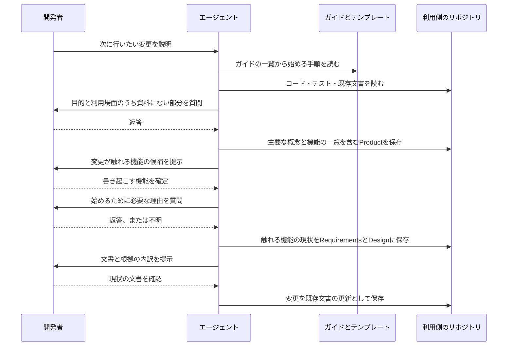

# 既存コードのあるプロジェクトで仕様を起点にした開発を始める設計

[English](design.md)

## このドキュメントについて

[既存コードのあるプロジェクトで仕様を起点にした開発を始めるRequirements](requirements.ja.md)を、1つのガイドラインと既存の文書の更新で実現する設計です。
親となる[sdevのProduct](../../product.ja.md)を前提とし、要件の内容はRequirementsを参照します。

### 対象読者

ガイドライン・テンプレート・参照の一覧を追加し、変更する開発者とエージェント。

### 前提知識

[文書の責務と更新](../../../../guidelines/documents.ja.md)、[エージェントの作業原則](../../../../guidelines/agent.ja.md)、ガイドをコマンドから読む方法を定めた[コマンド配布のRequirements](../command-distribution/requirements.ja.md)。

### このドキュメントで扱わないこと

要件の決定、コードを解析する処理、文書を生成するコマンドの設計。
プロダクト全体の技術的な構成を説明する文書の置き場所は、前提知識の文書の責務と更新で定めており、このガイドでは扱いません。
検証は[実装と検証のガイドライン](../../../../guidelines/agent.ja.md#実装と検証)に従って行い、結果は完了報告やPR本文に残します。

## 実装方針

実行する処理は追加せず、始める手順を1つのガイドラインとして書き、既存のガイドの一覧へ登録します。
エージェントはガイドの一覧からこのガイドを選び、手順に従って利用側のプロジェクトに文書を作ります。
Productに置く主要な概念と機能の一覧は、Productのテンプレートの項目として追加します。

| 部分 | 責務 |
| --- | --- |
| 始める手順のガイド | 手順の順序、各段で作る文書、質問の範囲、確定・未確認・不明の書き分け、提示時の報告を示す |
| ガイドの一覧の説明 | 仕様のないプロジェクトで変更を依頼されたときに、このガイドを選べるようにする |
| Productのテンプレート | 主要な概念と機能の一覧を記入する項目を提供する |
| Productのガイドと文書の責務 | 主要な概念と機能の一覧がProductの責務であることと、書き方を示す |
| Requirementsのガイド | 親Productがなく既存コードがある場合に、始める手順のガイドへ案内する |

### 始める手順のガイド

ガイドは、エージェントが上から順に進められるよう、手順の段ごとに節を分けます。
最初の節で適用する場面を示し、すでにProductと変更対象の仕様があるプロジェクトでは、通常の変更の進め方へ進むよう案内します。

続く節は、材料の確認、Productの書き起こし、触れる機能の選択、現状の書き起こし、変更の記述の順に置きます。
各節では、エージェントが資料から読み取ることと、開発者へ質問することを分けて書きます。
今の振る舞いと構成はコード、テスト、既存文書から読み取り、質問は資料にない理由と資料どうしの食い違いに限ります。
質問の進め方そのものは共通の作業ガイドへリンクし、このガイドには繰り返しません。

現状の書き起こしの節では、Productの作成、RequirementsとDesignの作成に、それぞれの既存のガイドとテンプレートを使うよう案内します。
現状を表す文書のための専用のテンプレートや文書の種別は設けません。
現状の文書は通常のRequirementsとDesignであり、次の変更はその文書の更新として書くため、変更前後の違いはGitの差分で読めます。

### 確定・未確認・不明の書き分けと提示時の報告

ガイドでは、内容の種類ごとに確かめる先を分けます。
今の振る舞いと構成（何をしているか）は、コードとテストで確かめます。
READMEや既存文書の説明は、コードのどこを読むかの手がかりとして使い、そのまま現状として写しません。
理由（なぜそうしているか）はコードから読めないことが多く、既存文書の説明も書いた時点のものなので、開発者の確認で確定します。
既存文書の説明を写すと、本文が「READMEは…と説明している」のような資料の言い方になり、確かめていない内容が確定した内容と同じ位置に残るためです。

理由の確認は、文書を保存する前に会話で行うよう、ガイドに書きます。
文書のレビューを最初の確認の場にすると、確認していない内容がいったん本文に書かれ、レビューで見落とされるとそのまま残るためです。

文書には、内容を次の3つの状態で書き分けます。

| 状態 | 内容 | 書く場所 |
| --- | --- | --- |
| 確定 | コードやテストで確かめた内容、開発者が答えたか今も正しいと確認した内容 | 本文。プロダクトや機能そのものの説明として書く |
| 未確認 | 資料から読み取ったが、開発者の確認を待っている内容 | その文書の未決事項。確認したいこと、資料から読んだ候補とその資料、決まるまでは本文に書かないこと、判断する人を書く |
| 不明 | 開発者にも分からない理由 | 本文の判断理由を書く位置。不明であることを文章で書く |

未確認の置き場所には、すべてのテンプレートにある未決事項を使います。
未決事項は、未決の内容、決まるまでの扱い、判断する人を書く項目で、未確認の項目に必要な内容をそのまま書けます。
開発者が確認したら、確認した内容を本文へ書き、未決事項から項目を消します。
これにより、本文だけを読めば確定した内容が分かり、未決事項を読めば確認が残っている箇所が分かります。

不明は、Designの判断理由を書く位置に文章で書きます。
検討した代替手段も、記録がなければ、記録がないことを書きます。
「現状の記述なので、なし」のように書くと、代替手段を検討しなかったことと区別できないため、この書き方をしないことをガイドに書きます。
未確認と不明のどちらにも、専用の記号やメタデータは設けず、通常のMarkdownの文章として読めるようにします。

根拠の内訳は、文書を提示するときの報告に、次の4つの区分で書きます。
コードやテストで確かめた内容、開発者の返答や確認による内容、未確認として未決事項に残した内容、不明のまま残した内容です。
既存文書から写しただけの内容は区分に含めません。既存文書の説明は、コードで確かめるか開発者が確認して、ほかの区分の内容になります。
この報告は会話やPR本文に残し、文書には保存しません。
作業ごとの確認結果を文書に置かないという、既存の文書の配置の決まりに合わせるためです。

### Productに置く主要な概念と機能の一覧

Productのテンプレートに、主要な概念と機能の一覧の項目を追加します。
既存コードのあるプロジェクトだけの項目にせず、すべてのProductに共通の項目にします。
新しく始めるプロジェクトでも、機能を追加するたびに一覧へ行を足せば、Productからプロダクトの機能の全体を読めるためです。
概念や機能がまだないProductでは、ほかの項目と同じく「なし」と理由を書きます。

主要な概念は、名前を太字にしたリストで、名前と意味を書きます。
機能の一覧は、機能の名前、1行の説明、仕様の3列の表にします。
仕様の列には、Requirementsがある機能ではそのRequirementsへの相対リンクを、ない機能では「未作成」と書きます。
ProductからRequirementsへの参照は、文書の参照方向で許可されています。
リンクのない行は検査の対象にならず、リンクのある行は既存のリンク切れの検査で確認されます。

一覧が大きくなる場合の分け方は、ガイドで選択肢だけを示します。
Productを分ける方法と、一覧を別の文書に分けてProductからリンクする方法です。

### 既存のガイドとの接続

Requirementsのガイドは、親Productがない場合にProductの作成から始めるよう案内しています。
ここへ、既存コードがある場合は始める手順のガイドを読む、という案内を足します。
Productのガイドには、主要な概念と機能の一覧の書き方を足します。
文書の責務の表では、Productに書くことへ主要な概念と機能の一覧を足し、機能の条件は引き続きRequirementsへ委ねることを示します。

文書と作業の入口の作業別の表に、既存コードのあるプロジェクトで仕様を起点にした開発を始める行を足します。
READMEのガイドの一覧にも、同じガイドを足します。

## アーキテクチャ・シーケンス図

ガイドは手順と判断基準を保持し、資料の読み取りと文書の作成はエージェントが担当します。
以下の図は進める順序を示すもので、sdevに実行エンジンがあることを表しません。

仕様がすでにあるプロジェクトでは、機能の候補の提示から始めます。
新しい機能の作成では、現状の書き起こしを行わず、新しい機能のRequirementsを作成して一覧へ行を足します。

## データモデル・ER 図

データはUTF-8のMarkdown本文です。
主要な概念はリスト、機能の一覧は表として、Productの本文に書きます。
機能を識別する専用のID、書き起こしの状態を表すメタデータ、別の関係一覧ファイルは導入しません。

機能の一覧の1行は、機能のディレクトリ1つに対応します。
仕様の列のリンクが、行とRequirementsの対応を表します。
独立したデータベースやエンティティを持たないため、ER図は使いません。

## API・インターフェース

接点は、ガイドの一覧と、そこから読むガイドの本文です。
ガイドは`sdev help brownfield`で読め、ほかのガイドと同じく`--lang`で言語を選べます。
ガイドの一覧の説明には、コードがあり仕様がないプロジェクトで仕様を起点にした開発を始めるときに読むことと、得られる結果を書きます。
配置済みのMarkdownを直接読む場合は、文書と作業の入口の表からたどります。

入力は開発者が説明する次の変更と利用側のリポジトリ、出力は利用側のリポジトリに保存する文書と、提示時の報告です。
新しいコマンド、オプション、出力形式は追加しません。

## 外部サービスとの連携方式

なし。
ガイドは実行ファイルに同梱され、材料は利用側のリポジトリにあります。

## データの取り扱い設計

書き起こした文書は利用側のプロジェクトへ保存し、変更と過去の参照にはGitを使います。
根拠の内訳は保存せず、会話やPR本文に残します。
sdevが利用側のコードや文書を収集・送信する処理は設けません。

## 認証認可に関する特記事項

なし。
ファイルの読み書きは利用する環境の権限に従い、独自の認証情報を持ちません。

## セキュリティ上の留意事項

ガイドに、材料として読んだ非公開の情報や認証情報を文書へ写さないことを書きます。
履歴やIssueを材料にする場合に、発言者の名前や連絡先を文書へ写さないことも書きます。

## デプロイに関する特記事項

なし。
ガイドとテンプレートは通常のリリースで実行ファイルに同梱されます。
テンプレートの項目の追加は新規作成するProductに適用され、既存のProductは既存の構造を尊重する決まりに従って、必要なときに項目を足します。

## 検討した代替手段

### コードから文書を生成するコマンドを追加する

手順を1つの操作にまとめられる利点があります。
一方、sdevは文書の生成や上書きを行わず、ガイドとテンプレートを表示する道具として作っています。
今の振る舞いはエージェントがコードから読み取れ、理由は開発者への質問でしか得られないため、コマンドが担える部分は小さくなります。
ガイドだけで要件を満たせるので、コマンドは追加しません。

### 機能の一覧を独立した文書にする

Productを短く保てる利点があります。
一方、Productを読んでもプロダクトの機能の全体が分からず、参照先が1つ増えます。
機能の全体はプロダクトが何を提供するかの説明なので、Productの中に置きます。
一覧が大きいプロジェクトでは、利用側の判断で別の文書に分けられます。

### 既存コード向けのProductテンプレートを別に用意する

新しく始めるプロジェクトのテンプレートを変えずに済む利点があります。
一方、同じProductにテンプレートが2種類でき、仕様を起点にした開発を始めた後の文書の形がプロジェクトの始め方で変わります。
始めた後は仕様のあるプロジェクトと同じ進め方で扱えることが要件なので、テンプレートは1つにします。

### すべての機能の現状を浅く書く

機能どうしの関係を最初に把握できる利点があります。
一方、次の変更が触れない機能にも手間がかかり、書いた文書は変更されないまま古くなります。
始めるために必要な文書だけを書くことが要件なので、採用しません。

### 根拠の区分を文書の本文に注記する

後から読む人が、各記述の根拠を文書だけで確認できる利点があります。
一方、本文が注記で読みにくくなり、通常のMarkdownを人が読み書きできることを優先する方針に合いません。
本文には確定した内容と不明だけを書き、未確認は未決事項に、内訳は提示時の報告に残します。

### 未確認の内容を本文に注記して書く

未確認の内容を、本文の該当箇所に「未確認」と注記して書く方法です。
読み手が、未確認の内容を本来の位置で読める利点があります。
一方、確定した内容と未確認の内容が本文で混ざり、注記を見落とすと未確認の内容を確定した内容として読みます。
既存文書を写した「READMEは…と説明している」のような文が本文に残る原因にもなります。
本文は確定した内容だけにし、未確認は既存の未決事項の項目に分けて書きます。

### 既存文書の理由を確定した内容として扱う

READMEや既存文書にある理由を、開発者の確認なしで確定した内容として書く方法です。
質問の数を減らせる利点があります。
一方、既存文書の理由は書いた時点のもので、今の目的や判断と変わっていることがあります。
理由を確定できるのは開発者なので、既存文書の理由は質問の候補として扱います。

## 未決事項

この設計の実装を妨げる未決事項はありません。
