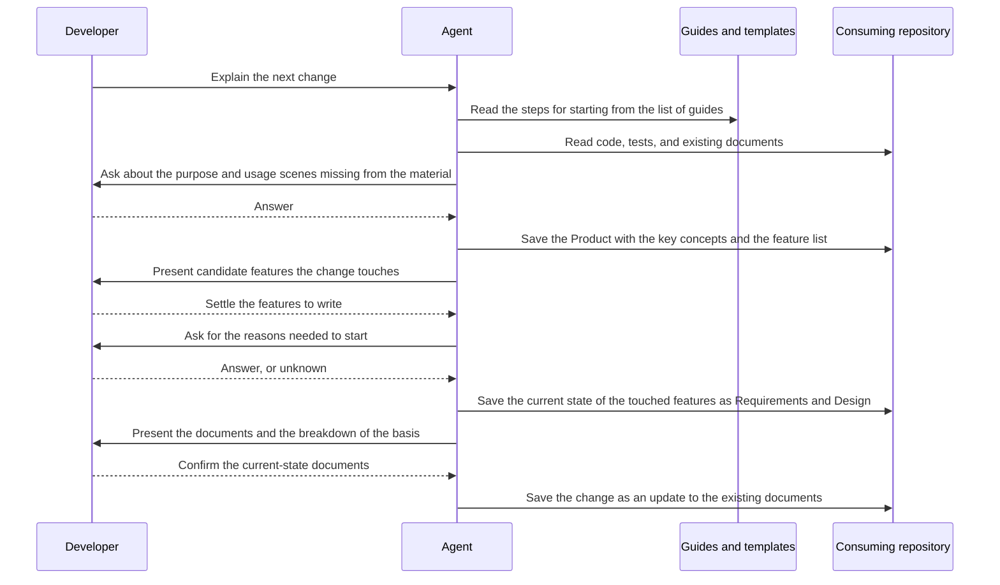

# Design for starting specifications in a project with existing code

[日本語](design.ja.md)

## About this document

Implement the [Requirements for starting specifications in a project with existing code](requirements.md) with one guideline and updates to existing documents.
The [sdev Product](../../product.md) gives the parent context; refer to Requirements for behavior.

### Audience

Developers and agents who add or change guidelines, templates, and reference lists.

### Prerequisites

[Document responsibilities and updates](../../../../guidelines/documents.md), [agent working principles](../../../../guidelines/agent.md), and the [command distribution Requirements](../command-distribution/requirements.md), which define how guides are read from the command.

### Outside this document

Deciding requirements, and designing code analysis or a command that generates documents.
Where to place a document that explains the technical structure of the whole product is defined by document responsibilities and updates in the prerequisites, and this guide does not cover it.
Follow [implementation and verification](../../../../guidelines/agent.md#implementation-and-verification), recording results in completion reports or PR descriptions.

## Implementation approach

Add no execution logic. Write the steps for starting as one guideline and register it in the existing list of guides.
The agent chooses this guide from the list and creates documents in the consuming project by following the steps.
The key concepts and the feature list placed in the Product are added as items of the Product template.

| Part | Responsibility |
| --- | --- |
| Guide for starting | Shows the order of steps, the documents each step creates, the range of questions, how to separate settled, unconfirmed, and unknown content, and the report given when presenting |
| Description in the list of guides | Lets the agent choose this guide when a change is requested in a project without specifications |
| Product template | Provides the items for writing the key concepts and the feature list |
| Product guide and document responsibilities | Show that the key concepts and the feature list are the Product's responsibility, and how to write them |
| Requirements guide | Points to the guide for starting when there is no parent Product and code already exists |

### Guide for starting

The guide is divided into one section per step so that the agent can proceed from the top.
The first section states when the guide applies, and directs a project that already has a Product and specifications for the changed features to the usual way of making changes.

The following sections are, in order: check the material, write the Product, choose the touched features, write the current state, and write the change.
Each section separates what the agent reads from the material from what it asks the developer.
The current behavior and structure are read from the code, tests, and existing documents, and questions are limited to reasons missing from the material and contradictions between materials.
How to ask questions is linked to the shared working guide and is not repeated in this guide.

The section on writing the current state directs the agent to use the existing guides and templates for creating the Product, Requirements, and Design.
No dedicated template or document type is created for documents that describe the current state.
A current-state document is an ordinary Requirements or Design, and the next change is written as an update to it, so the difference before and after the change can be read from the Git diff.

### Writing settled, unconfirmed, and unknown content, and the report given when presenting

The guide separates where each kind of content is confirmed.
The current behavior and structure (what the code does) are confirmed in the code and tests.
Explanations in the README and existing documents are used as hints for where to read in the code, and are not copied as the current state.
Reasons (why the code does it) often cannot be read from the code, and explanations in existing documents describe the time they were written, so reasons are settled by the developer's confirmation.
Copying explanations from existing documents makes the body read as what a material says, such as "The README explains that ...", and leaves unconfirmed content in the same place as settled content.

The guide says to confirm reasons in the conversation before saving the documents.
When the review of a document is the first place of confirmation, unconfirmed content is first written in the body, and stays there if the review misses it.

Documents separate content into the following three states.

| State | Content | Where it is written |
| --- | --- | --- |
| Settled | Content confirmed in code or tests, and content the developer answered or confirmed as still correct | The body, as a description of the product or feature itself |
| Unconfirmed | Content read from the material that is waiting for the developer's confirmation | The open questions of that document, with what needs confirmation, the candidate read from the material and that material, that it stays out of the body until decided, and who decides |
| Unknown | A reason the developer does not know either | The position in the body where the rationale is written, stated in prose |

Unconfirmed items are placed in the open questions, which every template has.
The open questions section records what is undecided, how it is handled until decided, and who decides, so it can hold what an unconfirmed item needs as it is.
When the developer confirms an item, the confirmed content is written in the body and the item is removed from the open questions.
This way, the body alone shows the settled content, and the open questions show where confirmation remains.

Unknowns are stated in prose at the position in the Design where the rationale is written.
For alternatives considered, when there is no record, the Design states that there is no record.
Writing "None, because this describes the current state" cannot be told apart from not having considered alternatives, so the guide says not to write it that way.
Neither unconfirmed items nor unknowns get a dedicated marker or metadata, so the text reads as ordinary Markdown prose.

The breakdown of the basis is written, in the report given when the documents are presented, in four groups.
They are content confirmed in code or tests, content based on the developer's answers or confirmation, content left as unconfirmed in the open questions, and content left unknown.
Content merely copied from existing documents is not a group; an explanation in an existing document becomes content of another group when it is confirmed in the code or by the developer.
This report is kept in the conversation or PR description and is not saved in a document.
This matches the existing placement rule that verification results for a piece of work are not placed in documents.

### Key concepts and the feature list in the Product

Add items for the key concepts and the feature list to the Product template.
They are items common to every Product, not items only for projects with existing code.
Even in a project started from scratch, adding a row to the list each time a feature is added lets the whole set of the product's features be read from the Product.
A Product that has no concepts or features yet writes "None" and the reason, like any other item.

The key concepts are written as a list with each name in bold, giving the name and its meaning.
The feature list is a table with three columns: the feature's name, a one-line description, and the specification.
The specification column holds a relative link to the Requirements for a feature that has them, and "Not written" for a feature that does not.
References from a Product to Requirements are allowed by the reference directions.
A row without a link is not subject to checks, and a row with a link is checked by the existing broken-link check.

For a list that grows large, the guide only presents the choices.
They are splitting the Product, and moving the list to a separate document linked from the Product.

### Connection with existing guides

The Requirements guide directs the agent to start by creating the Product when there is no parent Product.
Add to it a direction to read the guide for starting when code already exists.
Add to the Product guide how to write the key concepts and the feature list.
In the table of document responsibilities, add the key concepts and the feature list to what a Product contains, and show that feature conditions are still delegated to Requirements.

Add a row for starting specifications in a project with existing code to the task table in the documentation entry point.
Add the same guide to the list of guides in the README.

## Architecture and sequence diagrams

The guide holds the steps and decision criteria, and the agent reads the material and creates the documents.
The following diagram shows the order of the work and does not mean sdev has an execution engine.

In a project that already has specifications, the work starts from presenting the candidate features.
When creating a new feature, the current state is not written; Requirements for the new feature are created and a row is added to the list.

## Data model and ER diagrams

The data is UTF-8 Markdown text.
The key concepts are written as a list and the feature list as a table, in the body of the Product.
No dedicated ID for features, no metadata for the state of writing, and no separate relationship file is introduced.

One row of the feature list corresponds to one feature directory.
The link in the specification column expresses the correspondence between the row and the Requirements.
There is no separate database or entity, so no ER diagram is used.

## APIs and interfaces

The interface is the list of guides and the guide text read from it.
The guide is read with `sdev help brownfield`, and its language is chosen with `--lang` like any other guide.
The description in the list of guides states that it is read when starting specifications in a project that has code and no specifications, and what result it gives.
When reading the placed Markdown directly, the guide is reached from the table in the documentation entry point.

The input is the next change explained by the developer and the consuming repository; the output is the documents saved in the consuming repository and the report given when presenting.
No new command, option, or output format is added.

## External service integration

None.
The guide is bundled with the executable, and the material is in the consuming repository.

## Data handling

The documents written are saved in the consuming project, and Git is used for changes and for reading the past.
The breakdown of the basis is not saved; it is kept in the conversation or PR description.
sdev has no processing that collects or sends the consuming project's code or documents.

## Authentication and authorization notes

None.
Reading and writing files follow the permissions of the environment in use, and no separate credentials are held.

## Security considerations

The guide states that non-public information and credentials read as material are not copied into documents.
It also states that when history or issues are used as material, the names and contact details of the people who wrote them are not copied into documents.

## Deployment notes

None.
Guides and templates are bundled with the executable in a normal release.
The added template items apply to newly created Products; an existing Product follows the rule of respecting its existing structure and adds the items when needed.

## Alternatives considered

### Add a command that generates documents from code

This would gather the steps into one operation.
However, sdev is built as a tool that displays guides and templates, and does not generate or overwrite documents.
The agent can read current behavior from the code, and reasons can only be obtained by asking the developer, so little is left for a command to do.
The guide alone meets the requirements, so no command is added.

### Make the feature list a separate document

This would keep the Product short.
However, reading the Product would no longer show the whole set of the product's features, and there would be one more document to reference.
The whole set of features explains what the product provides, so the list is placed in the Product.
A project with a large list can move it to a separate document at its own discretion.

### Provide a separate Product template for existing code

This would leave the template for projects started from scratch unchanged.
However, the same Product would have two templates, and the form of the documents after starting would depend on how the project started.
The requirement is that, once started, the project is handled the same way as a project that has specifications, so one template is used.

### Write the current state of every feature briefly

This would show the relationships between features at the beginning.
However, effort would go into features the next change does not touch, and those documents would grow stale without being changed.
The requirement is to write only the documents needed to start, so this is not adopted.

### Annotate the body of documents with the basis groups

This would let a later reader confirm the basis of each statement from the document alone.
However, annotations would make the body hard to read, which does not fit the policy of keeping plain Markdown that people can read and write.
The body states only settled content and unknowns; unconfirmed items go in the open questions, and the breakdown is kept in the report given when presenting.

### Write unconfirmed content in the body with an annotation

This writes unconfirmed content at its place in the body, annotated as "unconfirmed".
It has the advantage that readers find unconfirmed content where it belongs.
However, settled and unconfirmed content mix in the body, and a reader who misses the annotation reads unconfirmed content as settled.
It also lets sentences copied from existing documents, such as "The README explains that ...", remain in the body.
The body holds only settled content, and unconfirmed content is written separately in the existing open questions section.

### Treat reasons in existing documents as settled content

This writes reasons found in the README or existing documents as settled content without asking the developer.
It has the advantage of fewer questions to the developer.
However, a reason in an existing document describes the time it was written, and may differ from the current purpose or decisions.
Only the developer can settle a reason, so reasons in existing documents are treated as candidates for questions.

## Open questions

No open questions block implementation of this design.
