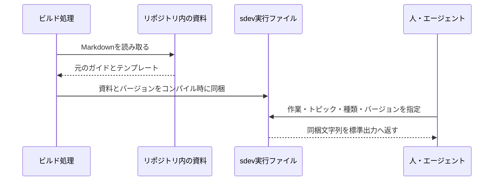

# コマンドの配布とガイドラインの参照の設計

## このドキュメントについて

[Requirements](requirements.md)と親の[Product](../../product.md)を前提に、Rust製sdev CLIと単体実行ファイルの配布を設計します。
比較用CLIで確認した小さい実行ファイルと起動時間を判断材料に、Rustを採用します。
配布方式の比較は過去の採用判断であり、当時の測定値を現在のCLIの性能保証として扱いません。

### 対象読者

sdev CLIの実装・更新・配布を行う開発者とエージェント。

### 前提知識

[文書の責務と更新](../../../../guidelines/documents.md)、[ガイドライン参照のRequirements](../guideline-reference/requirements.md)、[Rust開発ガイド](../../../../engineering/guidelines/rust-development.md)。

### このドキュメントで扱わないこと

lintの規則、可視化、ローカルWebサーバー、自動更新、公開リリースの実行は扱いません。
検証の実行手順と結果は実装・検証の作業で扱い、この文書に一時ログを蓄積しません。

## 実装方針

製品CLIをリポジトリ直下のCargoパッケージとし、実行ファイル名を`sdev`とします。
Rustの選択と更新、共通の検証・CI方針は[Rust開発ガイド](../../../../engineering/guidelines/rust-development.md)の共通規約に従います。
配布するsdevのバージョンはCargo.tomlで管理します。
製品で使うcrateは実行ファイルへ組み込み、利用時に別ファイルのライブラリや追加の実行環境を必要としません。

`docs/guidelines/`以下のMarkdownを作業ガイド、`docs/templates/`以下のMarkdownを内蔵の既定テンプレートとして、コンパイル時に同梱します。
それぞれを`help`と`template`のトピックへ対応付け、公開する名前・案内文・元資料の対応をカタログで管理します。
公開する名前は作業や資料の意味に合わせて決め、ファイル名から自動生成しません。
CLIの選択肢とガイド内の参照コマンドはこのカタログから作り、対象ディレクトリのMarkdownと登録内容が一致しない場合や、同じ操作にトピック名が重複する場合はビルドを止めます。
資料の追加・削除では元のMarkdownと対応する登録を変更し、資料数を別に管理しません。
`docs/products/`の仕様や`docs/engineering/`の開発規約など、対象ディレクトリ外の文書は同梱しません。
利用者へ内部のファイル名を資料IDとして指定させず、sdev自身のProductを利用先のProductの代わりに返すこともありません。

ガイドの意味と読む順序は既存の文書に置き、コマンドへの案内に必要な部分だけビルド時に読み替えます。
リンクの構文と位置を[pulldown-cmark](https://github.com/pulldown-cmark/pulldown-cmark)で読み取り、同梱ガイドやテンプレートへの相対リンクを「表示名（参照コマンド）」に変換します。
見出しを指すリンクは対応するコマンドと節名を案内します。
入口へのリンクは全体の案内である`sdev help`へ変換し、外部URLとコード中の文字列は変更しません。
未対応の内部リンクが追加された場合は、ビルド時にエラーにして案内先を曖昧に残しません。
元のMarkdownは書き換えず、GitHubでのリンクを維持します。

テンプレートの本文は変換せず、そのまま表示します。
ガイドは利用先の指示・規約で対象用と指定されたテンプレートを優先し、ない場合に内蔵の既定を使う進め方を案内します。
既存仕様の変更ではその構造を尊重し、任意のMarkdownをテンプレートとして推測しません。
資料参照の操作は利用先の自動探索・生成・上書きを行わず、ガイドと内蔵テンプレートの表示を担当します。

## アーキテクチャ・シーケンス図

## データモデル・ER 図

カタログの項目は、操作の種類、公開するトピック名、案内文、元資料の位置を持ちます。
元資料の位置はビルド時の入力であり、公開APIにはしません。
同梱する固定配列は、操作・トピック・案内文と出力本文を持ちます。
バージョンはCargoのパッケージバージョンをコンパイル時に取り込みます。
利用者の情報を保持するデータベースがないため、ER図は使いません。

## API・インターフェース

| 操作 | 出力 |
| --- | --- |
| `sdev`、`sdev --help`、`sdev help` | できることと作業・共通トピックの案内 |
| `sdev help product` / `requirements` / `design` | それぞれの作業ガイド |
| `sdev help documents` | 文書の責務・配置・更新とテンプレートの選び方 |
| `sdev help workflow` | 対話・調査・実装・検証の作業原則 |
| `sdev help scenarios` | 受け入れ条件のシナリオのガイド |
| `sdev template` | 内蔵の既定テンプレートの種類と利用先の指定を優先する案内 |
| `sdev template product` / `requirements` / `design` | 選んだ既定テンプレートの元のMarkdown本文 |
| `sdev --version` | 実行中のsdevのバージョン |

`-h`と`-V`もヘルプ・バージョンの別名とします。
関連する資料は対応するヘルプ・テンプレート操作へ案内し、1つのガイドへ全資料を連結しません。
利用先で読むべきProduct・Requirements・Designの意味は元ガイドから維持します。
仕様を作成するディレクトリ等の利用上必要なパスは本文に残します。

正常終了は0、不明な操作・トピック・種類・引数の不足や過剰は2、資料表示の標準出力などの入出力エラーは1とします。
この表は資料参照とバージョン確認の操作に適用し、lintの結果と終了コードは[文書リンク検査のRequirements](../document-lint/requirements.md)に対応する設計で定めます。
エラーは標準エラーへ書き、ガイドが不明なら`sdev help`、テンプレートなら`sdev template`で確認する方法を示します。
資料をファイル名から取り出す操作と、通知表示のための操作は提供しません。

## 外部サービスとの連携方式

CLIの実行時に外部サービスへ接続しません。
GitHub ReleasesにはOS・CPUとバージョンを識別できる実行ファイルを配置する方針とし、公開は手動の判断で行います。
[Rust開発ガイドのCI規約](../../../../engineering/guidelines/rust-development.md#ciと異なるosで確かめる)を前提に、配布機能では対象のOS・CPUで実行ファイルをビルドし、追加の実行環境への依存を確認して、チェックサムと通知を含むレビュー用成果物を保存します。
Releaseの作成や公開は行いません。
ビルドと配布物検証は開発基盤の`xtask`から実行し、製品CLIには開発操作を追加しません。
配布物検証タスクは、単体実行、空の作業場所とPATH、同梱本文・バージョン・チェックサム、および対象OSのライブラリ依存と最低OS条件を確認し、失敗を成功へ置き換えません。

| 対象 | Rustターゲット | 初期の利用条件 |
| --- | --- | --- |
| macOS arm64 | aarch64-apple-darwin | macOS 11以降 |
| macOS x64 | x86_64-apple-darwin | macOS 10.12以降 |
| Linux arm64 | aarch64-unknown-linux-gnu | glibc 2.35以降、kernel 4.1以降 |
| Linux x64 | x86_64-unknown-linux-gnu | glibc 2.35以降、kernel 3.2以降 |
| Windows x64 | x86_64-pc-windows-msvc | Windows 10以降 |

OS条件は[Rustの公表条件](https://doc.rust-lang.org/stable/rustc/platform-support.html)を出発点にします。
Linuxは実際のビルド環境をUbuntu 22.04に固定するため、[そのglibcのバージョン](https://packages.ubuntu.com/jammy-updates/libc6)に合わせ、配布時の条件を2.35以降とします。
古いglibcやmusl環境を初回の対象に広げません。
最低OS環境での実動作は、現在のOSでビルド・実行したことから推測しません。

macOSは[deployment targetの説明](https://doc.rust-lang.org/stable/rustc/platform-support/apple-darwin.html)に従って対象ごとの最低バージョンを指定します。
Windowsは[公式のCランタイムの説明](https://doc.rust-lang.org/reference/linkage.html)に従い`crt-static`を指定し、追加のCランタイムを要求しない構成にします。
最終的なDLL依存と利用環境での動作は配布時に確認します。

## データの取り扱い設計

リポジトリのガイドとテンプレートをビルド時に固定文字列として同梱します。
ガイドの参照案内だけを変換し、テンプレートは元のUTF-8バイト列を保ちます。
本文を出力するときに改行を追加しません。
資料の更新はコマンドのバージョンを更新して再ビルドすることで反映します。
資料参照の操作は利用者の文書・コードを読み取らず、利用状況も収集・保存しません。

Rust標準ライブラリの通知は実行ファイルへ埋め込まず、配布準備で別の`THIRD-PARTY-NOTICES.html`として含めます。
通常の依存として組み込むcrateの通知は、対象ターゲットでCargoが解決した依存とパッケージの元の通知本文から`THIRD-PARTY-CRATES.html`を生成します。
元の通知資料がない場合は配布準備を失敗にし、通知の欠落を成功にしません。
sdev自身のLICENSEがあれば、同じ配布準備で添付します。
これらの通知を実行時のファイル依存にはせず、実行に必要なものは単体実行ファイルだけにします。
生成物はGitの無視対象とします。

## 認証認可に関する特記事項

CLIの資料参照とバージョン表示には認証情報を使いません。
ビルド用のGitHub Actionsはリポジトリの読み取り権限だけを持ち、公開用の書き込み権限を与えません。
公開配布物の取得は個別の利用許可を必要としない形にします。

## セキュリティ上の留意事項

資料の中のコード・HTML・コマンドを実行せず、同梱本文を出力します。
実行時の作業ディレクトリや環境変数から設定・スクリプトを読み込みません。
通知はビルドで使用するRustの配布に含まれる`COPYRIGHT-library.html`を内容を変えずに配布物へ添付します。
sdev自身のライセンスはリポジトリに未配置のため、新たなライセンスを推測で選ばず、公開前の確認事項とします。

## デプロイに関する特記事項

なし。
通常の配布物の公開と差し替えで反映でき、既存データの移行は不要です。
取得・起動・更新の利用手順と、ライセンスの配置、署名・公証など公開前の作業は[配布と更新](../../../../engineering/guidelines/releasing.md)へまとめます。

## 検討した代替手段

### Bunの単体実行ファイル

同じTypeScriptから5組の生成を確認でき、将来Web画面を選ぶ場合には[Bunの標準機能](https://bun.com/docs/bundler/fullstack)でサーバーと資産の変換・同梱をまとめられます。
比較ではRustより実行ファイルが大きくなり、小さい配布ファイルが成立するRustを採用しました。
速度だけを最優先にした判断ではなく、今後のWeb画面の方式も未決のままです。

### scriptcの単体実行ファイル

TypeScriptで小さい配布ファイルを作り、困った場合にBunへ切り替える候補として比較しました。
動作したのは0.2.8の動的エンジン同梱構成であり、[0.3系のネイティブ化](https://scriptc.dev/docs/dependencies)は未検証です。
この制約を残したうえでRustを採用し、scriptcを製品のビルドに組み込みません。

## 未決事項

なし。
本機能の実装に必要な設計判断は決定しています。
公開前の作業は配布ガイドで管理し、可視化は別の機能で判断します。
