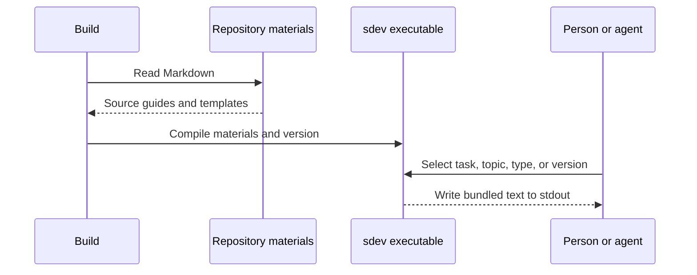

# Design: Command distribution and guideline access

[日本語](design.ja.md)

## About this document

This document designs the Rust sdev CLI and standalone distribution under the [Requirements](requirements.md) and parent [Product](../../product.md).
Rust was selected using executable size and startup measurements from comparison CLIs.
Those measurements explain a past decision; they do not guarantee the current CLI's performance.

### Intended readers

Developers and agents implementing, updating, and distributing sdev.

### Prerequisites

[Document responsibilities and updates](../../../../guidelines/documents.md), [guideline access requirements](../guideline-reference/requirements.md), and the [Rust development guide](../../../../engineering/guidelines/rust-development.md).

### Exclusions

Lint rules, visualization, local web servers, automatic updates, and package registry publication are excluded.
Verification procedures and results belong to implementation work, rather than temporary logs in this document.

## Implementation approach

The root Cargo package builds the product executable, named `sdev`.
Rust selection, updates, shared checks, and CI follow the [Rust development guide](../../../../engineering/guidelines/rust-development.md).
Cargo.toml owns the distributed version.
Product crates are compiled into the executable; users need no separate libraries or runtime.

Compile Markdown under `docs/guidelines/` as task guides and under `docs/templates/` as built-in default templates.
A catalog maps public operation/topic names, descriptions, and source paths. Names describe tasks and materials rather than being generated from filenames.
Guide descriptions state both when to use the guide and what it helps accomplish, so agents can match exploratory requests as well as explicit document tasks.
The descriptions select existing guidance; the guide bodies continue to own dialogue and work procedures.
Generate CLI choices and guide reference commands from this catalog. Fail the build for mismatches with the material directories or duplicate operation/topic names.
Add or remove source Markdown and catalog registrations together; do not maintain a separate material count.
Do not bundle specifications in `docs/products/` or development conventions in `docs/engineering/`.
Internal filenames are not public IDs, and sdev's Product is not returned in place of the consuming project's Product.
Register English and Japanese bodies for each public topic. Language choice follows the [localization requirements](../localization/requirements.md).

Keep guide meaning and reading order in the source documents; rewrite only the references needed for command access at build time.
Use [pulldown-cmark](https://github.com/pulldown-cmark/pulldown-cmark) to read link syntax and ranges, replacing relative links to bundled materials with their label and reference command.
Heading links include the command and section. Entry links become `sdev help`; reference commands retain the destination language explicitly.
Leave external URLs and code text unchanged. Fail builds for unmapped internal guide links rather than leaving ambiguous references.
Preserve source Markdown and its links for GitHub readers.

Output templates unchanged, including their Markdown body and language navigation.
Guides prioritize templates designated by repository instructions and use built-in defaults only when none applies.
Respect the structure of existing specifications; do not infer templates from arbitrary Markdown.
Material access displays guides and defaults without discovering, generating, or overwriting consuming repository files.

### Manual releases

Publication starts only through workflow_dispatch with main and an explicit version.
Accept stable `X.Y.Z` versions initially, without a `v` prefix, prerelease, or build metadata.
Update Cargo.toml and Cargo.lock through normal changes on main; the workflow does not create version commits.
Pass the starting commit SHA to every job. If main advances, stop publication and start a new manual run from current main.

Before starting, check the requested Cargo version, nonempty root LICENSE, source commit, and existing tag/Release.
Use `vX.Y.Z`. Stop for a tag at another commit, an annotated tag, or a published Release.
A lightweight tag created by this process at the same SHA can be reused on retry.

Call the same reusable build workflow as ordinary CI.
Development tasks own target definitions; derive both the CI matrix and expected publication artifacts from them.
Install Rust from the repository's pin without duplicating its version in workflows.
Start publication only after builds, shared checks, and native artifact verification succeed on every target.

Download each target's artifacts from the same run into separate directories and check the exact expected set.
Compare source commit, clean-source status, version, target, verified status, file sizes, SHA-256 values, and checksums.
Match LICENSE to the source and shared notice text across targets; stop rather than overwrite differences.
Stage executables, checksums, LICENSE, and Rust/crate notices for publication, excluding internal verification JSON.
Include the installer, its checksum, version/source record, and attestation bundle as required by [project bootstrap](../project-bootstrap/requirements.md).
A dedicated job in the reusable build workflow attests the aggregated files.
Before creating tags, the publication job verifies each file's repository, reusable workflow, source digest, and signer digest against attestations from this run.

After comparison, create the lightweight tag and draft Release.
Record source SHA and run ID in the draft; only retries of that run can replace its attachments.
Before publishing, recheck attachment names, states, sizes, SHA-256 values, tag, draft, and main's head.
Confirm the publication response and fetched state. Let GitHub determine latest-version ordering.
Serialize the entire release workflow without canceling a release when a new run starts.

| Failure or existing state | Handling |
| --- | --- |
| Initial mismatch or target build/verification failure | Stop without creating a tag or Release |
| Tag exists after failure before draft creation | Reuse the tag at the same SHA on retry |
| Attachment or comparison fails | Keep the draft; retry the original run while main has the same SHA, replacing only matching attachments and rechecking all files |
| Another run's draft, moved main, or unknown attachment | Stop without deletion or reuse; maintainer inspects the state |
| Already published or publication response unknown | Inspect public state; retries do not overwrite public Releases or files |

As documented for [GITHUB_TOKEN](https://docs.github.com/en/actions/concepts/security/github_token), tag pushes using that token do not trigger another workflow.
Connect builds and publication explicitly within one run rather than relying on tag pushes.
Reference the [reusable workflow](https://docs.github.com/en/actions/how-tos/reuse-automations/reuse-workflows) at the same executing commit and inspect drafts, assets, and publication through the [Release API](https://docs.github.com/en/rest/releases/releases).

### Local installation from source

Allow `cargo install --path . --locked` from the local Cargo package.
Use the standard [Cargo installation command](https://doc.rust-lang.org/cargo/commands/cargo-install.html), without adding a separate installer or product CLI installation operation for source builds.
`--root` permits an isolated destination. Bundled guides and templates use the same build path as releases.

## Architecture and sequence

## Data model and ER diagram

Each catalog entry holds an operation, public topic, descriptions in both languages, and a source path.
Source paths are build inputs, not public API.
The bundled array contains operation, topic, language, description, and output body.
Cargo's package version is included at compile time.
Artifact metadata records source commit, clean-source status, version, target, size, SHA-256, notices, and verification status.
Builds start unverified; only successful native verification marks them verified.
There is no user database, so no ER diagram is needed.

## API and interfaces

| Operation | Output |
| --- | --- |
| `sdev`, `sdev --help`, `sdev help` | Capabilities and task/shared topics |
| `sdev help product` / `requirements` / `design` | Corresponding task guide |
| `sdev help documents` | Document roles, placement, updates, and template selection |
| `sdev help workflow` | Conversation, research, implementation, and verification principles |
| `sdev help scenarios` | Acceptance scenario guide |
| `sdev template` | Built-in default types and reminder to prefer project-designated templates |
| `sdev template product` / `requirements` / `design` | The selected default's original Markdown |
| `sdev --version` | Running sdev version |

`-h` and `-V` are help and version aliases.
`--lang en` or `--lang ja` can select a language for one command; project configuration otherwise applies, with English as the unconfigured default.
Route related materials through their own operations rather than concatenating all materials into one guide.
Preserve references to the consuming project's Product, Requirements, and Design and any paths needed to create its specifications.

Exit codes are 0 for success, 2 for unknown operations/topics/types or missing/excess arguments, and 1 for I/O failures such as stdout errors.
These codes apply to material/version operations; lint results and statuses are defined under the [document lint requirements](../document-lint/requirements.md).
Write errors to stderr and point to `sdev help` or `sdev template` as appropriate.
Do not provide operations for fetching materials by filename or displaying notices.

## External service integration

Material output requires no external service.
GitHub Releases holds artifacts identified by OS, CPU, and version. Publication occurs only when a maintainer starts the manual workflow.
Following the [Rust CI conventions](../../../../engineering/guidelines/rust-development.md#ci-and-other-operating-systems), build on each target environment, check additional runtime dependencies, and save review artifacts with checksums and notices.
Ordinary CI stops at artifact storage; only a manual release creates tags and publishes Releases.
Build and verification are development `xtask` operations, not product CLI commands.
Verification checks standalone execution with an empty directory and PATH, material bodies, version, checksum, system dependencies, and minimum OS conditions. Failures remain failures.

| Platform | Rust target | Initial conditions |
| --- | --- | --- |
| macOS arm64 | aarch64-apple-darwin | macOS 11 or later |
| macOS x64 | x86_64-apple-darwin | macOS 10.12 or later |
| Linux arm64 | aarch64-unknown-linux-gnu | glibc 2.35+, kernel 4.1+ |
| Linux x64 | x86_64-unknown-linux-gnu | glibc 2.35+, kernel 3.2+ |
| Windows x64 | x86_64-pc-windows-msvc | Windows 10 or later |

Start with [Rust platform support](https://doc.rust-lang.org/stable/rustc/platform-support.html).
Linux builds use Ubuntu 22.04, so require [its glibc version](https://packages.ubuntu.com/jammy-updates/libc6), 2.35 or later.
Older glibc and musl are outside initial support. Running on a current OS does not prove operation on every minimum OS.
Set macOS minimum versions using the [deployment target](https://doc.rust-lang.org/stable/rustc/platform-support/apple-darwin.html).
Use Windows `crt-static` per the [runtime linkage documentation](https://doc.rust-lang.org/reference/linkage.html), then check final DLL dependencies and actual execution during distribution.

## Data handling

Bundle repository guides and templates as fixed strings at build time.
Transform guide references only; preserve template UTF-8 bytes and add no newline when printing bodies.
Material changes require rebuilding a new command version.
Material operations read project language configuration, but do not read user documents or code or collect usage data.

Ship Rust standard library notices separately as `THIRD-PARTY-NOTICES.html`.
Generate `THIRD-PARTY-CRATES.html` from target-resolved normal dependencies and their original notice text; missing notice sources fail distribution preparation.
Include sdev's LICENSE in the same preparation.
These files are not runtime dependencies. Generated artifacts are ignored by Git.

## Authentication and authorization

Material and version output do not use credentials.
Preparation/build jobs use contents: read; only the publication job receives contents: write.
GitHub CLI uses Actions GITHUB_TOKEN only for publication and comparison, without an additional personal token.
Do not persist checkout credentials or expose publication GH_TOKEN to compilation-only steps.
Public artifact downloads need no individual authorization.

## Security considerations

Print bundled text without executing its code, HTML, or commands.
Read only declarative project language configuration; do not load scripts from the working directory or environment.
Ship Rust's `COPYRIGHT-library.html` unchanged from the selected toolchain.
sdev uses the MIT License and includes its root LICENSE in distributions.

## Deployment considerations

No special migration is needed; normal release and executable replacement apply.
Installation, updates, license preparation, signing, and notarization procedures belong in [Distribution and updates](../../../../engineering/guidelines/releasing.md).

## Alternatives considered

### Bun standalone executable

The same TypeScript produced all five targets. Future web interfaces could use [Bun's built-in full-stack tooling](https://bun.com/docs/bundler/fullstack) for server and asset bundling.
Its binaries were larger in the comparison, so Rust was selected for a smaller distribution.
Speed alone did not decide the choice; the future web interface remains undecided.

### scriptc standalone executable

This option offered small TypeScript artifacts with Bun as a possible fallback.
Only 0.2.8 with a bundled dynamic engine was tested; [0.3 native compilation](https://scriptc.dev/docs/dependencies) was not verified.
Rust was chosen with this limitation recorded; scriptc is not part of product builds.

## Open questions

Implementation decisions for this feature are settled.
Track pre-publication work in the distribution guide and decide visualization separately.
