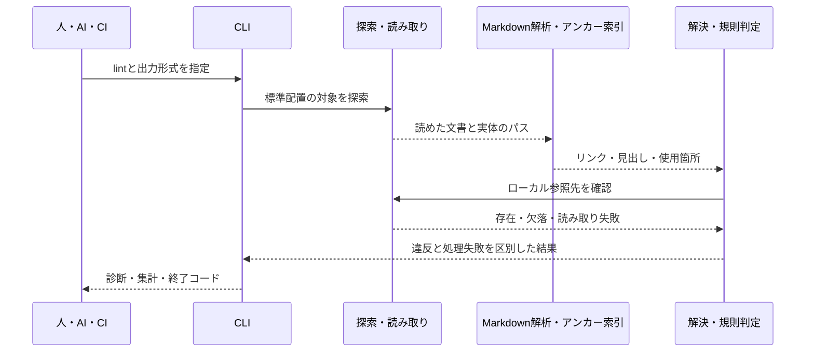

# Markdownのリンク切れと文書の参照方向の検査の設計

[English](design.md)

## このドキュメントについて

[Requirements](requirements.ja.md)と親の[Product](../../product.ja.md)に基づき、単体実行ファイルのsdevに文書lintを追加する方法を定めます。
参照方向の判断はRequirementsに掲載した表を使います。
その表と[文書の参照方向](../../../../guidelines/documents.ja.md#文書の参照方向)の共通規則が一致することを前提にし、このDesignで許可・禁止を変更しません。

### 対象読者

文書lintの実装・変更・レビューを行う人とAI。

### 前提知識

[文書の責務と更新](../../../../guidelines/documents.ja.md)、[Rust開発ガイド](../../../../engineering/guidelines/rust-development.ja.md)、Markdownの相対リンクとURIのフラグメント。

### このドキュメントで扱わないこと

コードやコードコメントの解析、外部サイトへの通信検査、自動修復、文書生成、可視化、lint用の設定と独自配置への対応は扱いません。
実装・検証の手順や実行結果は[実装と検証のガイドライン](../../../../guidelines/agent.ja.md#実装と検証)に従って作業時に記録します。

## 実装方針

製品CLIの操作として`lint`を追加し、対象探索、Markdown解析、参照先の解決、規則の判定、結果の表示を分けます。
解析と規則判定はファイルへの書き込みやプロセス起動を行わず、探索・読み取りが得た情報を入力にします。
既存のガイド・テンプレート表示とバージョン確認は維持します。
開発用の`xtask`へ製品機能を置かず、製品から開発用パッケージにも依存しません。

Markdownの構文解析には、既存のビルド処理でも使っている[pulldown-cmark](https://pulldown-cmark.github.io/pulldown-cmark/)を通常の依存として使います。
見出しのアンカー生成には[github-sluggerのRust実装](https://docs.rs/github-slugger/latest/github_slugger/)、パーセントエンコードの復号には[percent-encoding](https://docs.rs/percent-encoding/latest/percent_encoding/fn.percent_decode_str.html)、JSON出力には既存の開発用タスクでも使っているserde_jsonを使います。
それぞれ構文・Unicodeを含む見出しの識別・URL内の符号化・構造化出力を担当し、Markdown全体を独自の正規表現で読み取りません。
依存の具体的なバージョンとロックは開発規約に従って実装時に管理し、この設計に数値を複製しません。

### 入力から診断までの流れ

最初に、標準配置のMarkdownを読み、各文書について「文書の種類」「リンクとその使用箇所」「見出しのアンカー」を得ます。
次に、リンクを一つずつ解決し、参照先の存在と、そこへ参照してよいかを別々に調べます。
問題があれば、最初に記録した使用箇所を付けて診断へ変換します。

次の疑似コードは、後述する探索・抽出・解決・種別判定・規則判定のつながりを示します。
読み取り失敗を記録しても、ほかの文書の検査は続けます。

```text
対象一覧, 探索の処理失敗 = 標準配置から探す(プロジェクトのルート)
結果に探索の処理失敗を記録する

各対象について:
    本文を読み取れなければ、処理失敗を記録して次の文書へ進む
    文書の種類 = 配置から判定する(対象のパス)
    リンク一覧, 見出しのアンカー = Markdownから抽出する(本文)
    パス, 文書の種類, リンク一覧, アンカーを記録する

読めた各文書の、各リンクについて:
    参照先 = リンクを解決する(ルート, 参照元のパス, リンク先の文字列)
    外部URLなら、外部参照として数えて次のリンクへ進む
    解決できなければ、使用箇所と理由を診断にして次へ進む
    参照先の種類 = 配置から判定する(解決したパス)
    参照元と参照先の種類、および同じ文書かどうかから方向を判定する
    禁止方向なら、使用箇所と禁止理由を診断にする
    参照先がなければ、リンク切れを診断にして次へ進む
    参照先が存在し、参照元がProduct・Requirements・Designで、
    参照先の種類が不明なら、方向を判定できなかった処理失敗を記録する
    Markdownの見出しへの参照なら、参照先のアンカーと照合する
    見出しがなければ、使用箇所と見出しのリンク切れを診断にする

診断を並べて、検査結果と終了コードを返す
```

参照先のMarkdownが探索対象に含まれていなければ、見出しの照合に必要なときだけ読みます。
読めなかった場合は読み取りの処理失敗を記録し、ほかのリンクへ進みます。
種別が不明な場合の扱いは「文書種別の判定」、同じ文書の扱いは「参照方向の判定」に記述します。

### 標準配置と対象探索

起動時の作業ディレクトリを対象プロジェクトのルートとし、Gitによるルート探索や親ディレクトリへの移動は行いません。
対象はルート直下のREADME.md・AGENTS.mdとその言語版、および`docs/`以下にある拡張子`.md`の通常ファイルです。
拡張子の比較では大文字小文字を区別せず、ルートの入口ファイルは存在するものだけを対象にします。
標準配置の`docs/`が存在しない場合や対象のMarkdownがない場合は、検査成功にせず対象を見つけられなかった処理失敗とします。
lint用の設定、独自の対象・除外パターン、Gitの無視設定の読み込みは追加しません。

`docs/`のサブディレクトリを再帰的に調べ、相対パス順に処理します。
探索中のシンボリックリンクやWindowsの再解析ポイントはたどらず、検査対象を走査できなかった診断を残して安全に読める対象を続けます。
通常ファイルのMarkdownだけをUTF-8として読み、デコード失敗を文字の置き換えで隠しません。
あるファイルを読めなくても、独立して読める対象の検査は続けます。

### 文書種別の判定

文書の本文やタイトルを推測せず、ルートからの位置と名前の既定パターンで判定します。
次の分類を上から適用し、`<product>`と`<feature>`はそれぞれディレクトリ名を表します。

| パターン | 種別 |
| --- | --- |
| `docs/products/<product>/product.md` | Product |
| `docs/products/<product>/features/<feature>/requirements.md` | Requirements |
| `docs/products/<product>/features/<feature>/design.md` | Design |
| `docs/engineering/design/`以下のMarkdown | Design |
| `docs/guidelines/`、`docs/engineering/guidelines/`以下のMarkdown | ガイドライン |
| 上記以外のMarkdown、`.txt`・`.rst`・`.adoc`、ルートのLICENSE・NOTICE | 一般文書 |
| 画像・PDFなどの文書資産 | 資産 |
| コードと開発・配布設定の既定パターン | 実装 |
| 上記以外 | 不明 |

名前の判定ではdesign.ja.mdなどの言語接尾辞を取り除き、ディレクトリの対応を維持します。
接尾辞は小文字2〜3文字の主言語と、ハイフンで区切った1〜8文字の英数字の下位タグからなります。CLIが最初に対応するen・ja以外にも種別判定は適用できます。
テンプレートは記入構造を提供する一般文書であり、ファイル名がdesign.mdでもDesignへ分類しません。
コードの既定パターンは`src/`・`lib/`・`bin/`・`tests/`・`xtask/`・`scripts/`以下、およびRust・JavaScript・TypeScript・Go・Python・Java・Kotlin・Swift・C/C++・C#・Ruby・PHP・シェル・SQLのソース拡張子とします。
判定用の拡張子集合は`.rs`・`.js`・`.jsx`・`.mjs`・`.cjs`・`.ts`・`.tsx`・`.go`・`.py`・`.java`・`.kt`・`.kts`・`.swift`・`.c`・`.h`・`.cc`・`.cpp`・`.cxx`・`.hpp`・`.cs`・`.rb`・`.php`・`.sh`・`.bash`・`.zsh`・`.ps1`・`.sql`とし、本文の解析は行いません。
開発・配布設定は`.cargo/`・`.github/`以下と、ルートのCargo.toml・Cargo.lock・sdev.toml・rust-toolchain.toml・package.json・package-lock.json・npm-shrinkwrap.json・pnpm-lock.yaml・yarn.lock・bun.lock・bun.lockb・.gitignore・.gitattributes・.editorconfigを対象にします。
資産の拡張子は`.png`・`.jpg`・`.jpeg`・`.gif`・`.webp`・`.svg`・`.ico`・`.avif`・`.pdf`とし、ソースディレクトリにある画像をコードと混同しません。

一般文書・資産・ディレクトリを新たな禁止列に追加しません。
一般文書とガイドラインを参照元とする場合はリンク切れのみを調べます。
表の対象となる参照元から種別不明のファイルへのリンクは、方向を判定できなかった処理失敗とします。
一般文書として判定できた対象と、判定に必要な情報が足りない対象を区別するためです。

### Markdownからリンク・見出し・使用箇所を得る

この処理の入力はMarkdown本文で、出力は「検査するリンクの一覧」と「その文書の見出しのアンカー」です。
リンクには参照先の文字列だけでなく、本文のどこに書かれていたかも残します。
これにより、後の存在確認や方向判定で問題が見つかったときに、参照元の位置を示せます。

構文の読み分けはpulldown-cmarkに任せます。
構文解析器は、通常の文字列・リンク・画像・見出し・コード部分を区別して返します。
リンクと画像から参照先を取り出し、見出しからはアンカーを作るための表示文字列を集めます。
コード部分にリンクのような文字列があっても、通常のMarkdownリンクとして再解析しません。

| Markdownに書かれたもの | 取り出す情報 | 後の処理での使い方 |
| --- | --- | --- |
| 通常のリンク | 参照先の文字列と使用箇所 | パスの解決、存在確認、参照方向の判定 |
| 定義を使う参照形式のリンク | 定義から解決した参照先と、リンクの使用箇所 | 通常のリンクと同じ検査。位置は定義行へ置き換えない |
| 画像 | 画像の参照先と使用箇所 | 参照先の存在と、適用できる方向規則の確認 |
| 見出し | 装飾を除いた表示文字列と出現順 | GitHub形式のアンカーの作成 |
| コードブロック・インラインコード | 検査するリンクは取り出さない | 見せかけのリンクで診断を作らない |

実装では`into_offset_iter()`から得る本文中のバイト範囲を、リンクの使用箇所として保存します。
診断を出すときに元の本文の行・列へ変換するため、抽出後の文字列上の位置を使いません。

表・取り消し線・タスクリスト・脚注・GitHub形式のアラートを有効にし、独自の見出し属性やスマート引用符への置き換えは無効にします。
文書の先頭にあるYAML形式のメタデータは本文と分け、メタデータ中の文字列をMarkdownリンクとして検査しません。

インラインリンクと、定義が解決された完全参照・省略参照・短縮参照を同じ内部表現へ変換します。
参照定義の値を使用箇所に対応付け、診断位置はリンクの使用箇所を指します。
未使用の参照定義からは検査対象のリンクを作らず、未定義の参照がCommonMark上で通常の文字列になる場合も、リンクと見なす独自の構文規則は追加しません。
画像も参照先の存在を調べ、相手がDesignや実装であれば通常のリンクと同じ方向規則を適用します。
画像だから実装への参照を許可する例外は設けません。

フェンス・インデントによるコードブロック、インラインコード、HTMLコメント内の見せかけのリンクは抽出しません。
生のHTMLのhref・src属性や独自アンカー、JavaScriptから生成される参照は初回の解析対象外とします。
脚注内にある通常のMarkdownリンクは調べますが、脚注の番号と戻りリンクは文書間の参照として作りません。

### 具体例で処理を追う

参照元を`docs/products/example/features/search/design.md`とし、その本文が次の内容である例を考えます。
参照先のProduct・Designと、Productの「概要」という見出しは存在するものとします。

````markdown
[Product](../../product.md#概要)
[別機能のDesign](../other/design.md)
```markdown
[表示用の例](missing.md)
```
````

| 例の本文での位置 | 抽出・解決した情報 | 判定と結果 |
| --- | --- | --- |
| 1行目・1列目 | `../../product.md#概要`は`docs/products/example/product.md`の「概要」への参照 | 参照先はProductなので方向は許可。ファイルと見出しが存在するため診断なし |
| 2行目・1列目 | `../other/design.md`は`docs/products/example/features/other/design.md`への参照 | 参照先は別文書のDesignなので禁止。2行目・1列目とリンク先を付けた`forbidden-reference`を返す |
| 4行目 | `missing.md`はコードブロック内の表示用文字列 | 検査するリンクとして取り出さず、ファイルを探したりリンク切れを報告したりしない |

1行目の参照先に「概要」がなければ、方向は許可のまま`missing-heading`を返します。
2行目はファイルが存在しても方向違反であり、存在確認に成功しただけでは許可にしません。
抽出する段階で使用箇所を保持するため、どちらの診断にも参照元の位置を付けられます。

### URLとローカルパスの解決

外部URLの判定より先にWindowsのドライブ指定とUNC形式を識別し、OSに依存するローカル記法として処理失敗を返します。
それ以外のスキームを持つURLと`//`で始まるURLは外部として数え、接続・認証・ローカルへの読み替えを行いません。
HTTP・HTTPS・mailto・data・fileもこの扱いです。

ローカル参照は、文字列上の`#`でファイル側とフラグメントを分け、ファイル側の`?`以降をクエリーとして分離してから復号します。
クエリーはファイル名・見出しの照合には使いません。
パスとフラグメントのパーセント表現はそれぞれ一度だけUTF-8へ復号し、`+`は空白に変えません。
不正なパーセント表現やUTF-8、NUL、パスの復号によって区切りが生じる表現は`invalid-target`の違反にします。
Markdownパーサーが解釈したエスケープと文字参照を、さらに独自に二重展開しません。

ファイル部分が空なら同一ファイル、`/`で始まる参照は対象プロジェクトのルート、それ以外は参照元の親ディレクトリを基準に解決します。
これは[GitHubの相対リンクの説明](https://docs.github.com/en/get-started/writing-on-github/getting-started-with-writing-and-formatting-on-github/basic-writing-and-formatting-syntax#relative-links)に合わせた扱いです。
`.`と`..`をパス要素として正規化し、その論理パスを存在確認と実体の解決に使います。
ルートより外へ出る参照は範囲外の処理失敗とします。
区切りはURLの`/`を使い、バックスラッシュやドライブ記法をOS別に都合よく解釈しません。

存在確認の前に既存の親パスの実体を確かめ、シンボリックリンクを通じたルート外への参照も読みません。
参照先のシンボリックリンクがルート内の通常ファイルへ解決できる場合は、正規化したリンク先の配置から種別を判定します。
文書の同一性は実体のパスで判定し、別名を経由した同一Designの見出し参照を別Designとは扱いません。
翻訳版への切り替えでは、言語接尾辞を取り除いた実体のパスを比較します。参照先が欠落している場合は正規化した論理パスを比較し、同じDesignの翻訳先の欠落を別Designへの禁止参照とはしません。
正規化後に存在しないと確認できればリンク切れ、アクセス拒否などで確認できなければ処理失敗です。

ファイル名の大文字小文字やUnicodeの正規化は独自に変換せず、対象OSのファイルシステムに従います。
表示する相対パスは`/`に統一し、Windowsの内部用プレフィックスを表示しません。
ディレクトリへのリンクは存在を確認しますが、READMEや拡張子を補完して別ファイルへ解決しません。
実装の既定パターンにあるディレクトリは実装への参照として扱い、その他のディレクトリに方向規則は追加しません。

### GitHub形式の見出しアンカー

参照先のMarkdownを解析し、ATX形式とSetext形式の見出しからアンカーの集合を作ります。
見出しの表示文字列、インラインコードの内容、画像の代替テキストを順に集め、強調やリンクの構文自体は取り除きます。
文字参照はパーサーの解釈を使い、改行は空白として扱います。
インラインHTMLのタグ自体はテキストに含めません。

[GitHub公式の規則](https://docs.github.com/en/get-started/writing-on-github/getting-started-with-writing-and-formatting-on-github/basic-writing-and-formatting-syntax#section-links)を基準に、見出しテキストの両端の空白を取り除き、文字を小文字化し、空白をハイフンへ置き換え、装飾や除去対象の記号を取り除きます。
Rustのgithub-sluggerを、文書ごとに新しい状態で、見出しの出現順に使います。
同名の見出しや既存の接尾辞と衝突する場合は、使用済みのアンカーを避ける番号を付けます。
日本語などをローマ字へ変換する一般的なslug生成は使いません。

フラグメントは復号した値をアンカーと照合し、見出しの入力文字列と見なしてもう一度slug化しません。
空のフラグメントは文書先頭として扱い、存在する見出しの要求にはしません。
見出しが存在しない場合は`missing-heading`を返します。
コード・画像・PDFなどMarkdown以外の参照先では本文を解析せず、ファイルの存在と適用できる方向規則だけを確認し、見出し照合は対象外として結果へ数えます。
生のHTMLに定義された独自アンカーは見出しの集合へ加えず、初回に確認するのはMarkdown見出しに対応するフラグメントまでとします。

### 参照方向の判定

リンクと画像の各参照について、参照元と参照先の種別を確定してから規則を適用します。
Product・Requirements・Designを参照元とするときだけ、Requirementsの表に従って方向を判定します。
参照の必須性は検査対象外です。
同一ファイルの見出しと同じDesignの言語版への切り替えは別Designへの依存ではなく、ファイルと見出しの存在を確認します。
他文書のDesignへのリンクは、プロダクトや共通基盤の所属に関係なく禁止します。

リンク切れと方向違反は独立して診断します。
参照先が欠落していても既定パターンからDesignや実装と判定できる場合は、方向違反も示します。
存在しない参照先の種別が不明な場合は、リンク切れだけを報告し、存在する不明なファイルを判定できない処理失敗と混同しません。
規則は実行ファイルへ同梱し、利用先のMarkdownをプログラムや設定として実行しません。

## アーキテクチャ・シーケンス図



## データモデル・ER 図

| データ | 主な情報と責務 |
| --- | --- |
| Document | ルートからの相対パス、実体のパス、文書種別、UTF-8本文、行の開始位置 |
| Reference | 参照元、リンク・画像の区別、パーサーが解決した参照文字列、使用箇所のバイト範囲 |
| ResolvedTarget | 外部・ローカル・範囲外の区別、解決したパス、種別、フラグメント、存在確認の結果 |
| HeadingIndex | 文書ごとの使用済みアンカーと見出しのアンカー集合 |
| Diagnostic | kind（violation・failure）、code、path、line、column、target、reason、guidance |
| LintReport | status（pass・violations・incomplete）、diagnostics（診断一覧）、summary（検査対象と結果の集計） |

Documentの使用箇所からReference、ResolvedTarget、Diagnosticを対応付けます。
参照先の存在確認と見出し索引は、同じ実体のファイルについて実行中だけ共有します。
保存するエンティティやデータベースは持たないため、ER図は使いません。

## API・インターフェース

| 操作 | 振る舞い |
| --- | --- |
| `sdev lint` | 現在のプロジェクトの標準配置を検査し、人向けの診断を出力 |
| `sdev lint --format text` | 既定と同じテキスト出力 |
| `sdev lint --format json` | AIや他の処理が読むLintReportのJSONを出力 |
| `sdev lint --help`、`sdev lint -h` | 対象の既定パターン、出力と終了コードの案内 |

任意のファイル一覧、独自のルート探索、設定・除外・修復の引数は追加しません。
ルートのヘルプにもlintへの案内を追加します。
同梱ガイドの一覧を増やさず、診断のguidanceは`sdev help documents --lang ja`と「文書の参照方向」または「参照の確認」の節を案内します。
利用先にsdevのガイドライン一式をコピーする必要はありません。

テキストは`path:line:column [code] reason (target: ...)`の診断と、完了状態・集計を標準出力へ返します。
行・列のないファイル単位の診断では、位置の部分を省略します。
targetがnullの場合も参照先の括弧を省略し、ガイドへの案内は診断一覧の後に重複をまとめて表示します。
JSONはLintReportを表す単一オブジェクトと末尾改行を返し、表示用の文章や進捗ログを混ぜません。
pathは相対パス、lineとcolumnは先頭を1とし、columnはその行のUnicode文字数で数えます。
タブは1文字とし、内部のバイト範囲から変換します。
使用箇所のない探索失敗はline・column・targetをnullとします。

診断は相対パス・行・列・code・targetの順で安定して並べます。
参照元の本文全体は出力せず、リンク先と理由を示します。
JSONのcodeは識別子として固定し、reasonと案内の節名、文章の集計は選択した言語で表示し、未設定では英語にします。JSONのキー・code・statusは言語に依存しません。
targetは検査したリンク先の文字列、guidanceは`command`と`section`を持つ案内です。
表示言語が決まった後でlint固有の引数が不正な場合は、理由と使い方を同じ言語で標準エラーへ返し、標準出力を空にして終了コード2を返します。検査は開始しません。
不明な形式、形式の値の省略、余分な引数を含み、`--format json`と余分な引数の組み合わせでも同じ扱いです。
引数エラーの分岐で既存のLanguageを使って固定の理由文を選び、使い方と表示言語をそろえます。組み立てた出力全体を文字列置換で翻訳しません。
言語指定やプロジェクト設定の誤りは、この分岐より前に処理されるため、今回の変更には含めません。
検査開始後に発生したファイルの処理失敗は、JSONを含む同じ報告形式へ収めます。

| 終了コード | 報告状態 | 条件 |
| --- | --- | --- |
| 0 | pass | 対象の検査が完了し違反なし |
| 1 | violations | 検査は完了したが、リンク切れ・不正な参照・禁止方向がある |
| 2 | incomplete | 探索・読み取り・判定を完了できない、または引数・出力の処理失敗 |

違反と処理失敗が混在するときは、両方の診断を残して2を返します。
標準出力への書き込み失敗もlintでは2にし、違反だけの1と区別します。
他の既存操作の終了コードは変更しません。
CIは0だけを成功として利用できます。
実装と同じ変更で、共通チェックにsdev自身の文書を検査するlintを追加します。

| code | 区別 | 意味 |
| --- | --- | --- |
| missing-target | violation | 参照先が存在しないと確認できた |
| missing-heading | violation | 読めたMarkdownの見出しが存在しない |
| forbidden-reference | violation | ガイドラインで禁止された方向 |
| invalid-target | violation | 不正な符号化やローカル参照文字列 |
| discovery-failed、read-failed、invalid-utf8 | failure | 探索・読み取り・本文の解釈を完了できない |
| outside-root、unsupported-path、unclassified-target | failure | 安全に解決できない、OS固有記法、必要な種別が不明 |

通常の一般文書として判定したことは失敗ではありません。
それらは標準配置の仕様種別に当たらないMarkdownとして、リンク切れのみ検査したことを集計から区別できます。

### 標準出力の例

出力例は日本語を指定した`sdev lint --lang ja`を使います。既定は人向けのテキストです。
AIから構造化データを読む場合は`sdev lint --format json`を使います。
以下のパス・位置・件数は出力を説明するための例であり、検査対象や合否の固定値ではありません。

summaryの`documents`は読み取れた探索対象の文書数です。
その内訳を、方向も検査する`direction_documents`と、リンク切れのみ検査する`link_only_documents`で示します。
内部参照数は`internal_references`、外部参照数は`external_references`、Markdown以外へのフラグメントなど見出し照合の対象外だった数は`skipped_heading_checks`です。
`violations`と`failures`は、それぞれ検出した規則違反と処理失敗の数を示します。
読めなかった文書は`documents`に含めず、failureの診断で特定できるようにします。

#### テキスト：検査成功

操作は`sdev lint --lang ja`です。次がstdoutで、stderrは空、終了コードは0です。

```text
pass: 検査完了、違反なし
文書 4（方向も検査 2 / リンク切れのみ検査 2）、内部参照 6、外部参照 1、見出し照合対象外 0
違反 0、処理失敗 0
```

#### テキスト：リンク切れと禁止された参照

操作は`sdev lint --lang ja`です。次がstdoutで、stderrは空、終了コードは1です。
対象の検査は完了しています。

```text
docs/products/example/features/search/design.md:1:1 [missing-target] 参照先が存在しません (target: ../../missing-product.md)
docs/products/example/features/search/design.md:2:1 [forbidden-reference] Designから別文書のDesignへの参照は禁止です (target: ../other/design.md)
ガイド: sdev help documents --lang ja（参照の確認、文書の参照方向）
violations: 検査完了、違反あり
文書 4（方向も検査 2 / リンク切れのみ検査 2）、内部参照 6、外部参照 1、見出し照合対象外 0
違反 2、処理失敗 0
```

#### テキスト：読み取りに失敗して検査が未完了

操作は`sdev lint --lang ja`です。次がstdoutで、stderrは空、終了コードは2です。
読めた文書から検出した違反も結果へ残します。

```text
docs/products/example/features/search/design.md:1:1 [missing-target] 参照先が存在しません (target: ../../missing-product.md)
docs/products/example/features/search/design.md:2:1 [forbidden-reference] Designから別文書のDesignへの参照は禁止です (target: ../other/design.md)
docs/products/example/features/unreadable/requirements.md [read-failed] 文書を読み取れません（アクセス拒否）
ガイド: sdev help documents --lang ja（参照の確認、文書の参照方向）
incomplete: 検査未完了
文書 4（方向も検査 2 / リンク切れのみ検査 2）、内部参照 6、外部参照 1、見出し照合対象外 0
違反 2、処理失敗 1
```

#### JSON：AIが読む結果

操作は`sdev lint --format json --lang ja`です。
次は直前の未完了の例と同じ結果を返すstdoutで、stderrは空、終了コードは2です。
kind・code・位置・リンク先を個別の値として取り出せるため、AIがテキストの文章を分割して解釈する必要はありません。

```json
{
  "status": "incomplete",
  "diagnostics": [
    {
      "kind": "violation",
      "code": "missing-target",
      "path": "docs/products/example/features/search/design.md",
      "line": 1,
      "column": 1,
      "target": "../../missing-product.md",
      "reason": "参照先が存在しません",
      "guidance": {"command": "sdev help documents --lang ja", "section": "参照の確認"}
    },
    {
      "kind": "violation",
      "code": "forbidden-reference",
      "path": "docs/products/example/features/search/design.md",
      "line": 2,
      "column": 1,
      "target": "../other/design.md",
      "reason": "Designから別文書のDesignへの参照は禁止です",
      "guidance": {"command": "sdev help documents --lang ja", "section": "文書の参照方向"}
    },
    {
      "kind": "failure",
      "code": "read-failed",
      "path": "docs/products/example/features/unreadable/requirements.md",
      "line": null,
      "column": null,
      "target": null,
      "reason": "文書を読み取れません（アクセス拒否）",
      "guidance": {"command": "sdev help documents --lang ja", "section": "参照の確認"}
    }
  ],
  "summary": {
    "documents": 4,
    "direction_documents": 2,
    "link_only_documents": 2,
    "internal_references": 6,
    "external_references": 1,
    "skipped_heading_checks": 0,
    "violations": 2,
    "failures": 1
  }
}
```

JSONでも、検査成功は`status: "pass"`・空のdiagnostics・終了コード0、検査が完了して違反があれば`status: "violations"`・終了コード1です。
いずれも同じフィールド構成を使い、summaryは実際の対象と検出結果に合わせます。
不正な引数など、検査を開始できなかった場合の使い方の案内はstderrへ返し、これらの検査結果のstdoutへは混ぜません。

## 外部サービスとの連携方式

実行時の外部サービス連携はありません。
GitHubのAPIやレンダリング結果を問い合わせず、公式に公開された見出し・相対リンクの規則をローカルで処理します。
依存の取得とビルドは通常のCargoの作業とし、利用時にRust・Node.js・Pythonなどの実行環境やネットワークを要求しません。
外部URLをローカルファイルへ変換するホスト名判定も追加しません。

## データの取り扱い設計

対象のMarkdownと、見出し照合に必要な参照先Markdownだけを読み取ります。
探索対象外のMarkdownを参照先として読んでも、その文書のリンクまで検査対象へ昇格させません。
コード・画像・PDFは存在と種別の確認だけに使い、本文を解析しません。
必要なファイルの読み取りは起動ルートの実体内に限定し、絶対パスを含む内容やリンクを外部へ送信しません。

本文・解析結果・索引・診断は実行中のメモリーだけに保持します。
キャッシュファイル、利用状況の送信、履歴の保存、文書やコードの書き換えは行いません。
LFとCRLFを行位置の計算で区別して扱い、改行を正規化したコピーの位置を元ファイルの位置と取り違えません。

実行時に必要となるcrateを通常の依存へ追加する際は、その依存のライセンスと必要な通知を配布物の別添にも反映します。
通知ファイルを製品の実行時依存にせず、追加ライブラリを使っても単体実行ファイルで利用できる構成を維持します。

## 認証認可に関する特記事項

独自の認証・アカウントは追加しません。
実行した利用者のファイル読み取り権限に従い、権限不足を別の権限で回避せず処理失敗として返します。

## セキュリティ上の留意事項

Markdown内のリンク、コード、HTMLを命令として実行しません。
対象リポジトリの設定・フック・プラグイン・シェルを実行せず、Gitなどの外部コマンドも呼びません。
パスの区切りや`..`は復号後の成分で確認し、ルート外やシンボリックリンク先の機密ファイルを読むことを防ぎます。
ファイル名と参照文字列の制御文字は、テキストではエスケープし、JSONではシリアライザーに処理させます。
非UTF-8のOSパスは置き換え表示で同じファイルへ混同せず、処理できない対象として診断します。
表示可能な親パスと、元のOS文字列を識別できるバイトまたはUTF-16コード単位のエスケープを使い、壊れた文字列をJSONへ直接渡しません。

## デプロイに関する特記事項

なし。
通常の単体実行ファイルのビルド・差し替えで反映でき、既存データの移行はありません。
配布と更新の操作は[配布ガイド](../../../../engineering/guidelines/releasing.ja.md)に従います。
機能のDesignとRequirementsが完成したことを、lintの実装・公開・CI検証の完了とは扱いません。

## 検討した代替手段

### 正規表現だけでリンクと見出しを取り出す

依存は少なくできますが、参照定義・画像・エスケープ・入れ子やコード内の擬似リンクを同じ規則で扱えません。
既存のMarkdownパーサーから構文と使用箇所を得る方法を選びます。

### 別の汎用slug生成やブラウザーで見出しを調べる

一般的なslug生成は日本語の変換や記号処理、重複時の扱いがGitHubと異なる場合があります。
ブラウザーやGitHub APIに任せると実行環境と通信が必要になります。
GitHub互換を目的とするRust実装を使い、Markdownの構文解析から得た見出しのテキストだけを渡します。

### Gitや設定ファイルから対象を自由に選ぶ

既存プロジェクトごとの配置へ合わせやすくなりますが、今回決まった標準配置から対象を決める範囲を広げます。
初回は作業ディレクトリと既定パターンだけを使い、独自設定や無視規則を追加しません。

### 処理失敗と規則違反を同じ結果にする

CLIの実装を単純にできますが、文書を読めなかったことと、読んで違反が見つかったことを利用者やCIが区別できません。
検出済みの違反を残しつつ未完了を優先する結果と終了コードにします。

## 未決事項

なし。
初回の範囲と、実装に必要な構文・対象・判定・入出力の扱いはこの文書で決定しています。
独自配置、HTML内の参照、コードコメントの検査は、必要になる具体例を得た際に別の要件変更として判断します。
