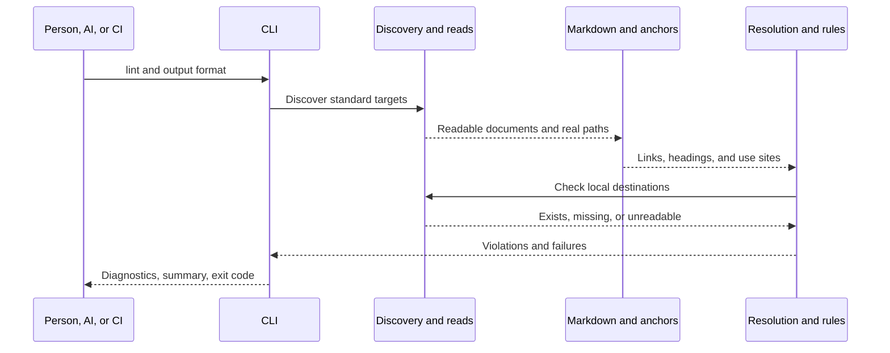

# Design: Markdown links and document reference directions

[日本語](design.ja.md)

## About this document

This document adds document lint to standalone sdev under the [Requirements](requirements.md) and parent [Product](../../product.md).
Use the Requirements' direction table, assuming agreement with the shared [document reference rules](../../../../guidelines/documents.md#reference-directions).
This Design does not change permissions.

### Intended readers

People and AI implementing, changing, or reviewing document lint.

### Prerequisites

[Document responsibilities and updates](../../../../guidelines/documents.md), the [Rust development guide](../../../../engineering/guidelines/rust-development.md), Markdown relative links, and URI fragments.

### Exclusions

Code/comment parsing, network checks, repair, generation, visualization, lint configuration, and custom placement are excluded.
Record implementation/verification procedures and results during work following the [implementation and verification guideline](../../../../guidelines/agent.md#implementation-and-verification).

## Implementation approach

Add product operation `lint`, separating discovery, parsing, destination resolution, rule evaluation, and reporting.
Parsing and rule evaluation consume discovered/read data without writing files or starting processes.
Keep existing material and version output. Product functionality belongs outside development `xtask` and has no dependency on the development package.

Use [pulldown-cmark](https://pulldown-cmark.github.io/pulldown-cmark/) as a normal dependency, as already used by the build.
Use the [Rust github-slugger implementation](https://docs.rs/github-slugger/latest/github_slugger/) for heading anchors, [percent-encoding](https://docs.rs/percent-encoding/latest/percent_encoding/fn.percent_decode_str.html) for decoding, and serde_json for structured output.
These handle syntax, Unicode heading identity, encoded URLs, and JSON; do not parse all Markdown with custom regular expressions.
Pin dependencies and locks following development conventions without duplicating version numbers here.

### From input to diagnostics

First read standard Markdown targets and extract document type, links/use sites, and heading anchors.
Then resolve each link, independently checking destination existence and direction, and attach the original use site to diagnostics.
Continue other documents after read failures:

```text
targets, discovery_failures = discover(project_root)
record discovery_failures
for each target:
    if unreadable: record failure and continue
    classify path
    extract links and heading anchors
    record path, type, links, anchors
for each link in each readable document:
    resolve root, source path, and destination string
    if external: count and continue
    if unresolved: diagnose use site and reason, then continue
    classify destination
    check source/destination types and document identity
    diagnose any forbidden direction
    if missing: diagnose missing target and continue
    if existing destination is unclassified and source is Product/Requirements/Design:
        record direction-classification failure
    if Markdown heading reference: compare destination anchors
    diagnose any missing heading
sort diagnostics and return report with exit code
```

Read Markdown outside discovery targets only when needed for a referenced heading.
Record read failure and continue other links when that read fails.
Classification and identity details follow below.

### Standard placement and discovery

Use the startup working directory as project root, without Git root search or parent traversal.
Select root README.md/AGENTS.md and language variants, plus ordinary `.md` files recursively under `docs/`.
Compare extensions case-insensitively; include existing root entry files only.
Missing `docs/` or no target Markdown is an incomplete discovery result, not success.
Do not add lint settings, custom include/exclude patterns, or Git ignore handling.
Language configuration affects presentation, not target selection.

Process relative paths in order.
Do not follow discovery symlinks or Windows reparse points; report failure for unsafe entries and continue safe targets.
Read regular Markdown as UTF-8 without replacement decoding.
Continue independent readable files after any failure.

### Document classification

Use root-relative path/name patterns, without inferring from titles or content.
Apply these in order; `<product>` and `<feature>` are directory names:

| Pattern | Type |
| --- | --- |
| `docs/products/<product>/product.md` | Product |
| `docs/products/<product>/features/<feature>/requirements.md` | Requirements |
| `docs/products/<product>/features/<feature>/design.md` | Design |
| Markdown under `docs/engineering/design/` | Design |
| Markdown under `docs/guidelines/` or `docs/engineering/guidelines/` | Guidelines |
| Other Markdown, `.txt`, `.rst`, `.adoc`, root LICENSE/NOTICE | General document |
| Images, PDF, and other document assets | Asset |
| Default code/development/distribution patterns | Implementation |
| Everything else | Unknown |

Before matching document names, remove a language suffix such as `.ja` from `design.ja.md`, retaining directory identity.
A suffix has a two- or three-letter lowercase primary language and optional hyphen-separated alphanumeric subtags of one to eight characters.
This supports document classification beyond the CLI's initial en/ja choices without treating arbitrary dotted names as language variants.
Templates remain general documents even when named design.md.
Code defaults include `src/`, `lib/`, `bin/`, `tests/`, `xtask/`, and `scripts/`, and these source extensions:
`.rs`, `.js`, `.jsx`, `.mjs`, `.cjs`, `.ts`, `.tsx`, `.go`, `.py`, `.java`, `.kt`, `.kts`, `.swift`, `.c`, `.h`, `.cc`, `.cpp`, `.cxx`, `.hpp`, `.cs`, `.rb`, `.php`, `.sh`, `.bash`, `.zsh`, `.ps1`, `.sql`.
Do not parse their bodies.
Development/distribution settings include `.cargo/`, `.github/`, and root Cargo.toml, Cargo.lock, sdev.toml, rust-toolchain.toml, package.json, package-lock.json, npm-shrinkwrap.json, pnpm-lock.yaml, yarn.lock, bun.lock, bun.lockb, .gitignore, .gitattributes, and .editorconfig.
Asset extensions are `.png`, `.jpg`, `.jpeg`, `.gif`, `.webp`, `.svg`, `.ico`, `.avif`, `.pdf`; an image under a source directory is not code.

Do not add general documents, assets, or ordinary directories as forbidden columns.
General documents and guidelines as sources receive link checks only.
For a table-governed source, an existing unknown destination yields an incomplete classification result, distinct from a known general document.

### Extract links, headings, and use sites

Input is Markdown text; output is checked references and heading anchors.
Keep each reference's destination and original use location so later checks can identify the source.
Let pulldown-cmark distinguish text, links, images, headings, and code.
Extract destinations from links/images and visible heading text for anchors; never reparse code strings as links.

| Markdown construct | Extracted information | Later use |
| --- | --- | --- |
| Ordinary link | Destination and use site | Resolution, existence, direction |
| Resolved reference-style link | Defined destination and link use site | Same checks; do not replace location with definition line |
| Image | Destination and use site | Existence and applicable direction |
| Heading | Visible text and occurrence order | GitHub-style anchors |
| Fenced/indented/inline code | No checked links | No false diagnostics from examples |

Store original byte ranges from `into_offset_iter()`, later translating those into source line/column instead of positions in extracted strings.
Enable tables, strikethrough, task lists, footnotes, and GitHub alerts; disable custom heading attributes and smart punctuation.
Separate leading YAML metadata from body so its strings are not checked as Markdown links.

Represent inline and resolved full/collapsed/shortcut reference links uniformly.
Associate definitions with uses; unused definitions produce no checked links.
Undefined references that CommonMark treats as text do not gain custom link semantics.
Images receive ordinary direction checks too, with no exception permitting implementation links.

Ignore false links in fenced/indented code, inline code, and HTML comments.
Raw HTML href/src, custom HTML anchors, and JavaScript-generated references are excluded initially.
Check ordinary Markdown links inside footnotes, but do not create document references for footnote numbers or backlinks.

### Worked example

Suppose `docs/products/example/features/search/design.md` contains the following, and referenced Product/Design files and the Product's Overview heading exist:

````markdown
[Product](../../product.md#overview)
[Other feature Design](../other/design.md)
```markdown
[Display example](missing.md)
```
````

| Source location | Extracted/resolved information | Result |
| --- | --- | --- |
| Line 1, column 1 | Product's Overview in `docs/products/example/product.md` | Allowed direction and existing file/heading; no diagnostic |
| Line 2, column 1 | `docs/products/example/features/other/design.md` | Forbidden other Design; `forbidden-reference` with location/destination |
| Line 4 | A display string in a code block | Not extracted, resolved, or reported as missing |

If Overview is absent, line 1 still has an allowed direction but reports `missing-heading`.
Line 2 remains forbidden even though the file exists.
Original use ranges supply locations for both diagnostics.

### Resolve URLs and local paths

Recognize Windows drive and UNC syntax before external URL schemes; report those OS-specific local forms as processing failures.
Other schemes and `//` URLs are external, without network access, authentication, or local rewriting, including HTTP, HTTPS, mailto, data, and file.

For local destinations, split literal `#` into path/fragment and remove a literal path query after `?` before decoding.
Queries do not participate in file/heading matching.
Decode percent representations in path and fragment once as UTF-8; preserve `+`.
Malformed percent/UTF-8, NUL, or encoded path separators produce `invalid-target` violations.
Do not expand escapes/entities a second time after the Markdown parser.

An empty file means the same document; `/` means project-root relative; other paths are source-parent relative, following [GitHub relative links](https://docs.github.com/en/get-started/writing-on-github/getting-started-with-writing-and-formatting-on-github/basic-writing-and-formatting-syntax#relative-links).
Normalize `.`/`..` path components for logical existence and real-path resolution.
References escaping root produce failures.
Use URL `/` separators without platform-specific interpretation of backslashes or drive notation.

Resolve existing parents before existence checks to prevent reads outside root through symlinks.
For an in-root symlink to a regular file, classify the canonical target placement.
Use real paths for document identity so aliases to the same Design are allowed.
For translation navigation, compare real paths after removing the language suffix; when a target is missing, compare normalized logical identities so it produces only the appropriate missing-target diagnostic.
Confirmed absence is a broken link; access denial or inability to determine existence is a failure.

Let the filesystem determine filename case and Unicode normalization.
Display relative paths with `/` and without internal Windows prefixes.
Directory links check existence without inferring README or extensions.
Implementation-pattern directories count as implementation; other directories gain no new direction rule.

### GitHub-style heading anchors

Parse ATX/Setext headings into an anchor set.
Collect visible text, inline code, and image alt text in order, excluding emphasis/link syntax and inline HTML tags.
Use parser-decoded entities and convert breaks to spaces.

Following [GitHub section links](https://docs.github.com/en/get-started/writing-on-github/getting-started-with-writing-and-formatting-on-github/basic-writing-and-formatting-syntax#section-links), trim heading text, lowercase, replace spaces with hyphens, and remove formatting and applicable punctuation.
Use fresh github-slugger state per document in occurrence order, numbering collisions with headings or existing suffixes.
Do not romanize Japanese or use a generic slugger with different rules.

Compare the decoded fragment directly, without treating it as heading text and slugging again.
An empty fragment means document start and requires no heading.
Missing anchors produce `missing-heading`.
For non-Markdown code/assets/PDF, check existence and direction without parsing bodies; count heading checks as skipped.
Custom HTML anchors are not added; initial fragment checks cover Markdown headings only.

### Reference direction evaluation

Classify both ends of each link/image before applying rules.
Only Product, Requirements, and Design sources use the Requirements table; mandatory references are excluded.
Headings in the same real document and navigation between language versions of that same Design do not create another Design dependency, but retain existence/heading checks.
Other Design links remain forbidden regardless of product or platform membership.

Report existence and direction independently.
A missing target identifiable as Design or implementation can produce both diagnostics.
A missing unknown target produces only a broken-link diagnostic, distinct from failure to classify an existing unknown file.
Bundle rules in the executable; never execute repository Markdown as code or settings.

## Architecture and sequence



## Data model and ER diagram

| Data | Information and responsibility |
| --- | --- |
| Document | Relative/real paths, type, UTF-8 body, line starts |
| Reference | Source, link/image kind, parser-resolved destination, use byte range |
| ResolvedTarget | External/local/outside classification, resolved path, type, fragment, existence result |
| HeadingIndex | Per-document used anchors and anchor set |
| Diagnostic | kind (violation/failure), code, path, line, column, target, reason, guidance |
| LintReport | status (pass/violations/incomplete), diagnostics, summary |

Associate references, resolved targets, and diagnostics through document use sites.
Share existence results and heading indexes for the same real file only during execution.
No persistent entities/database are needed, so no ER diagram is included.

## API and interfaces

| Operation | Behavior |
| --- | --- |
| `sdev lint` | Check current project's standard placement and output human-readable diagnostics |
| `sdev lint --format text` | Explicit default text format |
| `sdev lint --format json` | Output one LintReport JSON object for AI/tools |
| `sdev lint --help`, `sdev lint -h` | Explain patterns, output, and statuses |

Do not add arbitrary file lists, root search, lint configuration, exclusions, or repair flags.
Root help points to lint without adding a bundled guide topic.
Guidance points to `sdev help documents --lang en` or its Japanese equivalent and the reference-direction/checking section, without requiring copied guidelines.

Text stdout contains `path:line:column [code] reason (target: ...)` and completion/count summaries.
Omit locations for file-level diagnostics and target parentheses for null targets; deduplicate guidance after diagnostics.
JSON stdout is one object followed by a newline, without prose or progress logs.
Paths are relative; line/column are one-based, with columns counted as Unicode characters and a tab counting as one.
Convert from original byte ranges. Discovery failures without use sites have null line, column, and target.

Sort diagnostics stably by relative path, line, column, code, and target.
Show destination/reason without whole source bodies.
JSON keys, code identifiers, and status values are stable; reasons, guidance sections, and text summaries follow the selected language, defaulting to English.
`target` retains the checked link string; `guidance` has `command` and `section`.
Once the display language is selected, invalid lint arguments write a localized reason and usage to stderr, leave stdout empty, and return 2 without starting checks.
This applies to unknown formats, missing format values, and extra arguments, including extra arguments with `--format json`.
Select the fixed reason with the existing Language value at the argument-error branch, using the same language as usage. Do not translate the assembled output by replacement.
The existing language selection and two fixed messages are sufficient for this branch. Follow the Requirements' preference for translated errors without adding a translation mechanism or changing validation order merely to translate every error.
Language-option and project-configuration errors occur before this branch and are outside this change; they may remain in English.
File failures after checks begin stay within the same report format, including JSON.

| Exit | Status | Condition |
| --- | --- | --- |
| 0 | pass | Completed without violations |
| 1 | violations | Completed with broken links, invalid targets, or forbidden directions |
| 2 | incomplete | Discovery/read/classification incomplete, or argument/output failure |

Mixed results preserve both kinds and exit 2. Stdout failure also exits 2, distinct from violation-only 1.
Other operations keep their existing exit codes; CI accepts only 0.
Add self-lint of sdev documents to common checks with the implementation.

| code | Kind | Meaning |
| --- | --- | --- |
| missing-target | violation | Confirmed absent destination |
| missing-heading | violation | Missing heading in readable Markdown |
| forbidden-reference | violation | Forbidden guideline direction |
| invalid-target | violation | Invalid encoding or local reference string |
| discovery-failed, read-failed, invalid-utf8 | failure | Discovery/read/decoding could not complete |
| outside-root, unsupported-path, unclassified-target | failure | Unsafe resolution, OS-specific notation, or unknown required type |

General document classification is not failure; summary distinguishes link-only checks from direction checks.

### Output examples

Default `sdev lint` is human-readable text; use `sdev lint --format json` for structured data.
Paths, positions, and counts below illustrate output rather than fixed acceptance values.
`documents` counts readable discovered targets, split into `direction_documents` and `link_only_documents`.
`internal_references` and `external_references` count references; `skipped_heading_checks` counts fragments not checked against Markdown headings.
`violations` and `failures` count findings. Unreadable documents are excluded from `documents` and identified by failure diagnostics.

#### Text: successful checks

For `sdev lint`, stdout is below, stderr is empty, and exit is 0:

```text
pass: Check complete, no violations
Documents 4 (direction-checked 2 / links-only 2), internal references 6, external references 1, heading checks skipped 0
Violations 0, failures 0
```

#### Text: broken link and forbidden reference

For `sdev lint`, stdout is below, stderr is empty, and exit is 1. Checks completed:

```text
docs/products/example/features/search/design.md:1:1 [missing-target] Target does not exist (target: ../../missing-product.md)
docs/products/example/features/search/design.md:2:1 [forbidden-reference] References from Design to another Design are forbidden (target: ../other/design.md)
Guide: sdev help documents --lang en (Checking references, Reference directions)
violations: Check complete, violations found
Documents 4 (direction-checked 2 / links-only 2), internal references 6, external references 1, heading checks skipped 0
Violations 2, failures 0
```

#### Text: incomplete checks after read failure

For `sdev lint`, stdout includes findings from readable documents, stderr is empty, and exit is 2:

```text
docs/products/example/features/search/design.md:1:1 [missing-target] Target does not exist (target: ../../missing-product.md)
docs/products/example/features/search/design.md:2:1 [forbidden-reference] References from Design to another Design are forbidden (target: ../other/design.md)
docs/products/example/features/unreadable/requirements.md [read-failed] Cannot inspect or read file: Permission denied
Guide: sdev help documents --lang en (Checking references, Reference directions)
incomplete: Check incomplete
Documents 4 (direction-checked 2 / links-only 2), internal references 6, external references 1, heading checks skipped 0
Violations 2, failures 1
```

#### JSON: results for AI

`sdev lint --format json` returns the same incomplete result as one stdout object, with empty stderr and exit 2.
AI can read kind, code, position, and target separately without splitting prose:

```json
{
  "status": "incomplete",
  "diagnostics": [
    {
      "kind": "violation",
      "code": "missing-target",
      "path": "docs/products/example/features/search/design.md",
      "line": 1,
      "column": 1,
      "target": "../../missing-product.md",
      "reason": "Target does not exist",
      "guidance": {"command": "sdev help documents --lang en", "section": "Checking references"}
    },
    {
      "kind": "violation",
      "code": "forbidden-reference",
      "path": "docs/products/example/features/search/design.md",
      "line": 2,
      "column": 1,
      "target": "../other/design.md",
      "reason": "References from Design to another Design are forbidden",
      "guidance": {"command": "sdev help documents --lang en", "section": "Reference directions"}
    },
    {
      "kind": "failure",
      "code": "read-failed",
      "path": "docs/products/example/features/unreadable/requirements.md",
      "line": null,
      "column": null,
      "target": null,
      "reason": "Cannot inspect or read file: Permission denied",
      "guidance": {"command": "sdev help documents --lang en", "section": "Checking references"}
    }
  ],
  "summary": {
    "documents": 4,
    "direction_documents": 2,
    "link_only_documents": 2,
    "internal_references": 6,
    "external_references": 1,
    "skipped_heading_checks": 0,
    "violations": 2,
    "failures": 1
  }
}
```

Success uses `status: "pass"`, empty diagnostics, and exit 0. Completed violations use `status: "violations"` and exit 1.
Keep the same fields with actual counts. Pre-check usage errors go to stderr, never into report stdout.

## External service integration

No runtime external service is used.
Process published GitHub heading/relative-link rules locally without API or rendered-page requests.
Dependency retrieval/build remains normal Cargo work; product use requires no runtime or network.
Do not add hostname rules converting external URLs to local files.

## Data handling

Read selected Markdown and destination Markdown needed for heading checks only.
Reading a destination outside discovery does not promote its own links into targets.
Code/images/PDF receive existence/type checks without body parsing.
Keep necessary reads within the startup root's real boundary and send no content or links externally.

Keep bodies, parse results, indexes, and diagnostics in memory only: no cache, telemetry, history, or source rewrites.
Handle LF/CRLF in original source positions without confusing normalized-copy offsets with original offsets.
When adding runtime crates, include their licenses/notices in distribution attachments without creating runtime notice-file or library dependencies.

## Authentication and authorization

No accounts or custom authentication.
Respect the invoking user's read permissions; report insufficient access rather than bypassing it with another identity.

## Security considerations

Never execute Markdown links, code, or HTML as instructions.
Do not execute repository settings, hooks, plugins, shell, or external Git commands.
Check decoded separators/parent components and real boundaries to avoid reading secrets outside root or through escaping symlinks.
Escape filename/destination control characters in text and use JSON serialization for JSON.
Do not conflate non-UTF-8 OS paths through replacement display: diagnose unsupported paths using a displayable parent and escaped bytes or UTF-16 units, without passing malformed strings to JSON.

## Deployment considerations

Normal standalone executable builds/replacement apply, without data migration.
Follow the [distribution guide](../../../../engineering/guidelines/releasing.md).
Completed Requirements/Design do not mean implementation, publication, or CI verification is complete.

## Alternatives considered

### Extract links/headings only with regular expressions

This reduces dependencies but does not consistently handle definitions, images, escaping, nesting, and false links inside code.
Use the existing Markdown parser's syntax and source ranges.

### Use generic slugs or inspect headings in a browser

Generic sluggers can differ on Japanese, punctuation, and duplicate handling.
Browser/API inspection requires runtime and network access.
Use a GitHub-compatible Rust implementation on heading text from the Markdown parser.

### Select targets through Git or configuration

This accommodates existing custom projects but expands the agreed scope.
Initially use the current directory and default patterns, without custom settings or ignore rules.

### Combine processing failures and violations

This simplifies code but hides whether a document was unreadable or checked and invalid.
Preserve known violations while prioritizing incomplete status and exit code.

## Open questions

None. Initial syntax, target, rule, and I/O decisions are settled here.
Reconsider custom placement, HTML references, and code-comment checks through separate requirement changes when concrete needs arise.
