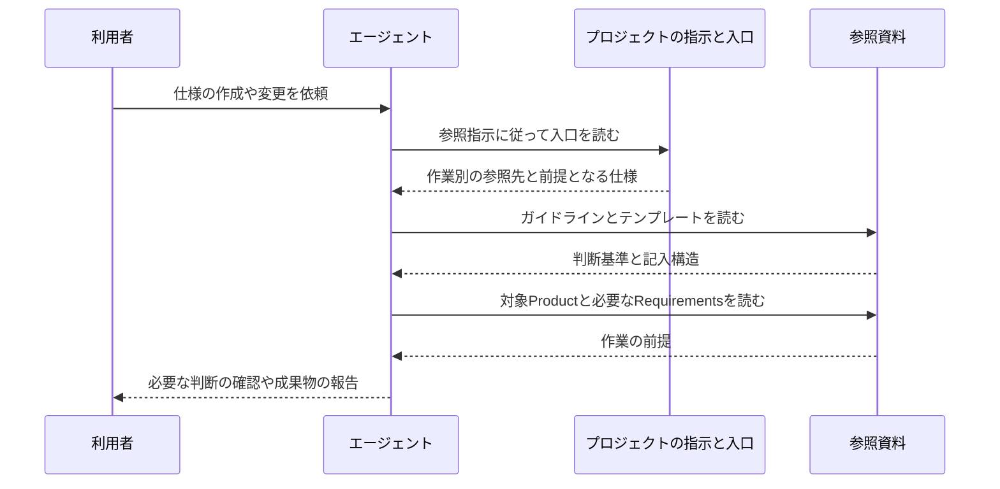

# ガイドラインとテンプレートの参照の設計

[English](design.md)

## このドキュメントについて

[ガイドラインとテンプレートの参照のRequirements](requirements.ja.md)を、静的なMarkdownとリンクで実現する設計です。
親となる[sdevのProduct](../../product.ja.md)を前提とし、要件の内容はRequirementsを参照します。
この機能は配置済みMarkdownを直接読む経路を扱います。
CLIからの参照と実行ファイルの配布は、[コマンド配布のRequirements](../command-distribution/requirements.ja.md)に対応する機能で扱います。

### 対象読者

文書の配置・案内を実装し、変更する開発者とエージェント。

### 前提知識

Markdownファイルを読む方法と、[文書の責務・配置規約](../../../../guidelines/documents.ja.md)。

### このドキュメントで扱わないこと

要件の決定、Web配信の設計、CLIや文書を解析する処理の設計。
検証は[実装と検証のガイドライン](../../../../guidelines/agent.ja.md#実装と検証)に従って行い、結果は完了報告やPR本文に残す。

## 実装方針

実行コードを追加せず、入口・ガイドライン・テンプレートをMarkdownファイルとして配置します。
配置済みMarkdownを直接読む場合は、[文書と作業の入口](../../../../README.ja.md)の作業別の表から必要な文書へ進みます。
sdev自身の[AGENTS.md](../../../../../AGENTS.ja.md)は、作業開始時に`cargo build --locked --package sdev --bin sdev`でこのチェックアウトをビルドし、`./target/debug/sdev help`からガイドを読むよう指示します。
対象のProduct・Requirements・Designはこの入口から確認し、作業の進め方はガイドへ委ねます。
実際の配置は前提知識に示した配置規約に従います。

| 部分 | 責務 |
| --- | --- |
| プロジェクトの参照指示 | 入口を読む契機を示す。ルールの本文を複製しない |
| 入口 | 作業の目的から、読む文書と上位仕様を選ぶ案内を提供する |
| ガイドライン | 文書の責務と判断基準、調査・確認・執筆・読み返しの進め方を提供する |
| テンプレート | 記入する構造を提供する |

### 執筆と見直しの案内

文書の組み立てと段落のつながりは、[文書の責務と更新](../../../../guidelines/documents.ja.md#書き方と判断の区別)の共通基準にまとめます。
Designガイドは、その基準を設計の説明へ適用する手順と短い改善例を示します。
テンプレートは説明の入口となる記入欄を示し、ガイドの規則を繰り返しません。

修正時の見直し範囲は、同じ文書ガイドの[変更の扱い](../../../../guidelines/documents.ja.md#変更の扱い)で定めます。
作業ガイドは保存内容と文書全体を確認し、機械的な検査と読み返しの判断を分けて報告する手順へつなぎます。
既存の規則で扱える指摘は説明や例の修正に使い、同じ趣旨の規則を増やしません。

### 対話と依頼の範囲

依頼の解釈と利用者の判断は、共通の作業ガイドの「依頼の範囲とレビュー」にまとめます。
Requirements・Designのガイドと実装前の手順から同じ節へ案内し、文書だけの依頼と実装までの依頼で進め方を分けます。
レビュー状況の管理ファイルや実行を制御する仕組みは設けず、会話での利用者の指示を使います。

質問の組み立て方、回答に応じた掘り下げ、ツール選択と回答を待つ扱いは、共通の作業ガイドの「質問で考えを具体化する」に置きます。
Product・Requirements・Designのガイドは、それぞれに合う質問の論点を添えて同じ節へリンクします。
ツールの呼び出しは利用するエージェントが担当し、使えない環境では会話で質問します。

### 参照先と取得失敗

参照先は相対Markdownリンクで直接ファイルを指し、同じ言語版の内容を別の配信用ファイルへ生成しません。
同じ構成のまま配置を移しても、ローカルとGitHubで文書間を参照できます。
GitHubでの扱いは[公式のMarkdown説明](https://docs.github.com/en/get-started/writing-on-github/getting-started-with-writing-and-formatting-on-github/basic-writing-and-formatting-syntax#relative-links)に従います。これは公開先をGitHubに限定するものではありません。

取得失敗はエージェントの読み取り操作で判明します。
入口から共通ガイドの取得失敗時の案内へつなぎ、エージェントが不足を報告できるようにします。
取得の再試行、文書内容の推測、指示の強制はsdevの処理として追加しません。

## アーキテクチャ・シーケンス図

文書は内容とリンクを保持し、取得と進行はエージェントが担当します。
以下の図は読み取りの順序を示すもので、sdevに実行エンジンがあることを表しません。

Productの新規作成で上位仕様がない場合は、依頼を入力とします。
既存文書の変更では対象の既存文書も読みます。

## データモデル・ER 図

データはUTF-8のMarkdown本文です。
文書の見出しと本文に記述し、リンクは通常の`[表示名](相対パス)`の形にします。
機能や文書の識別のための専用ID、追加の属性を記述するメタデータ、別の関係一覧ファイルは導入しません。

入口の1つの作業行が、1つ以上のガイドラインと対応するテンプレートを参照します。
Product・Requirements・Designの関係は、配置規約のディレクトリとMarkdownリンクで表します。
独立したデータベースやエンティティを持たないため、ER図は使いません。

## API・インターフェース

接点は[文書と作業の入口](../../../../README.ja.md)と、そこからリンクするMarkdown本文です。
エージェントはファイルを読む手段で本文を取得し、ファイルを基準に相対リンクを解決します。
入口に対する入力は作業目的、出力は対応する資料への案内であり、HTTP APIやCLIコマンドは追加しません。

別のプロジェクトへ導入するための指示例は、[README](../../../../../README.ja.md)と初期設定で生成する指示に置きます。
ローカル配置先は利用者が置き換える欄として示し、特定環境の絶対パスは埋め込みません。
公開URLの指示例は、実際の配信先を用意して確認できるまで追加しません。

## 外部サービスとの連携方式

なし。
利用時の読み取りはローカルファイルを対象とし、ネットワーク接続・認証・外部ライブラリを必要としません。
設計の根拠として示したWeb資料の参照は、文書機能を動かすための依存ではありません。

## データの取り扱い設計

ガイドライン・テンプレート・参照案内はリポジトリ内で編集し、同じファイルを読み取ります。
利用側でテンプレートから作成した仕様は、利用側のプロジェクトへ保存します。
プロジェクトの仕様を収集・複製する保存先や、アクセス計測の仕組みは設けません。

文書の変更・削除と過去の参照にはGitを使います。
データベース、キャッシュ、保存期限を管理する処理は持ちません。
削除や移動を行うときは、その文書を指すリンクも更新します。

## 認証認可に関する特記事項

なし。
ファイルの読み書きは利用する環境のファイル権限に従い、独自のアカウントや認証情報を持ちません。

## セキュリティ上の留意事項

参照例には架空の業務情報や認証値を埋め込まず、置き換える欄を説明として記述します。
特定の環境のパスや内部文書への参照を配布資料に残しません。
外部への送信処理や、利用者の文書を自動変更する処理は追加しません。

## デプロイに関する特記事項

なし。
ローカルのMarkdownの配置で利用でき、ビルドやサーバーへの反映処理を設けません。

## 検討した代替手段

### CLIで資料を取得・表示する

参照をコマンドにまとめられる利点があります。
一方、文書を読むだけの段階で実行環境とインストール手順が必要になります。
配置済みMarkdownの参照は通常のファイル読み取りで要件を満たせるため、この機能にCLIは追加しません。
実行ファイルへ資料を同梱する経路は、配布機能で設計します。

### Webサイトを構築してから資料を提供する

ローカル配置をせずURLで参照できる利点があります。
一方、公開先とバージョンの扱いを決め、配信経路を確認する作業が必要です。
仕様を使ってsdev自身を開発するための最小構成には不要なので、Web公開は別の機能として判断します。

### 特定のエージェント専用のスキルとして配布する

起動方法とツール操作を揃えられる利点があります。
一方、利用するエージェントの形式やツールに手順が依存します。
普段使うエージェントがMarkdownを読んで進める使い方に合わせ、通常の文書として手順を提供します。

## 未決事項

この設計の実装を妨げる未決事項はありません。
Web配信や解析機能に関する判断は、[Product](../../product.ja.md)に記載した見直し条件に従います。
