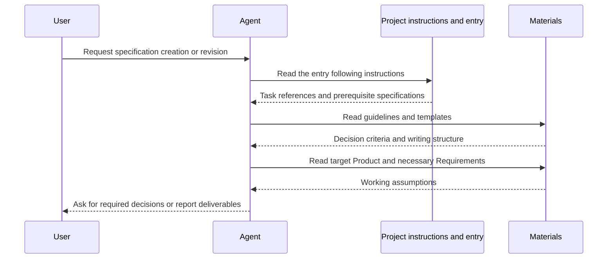

# Guideline and template reference design

[日本語](design.ja.md)

## About this document

Implement the [guideline and template reference Requirements](requirements.md) with static Markdown and links.
The [sdev Product](../../product.md) gives the parent context; refer to Requirements for behavior.
This feature supports reading repository Markdown directly.
CLI reference and executable distribution belong to the feature defined by [command distribution Requirements](../command-distribution/requirements.md).

### Audience

Developers and agents implementing or changing document placement and navigation.

### Prerequisites

Reading Markdown and following [document responsibilities and placement](../../../../guidelines/documents.md).

### Outside this document

Deciding requirements, web delivery, and CLI or document-parser design.
Follow [implementation and verification](../../../../guidelines/agent.md#implementation-and-verification), recording results in completion reports or PR descriptions.

## Implementation approach

Place entry points, guidelines, and templates as Markdown files without adding execution code for direct reference.
Use the task table in the [documentation entry point](../../../../README.md) to select documents.
sdev's own [AGENTS.md](../../../../../AGENTS.md) instructs agents to build this checkout with `cargo build --locked --package sdev --bin sdev`, then read guides through `./target/debug/sdev help`.
Find target Product, Requirements, and Design from the entry point; delegate working practices to guidelines.
Follow the placement conventions identified in prerequisites.

| Part | Responsibility |
| --- | --- |
| Project instructions | Establish when to read the entry point, without duplicating rules |
| Entry point | Map task purposes to documents and upstream specifications |
| Guidelines | Responsibilities, judgment, research, preparation, writing, and review |
| Templates | Structure for writing |

Relative Markdown links point directly to files.
Do not generate another delivery copy of the same language version.
Relative links remain usable when relocating the same tree and when browsing files on GitHub.
GitHub's [official Markdown guidance](https://docs.github.com/en/get-started/writing-on-github/getting-started-with-writing-and-formatting-on-github/basic-writing-and-formatting-syntax#relative-links) explains relative links; this does not select GitHub as the only publication destination.

The agent's reading operation reveals retrieval failures.
Put failure guidance in common guidelines and reference it from the entry point.
Do not add sdev-side retries, guessed document contents, or enforcement of instructions.

Keep request interpretation, presentation, and necessary user decisions in Request scope and review in the shared working guide.
Explain that an idea alone does not authorize implementation: clarify purpose and scope through dialogue.
Requirements and Design guides link to that section for document-only stopping points and implementation progress updates.
Implementation preparation references the same section.
Use conversational user instructions without adding review-state files or an execution controller.

Keep question construction, answer-driven follow-up, tool selection, and waiting behavior in Make ideas concrete through questions.
Product, Requirements, and Design guides link to it and add questions fitting each document's responsibility.
The agent calls tools, falling back to conversational questions when unavailable.
No particular question tool becomes an sdev runtime dependency.

## Architecture and sequence diagrams

Documents hold content and references; the agent retrieves them and manages progress.
This diagram illustrates reading order, not an sdev execution engine.

For a new Product without upstream specifications, use the request as input.
When revising documents, also read the existing target.

## Data model and ER diagrams

Use UTF-8 Markdown bodies, headings, and ordinary `[label](relative-path)` links.
Do not introduce dedicated feature IDs, attribute metadata, or a separate relationship registry.
Language versions express the same document as specified by localization requirements.

Each task row references one or more guidelines and its template.
Directory layout and Markdown links express Product, Requirements, and Design relationships.
No independent database or entities need an ER diagram.

## APIs and interfaces

Interfaces are the [documentation entry point](../../../../README.md) and linked Markdown bodies.
Agents read files and resolve relative links against their locations.
Task purpose is the entry's input; matching references are its output. This feature adds no HTTP API or CLI command.

Keep consuming-project instruction examples in the [README](../../../../../README.md) and in generated initialization instructions.
Use replaceable locations rather than absolute personal paths.
Add public URL examples only when actual delivery exists and has been verified.

## External service integration

None. Local reading needs no network, authentication, or external library.
Web sources supporting design reasons are not operational dependencies of the document feature.

## Data handling

Edit and read the same repository guideline, template, and reference files.
Specifications produced from templates belong in the consuming project.
Do not collect, copy, or measure access to those project specifications.

Use Git for changes, deletion, and historical references.
No database, cache, or retention process is introduced.
Update incoming links when deleting or moving a document.

## Authentication and authorization notes

None. Follow existing filesystem permissions without separate accounts or credentials.

## Security considerations

Describe replaceable fields rather than inventing business information or credentials for examples.
Exclude personal paths and internal references from distributed materials.
Add no external transmission or automatic changes to consuming-project documents through this reference feature.

## Deployment notes

None. Repository Markdown can be used directly without a build or server deployment for this reference path.

## Alternatives considered

### Retrieve and display materials with a CLI

A CLI centralizes references but adds installation merely to read documents.
Ordinary file reading meets this feature's requirements; executable-embedded materials are designed by the distribution feature.

### Build a website before providing materials

A website avoids local placement but requires decisions about hosting and versions plus delivery verification.
It is unnecessary for the minimum documentation used to develop sdev itself. Treat web publication as another feature.

### Distribute an agent-specific skill

A skill can standardize entry and tool operations but ties procedures to an agent's format and tools.
Provide ordinary Markdown for the user's usual agent to read.

## Open questions

None blocking this design.
Revisit web delivery and analysis features under the conditions stated in the [Product](../../product.md).
