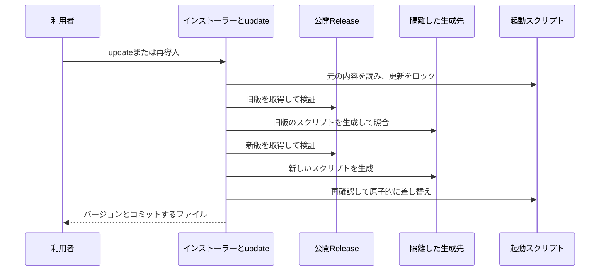

# プロジェクトへの導入の設計

[English](design.md)

## このドキュメントについて

[Requirements](requirements.ja.md)と[sdevのProduct](../../product.ja.md)を前提に、配布ファイルの準備と初期設定を分けて実装します。

### 対象読者

導入機能を実装・変更する人とAI。

### 前提知識

[配布のRequirements](../command-distribution/requirements.ja.md)と[文書の責務と更新](../../../../guidelines/documents.ja.md)を参照します。

### このドキュメントで扱わないこと

仕様の生成、外部公開の実行、OSの署名・公証は扱いません。

## 実装方針

`install.sh`はPOSIX shで実装し、OS・CPUの選択、curlでの取得、ハッシュ照合、任意の証明検証、起動確認、配置を担当します。
Rust・Node.js・Pythonを導入用の前提に追加しません。
macOS arm64/x64とLinux arm64/x64を既存のReleaseのファイル名へ対応付けます。
初回のWindows導入は既存の手動取得を使います。

バージョンを指定しない場合は公開Webの`releases/latest`のリダイレクト先からタグを読み、GitHub APIを使いません。
タグは`vX.Y.Z`の安定版だけを受け入れ、取得ファイル名は既存の配布名から組み立てます。
curlのHTTPエラーを失敗にし、取得先と通信待ち時間を固定します。
最新Releaseの検索、各ファイルの取得、照合・証明検証の開始を標準エラーへ表示します。標準エラーが端末につながっている場合はcurlの進捗バーも表示し、非対話の環境では段階ごとの表示にとどめます。
シェルの設定ファイルや環境変数に認証情報を追加しません。

配置先ディレクトリが通常のディレクトリであることを確認し、その配下の一時ディレクトリへ取得します。
既定は`./bin`とし、起動スクリプトからの取得用に`--install-dir DIR`も受け付けます。
配置先までの既存の親ディレクトリも確認し、シンボリックリンクを経由しません。
実行ファイルと`.sha256`を取得し、`sha256sum`または`shasum -a 256`で計算した値と、ファイル名も含めて照合します。
取得先から渡されたパスを使って任意のファイルを照合しません。
照合後、指定されていれば証明を検証し、その後に取得した実行ファイルの`--version`を照合します。
すべて成功した場合だけ同じファイルシステム上で配置先の`sdev`を差し替えます。
一時領域は成功時・失敗時・シグナル受信時に削除します。

`init`は現在のディレクトリをプロジェクトのルートとし、AGENTS.mdと.gitignore、sdev.toml、macOS・Linuxでは起動スクリプトを扱います。
言語設定と指示の言語は[言語対応のRequirements](../localization/requirements.ja.md)に従います。
全対象を先に読み取り、通常ファイル・UTF-8・区切り・配置先の条件を確認してから変更を準備します。
`--path`は既定の`bin/sdev`を変更する引数です。先頭の`./`は正規化し、絶対パス・親への移動・予約済みのAGENTS.md・.gitignore・sdev.toml、キャッシュ配下を拒否します。
シェルとMarkdownで同じパスを安全に表現できるよう、構成要素には英数字・`-`・`_`・`.`だけを使います。
スクリプトの既存の親が通常のディレクトリかを確認し、不足する親だけを作ります。
保存は同じディレクトリの一時ファイルを作り、本文と既存の権限を反映してからrenameします。
新しい起動スクリプトには実行権限を付けます。
通常ファイルの差し替えには[標準ライブラリのrename](https://doc.rust-lang.org/std/fs/fn.rename.html)を使います。
`init`ではファイルをまたぐトランザクションや同時編集の制御は追加せず、保存途中の失敗は対象を示します。

### コミットする起動スクリプト

[miseのコミット用wrapper](https://mise.jdx.dev/continuous-integration.html#other-ci-providers)を参考に、固定したバージョンを必要時に取得して実行する入口を生成します。
sdevがPOSIX shのスクリプトを生成し、追加の管理ツールは導入しません。
既定の配置と役割は次のとおりです。

```text
bin/sdev                         # コミットする起動スクリプト
.sdev/bin/<version>/<os>-<arch>/sdev # 取得した本体
AGENTS.md                        # 起動スクリプトから資料を参照
sdev.toml                        # プロジェクトの文書言語
```

起動スクリプトは生成元のsdevのバージョンと、配置先からルートまでの相対的な深さを保持します。
絶対パスを埋め込まず、別のディレクトリへcloneしてもルートを求められるようにします。
OS・CPUごとに本体の保存先を分け、生成元と異なる対応環境でも使えます。
実行時は呼び出し元の作業ディレクトリを保ち、すべての引数を`exec`で本体へ渡します。
取得処理だけをプロジェクトのルートを基準とするサブシェルで実行します。

スクリプトには同じソースのインストーラーを埋め込みます。
実行時に別のシェルスクリプトを取得・実行せず、コミットした処理からReleaseの本体・チェックサムを直接取得します。
取得処理には固定した`--version`とキャッシュの`--install-dir`を渡し、`--init`は渡しません。
初期設定を再帰的に実行せず、起動のたびにAGENTS.mdや.gitignoreを編集しないためです。
取得済みの通常ファイルが実行可能なら追加の通信をせずに使います。
初回取得には既存のチェックサム・バージョン確認・差し替え・通信制限・進捗表示を共通利用します。
通常はチェックサムによる一致確認を行い、証明も検証する取得には`SDEV_VERIFY=1`を用意します。検証失敗を通常取得へ切り替えません。

指定先に同一の生成済みスクリプトがあれば変更しません。
別の内容があれば失敗し、削除・移動・配置先の見直しを案内します。
初回の`install.sh --init`との接続のため、既存のファイルが起動中のsdev実行ファイルとバイト単位で一致する場合だけスクリプトへの置き換えを認めます。
インストーラーは旧Releaseの`init`とも接続できるよう、既定の本体の配置先を`bin/sdev`に保ちます。
新しい`init`はそこを起動スクリプトへ置き換え、本体は次回の起動時にキャッシュへ取得します。
初回導入では本体を二度取得しますが、旧Releaseの指示が存在しない本体を参照する互換性の問題を避けます。
導入先に生成済みの起動スクリプトがある場合は、後述の明示的な更新へ進みます。
旧版が追加したAGENTS.mdの指示は保持します。指定先のコマンド参照が見つからない既存のsdev部分は、手動で合わせる必要があることを示して失敗します。
バージョン更新は新しいsdevで起動スクリプトを生成し直して差分をコミットする操作とし、実行時には自動更新しません。
Windowsでは従来の手動配置と`init`を維持し、`--path`によるシェルスクリプトの生成は対応するUnix環境に限定します。

### 明示的なプロジェクトの更新

更新では、プロジェクトの入口と文書を保ち、Gitで共有するバージョンを変更します。
Rustの`update`コマンドは引数を検査し、内蔵インストーラーを`sh -s -- --update`で実行して、プロジェクト内の相対配置先・版・検証オプションを渡します。
起動スクリプトは自分の相対配置先を`SDEV_LAUNCHER_PATH`で渡し、本体の直接実行では`bin/sdev`を既定にします。
`init`と同様にプロジェクトのルートで実行し、起動中の本体やパッケージ管理による配置は置き換えません。

curlでの再導入とコマンドで同じ検査を使うため、取得と更新は同じインストーラーが担当します。
導入先に起動スクリプトがあれば自動的に更新へ進み、`--update --path PATH`では対象を明示できます。
単体の実行ファイルへの通常の導入は維持し、明示的な更新ではそのファイルを拒否します。
更新先には`init`と同じ相対パスの条件を使い、対象・親・キャッシュのシンボリックリンクを拒否します。

スクリプトの見出しから旧版を読み取りますが、それだけでは上書きを許可しません。
その公開済みの旧版本体を、チェックサムと指定された証明検証を行って取得し、隔離した場所で同じ相対パスを指定して`init`します。
そこで生成した本文と元のスクリプトを比較することで、現在の生成処理と形が異なる旧版も扱い、利用者の編集を保護します。
ソースコミットの指定は新版へ適用し、旧版はその版の署名済み配布記録を使って証明を検証します。

比較に成功したら同じ取得処理で新版を検証し、別の隔離した場所で新しいスクリプトを生成します。
これらの初期設定は、利用先の文書には触れません。
同じ版なら、その旨を表示してスクリプトを書き直しません。
異なる版では、元の権限を持つ隣接一時ファイルへ新しい本文を書き、本体を版・OS・CPU別のキャッシュへ配置してから、同じファイルシステム上のrenameでスクリプトを切り替えます。
差し替え直前にも元の内容とファイル種別を確認します。同時更新はプロジェクトのキャッシュ内のロック用ディレクトリで防ぎ、強制終了後に残った場合は勝手に削除せず確認を案内します。
失敗時は旧スクリプトを保持します。最後の差し替えに失敗した場合、検証済みで未使用の新版キャッシュが残ることは許容します。
通常の終了と扱えるシグナルでは、準備用の領域・隣接一時ファイル・自分が取得したロックを削除します。

## アーキテクチャ・シーケンス図

処理は、取得、照合、任意の証明検証、起動確認、配置、任意の初期設定の順です。
更新では、旧版の内容照合と新版の検査が両方成功してから入口を差し替えます。その関係を次の図で示します。



## データモデル・ER 図

永続データベースは使いません。
AGENTS.mdのsdev部分は`<!-- sdev:begin -->`と`<!-- sdev:end -->`で識別します。
区切りが一組あり順序が正しければ、利用者の編集を含めて既存の部分を保持します。
区切りが片方だけ、複数、または順序が逆なら失敗します。
区切りの外の本文はバイト列として保持し、追記部分は既存にCRLFがあればCRLF、なければLFにします。

.gitignoreにはUnixで`/.sdev/`を追加し、指定した起動スクリプトと同一の既存の除外行だけを取り除きます。
たとえば既定の配置では旧版の`/bin/sdev`を取り除きます。ほかの除外指定は保持し、利用先が`bin`全体を除外している場合はその規約に合わせるよう案内します。
Windowsでは従来の`/bin/sdev`と`/bin/sdev.exe`を維持します。
同じ除外行があれば重複させません。
参照指示のコマンドはUnixでは指定先に`./`を付けたパス、Windowsでは`./bin/sdev.exe`とします。
利用者の仕様ファイルの内容や名前は推測しません。
初回に追加する指示には、「作りたい」だけで実装までの依頼とみなさないことを含めます。
文書作成だけの依頼は提示で区切り、実装まで任されていれば途中で要点を提示し、利用者の判断が必要な場合に確認するよう短く記述します。
詳細は共通の作業ガイドへ案内します。
目的や条件の不明点を仮定で補わずに質問し、利用できる質問ツールを優先して、回答から次の質問を選ぶことも参照指示に含めます。
既存の区切り内の指示は旧版も含めて保持し、更新時に必要な追記はREADMEで案内します。

## API・インターフェース

| 操作 | 振る舞い |
| --- | --- |
| `sh install.sh` | 最新の安定Releaseを`./bin/sdev`へ導入 |
| `sh install.sh --version X.Y.Z` | 指定バージョンを導入 |
| `sh install.sh --install-dir DIR` | 本体を指定ディレクトリの`sdev`へ導入 |
| `sh install.sh --init` | 配置後に本体の`init`を実行し、新版では起動スクリプトを生成 |
| `sh install.sh --verify` | チェックサムに加えAttestationsを検証 |
| `sh install.sh --verify --source-commit SHA` | 独立して確認したソースコミットにも固定して検証 |
| `sh install.sh --verify --trusted-root FILE` | 利用者が独立して用意した信頼情報を使って証明を検証 |
| `sdev update [--version X.Y.Z] [--path PATH]` | 最新安定版または指定版へ起動スクリプトを更新する |
| `sdev update --verify [--source-commit SHA] [--trusted-root FILE]` | 切り替え前に証明も検証する。`SDEV_VERIFY=1`でも指定できる |
| `sh install.sh --update --path ./scripts/sdev` | 任意の配置先の起動スクリプトを明示して更新する |
| `sdev init` | Unixでは`./bin/sdev`の起動スクリプトと参照指示・言語設定・キャッシュの除外を準備 |
| `sdev init --lang en --translations ja` | 規定言語と翻訳言語を初期設定 |
| `sdev init --path ./scripts/sdev` | Unixの起動スクリプトの配置先と参照指示を変更 |
| `sdev init --help` | 対象ファイルと使い方を表示。ファイルを変更しない |
| `./bin/sdev ARG...` | 固定した本体を必要時に取得して引数を渡す |
| `SDEV_VERIFY=1 ./bin/sdev ARG...` | 未取得の本体を証明検証付きで取得して実行 |

bootstrapの成功は0、引数や取得・検証・配置の失敗は非ゼロです。
`--init`で初期設定が失敗した場合はその終了コードを返し、導入済みのバイナリーを保持します。
`init`の引数・設定エラーは2、処理・出力の失敗は1、成功は0です。

`update`は引数・設定の誤りを2、処理・出力の失敗を1、成功を0で返します。
インストーラーの更新処理は、`--init`付きでも利用先の初期設定をやり直しません。

## 外部サービスとの連携方式

GitHubの公開ReleaseをHTTPSで取得し、認証を要求する非公開配布は初回の対象にしません。
最新Releaseが存在しない場合も通常の取得失敗として返します。
取得には[curlの失敗判定・リダイレクト・保存先指定](https://curl.se/docs/manpage.html)を使います。

再利用ビルドワークフローの専用ジョブで配布ファイルを検証・集約してから、GitHubの[attestアクション](https://github.com/actions/attest)で実行ファイルとインストーラーを含む公開対象を署名します。
証明のbundleをReleaseへ`attestation.sigstore.json`として添付します。
`sdev-release.txt`にはバージョンとソースコミットを記録し、このファイルにも同じ証明を付けます。
公開処理も同じ証明を検証し、ファイル群と証明の照合に成功してからタグ・Releaseを作成します。
署名の権限はmainの手動公開から呼ぶ専用ジョブだけに付け、通常のPRのビルドと、Releaseを書き込む公開ジョブへ付けません。

bootstrapの`--verify`は[gh attestation verify](https://cli.github.com/manual/gh_attestation_verify)へローカルbundleを渡します。
`--hostname github.com`、`--repo azu/sdev`、再利用ビルドワークフローのパス、`--source-ref refs/heads/main`、`--deny-self-hosted-runners`を指定します。
先に記録の証明を検証してコミットを読み、そのコミットを`--source-digest`と`--signer-digest`の両方に指定して、記録と実行ファイルを検証します。
利用者が`--source-commit`を指定した場合は、記録のコミットがその値と一致することも確認します。
指定がない場合のコミットは証明済みの記録を基準とし、Gitのタグから独立して取得した値とは扱いません。
公開処理は起動時に固定したコミットを両方のdigestへ渡します。
検証に用いるGitHub CLIは、[信頼情報の取得時に資格情報を送る問題の修正](https://github.com/cli/cli/security/advisories/GHSA-8xvp-7hj6-mcj9)を含む2.93.0以降を要求します。
GitHub APIから証明を探索しないため、クラウドで別リポジトリのAPIにアクセスする制約を避けます。
信頼情報の自動取得先へ通信できない環境では、利用者が独立して用意した`--custom-trusted-root`相当のファイルを渡します。
信頼情報を同じ未検証の配布物から自動的に取得して信用する仕組みは作りません。

## データの取り扱い設計

永続化するのは初期設定の3ファイル、Unixの起動スクリプト、必要時に取得する本体です。
起動スクリプトと指示・設定をコミットし、`.sdev/`以下の本体はGit管理しません。
キャッシュを削除した場合は次回の起動で再取得します。
証明とチェックサムは確認時の一時領域だけに保持します。
既存の指示本文やパスを外部へ送信しません。
bootstrapは`.gitignore`を変更せず、`init`の実行時にだけ除外行を追加します。
クラウドではコミットした起動スクリプトを使い、Git管理済みの指示を毎回書き換えません。

## 認証認可に関する特記事項

導入ではGitHubへのログイン・トークン・管理者権限を要求しません。
公開時の証明生成にはGitHub ActionsのOIDCとattestations権限を使い、利用者へその資格情報を配布しません。

## セキュリティ上の留意事項

シンボリックリンクへの書き込みと、検証前の実行を避けます。
取得ファイルの起動時にshellのコードとして読み込まず、通常の実行ファイルとして起動します。
既存の実行ファイルが動いていても、直接上書きせず検証後に差し替えます。
生成するスクリプトにも親ディレクトリの検証を適用し、配置先の文字列をshellのコードとして評価しません。
キャッシュも通常のディレクトリ・ファイルだけを使い、シンボリックリンクを経由して取得・実行しません。
キャッシュは利用者の書き込み可能な実行ファイルとして信頼します。起動ごとの再検証は行わず、確認し直す場合は削除して再取得します。

チェックサムは一致だけの確認であり、同じ配布元の実行ファイルとハッシュが両方置き換えられた場合の配布元の証明にはなりません。
起動スクリプトには全OSの期待ハッシュを埋め込みません。`init`を通信なしで実行でき、同じReleaseのビルド結果を本体へ循環して埋め込まずに済むよう、取得時の照合と任意の証明検証を使います。
`--verify`も、すでに起動したインストーラー自身の信頼を後から証明するものではありません。
入口のスクリプトは確認したソースを使うか、配布されたスクリプトとbundleを実行前に独立したGitHub CLIで検証します。
ワークフローの証明はコードの無害さの保証ではありません。

## デプロイに関する特記事項

初回はReleaseへインストーラーとbundleを追加します。
READMEにはGitHubのインストーラーをcurlで取得する導入手順を記載します。
ソースの反映とRelease公開後に、そのURLから取得・起動できることを確認します。
Claude Code on the webでは[Setup scriptと許可ドメイン](https://code.claude.com/docs/en/cloud-environments)を利用します。
既定のUbuntu x86_64は既存のLinux x64配布の対象ですが、ネットワーク経路と証明の検証は実環境で別途確認します。

## 検討した代替手段

### GitHub CLIを導入の必須条件にする

配布元の検証をそろえられますが、curlだけで導入したい利用者にもGitHub CLIを要求します。
通常の取得と証明による検証を区別して提供し、検証を指定した場合は失敗時に停止します。

### グローバルな配置とPATHの編集

複数プロジェクトで共有できますが、環境ごとに準備が必要です。
プロジェクト内の固定パスを使い、指示から実行場所をたどれる形を選びます。

### insmithでインストーラーを生成する

[insmithの紹介](https://songmu.jp/riji/entry/2026-09-28-insmith.html)と[証明を使う公開フロー](https://songmu.jp/riji/entry/2026-10-11-github-actions-artifact-attestations.html)を参照しました。
生成物の配置や署名コミットを照合する方針は本機能にも適用できます。
調査時のinsmithは証明をGitHub APIから取得し、タグのコミットを`git ls-remote`で取得するため、クラウドの別リポジトリへのアクセス制約に対応するローカルbundleと記録の経路を持ちません。
今回はその経路を持つ小さなスクリプトを実装します。
insmithが同じ経路へ対応した場合は、生成による保守へ移す候補として比較します。

## 未決事項

実装に必要な判断はありません。
実際の公開URLとクラウド環境での確認は、公開時に保守者が配布ガイドへ記録します。
