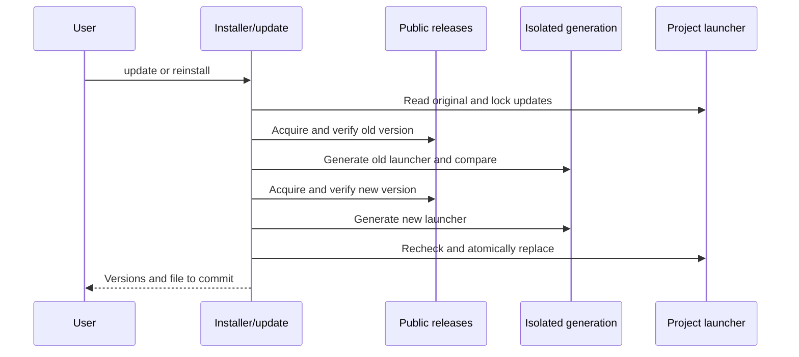

# Design: Project bootstrap

[日本語](design.ja.md)

## About this document

Under the [Requirements](requirements.md) and [sdev Product](../../product.md), separate executable installation from project initialization.

### Intended readers

People and AI implementing or changing installation.

### Prerequisites

[Distribution requirements](../command-distribution/requirements.md) and [Document responsibilities and updates](../../../../guidelines/documents.md).

### Exclusions

Specification generation, actual external publication, and OS signing/notarization are excluded.

## Implementation approach

Implement `install.sh` in POSIX sh for platform selection, curl downloads, hash comparison, optional attestation verification, startup checks, and installation.
Require no Rust, Node.js, or Python.
Map macOS arm64/x64 and Linux arm64/x64 to existing release filenames; Windows initially uses manual downloads.

Without an explicit version, read the public `releases/latest` redirect rather than using GitHub API.
Accept only stable `vX.Y.Z` tags and derive filenames from existing distribution names.
Treat HTTP errors as failures and fix download sources and network timeouts.
Report latest-version lookup, each file, and comparison/verification starts on stderr. Use curl's progress bar only when stderr is a terminal; otherwise report steps.
Do not add credentials to shell configuration or environment.

Validate the destination and every existing parent as ordinary directories, without symlink traversal.
Download into a temporary directory within the destination, defaulting to `./bin`; accept `--install-dir DIR` for launcher acquisition.
Download the executable and `.sha256`; compare both the expected filename and a value computed by `sha256sum` or `shasum -a 256`.
Do not use downloaded paths to choose arbitrary local files for hashing.
After hashes and requested attestations pass, verify the downloaded executable's `--version`.
Replace destination `sdev` on the same filesystem only after all checks succeed.
Remove temporary files on success, failure, and signals.

`init` uses the current directory as root and handles AGENTS.md, .gitignore, sdev.toml, and a macOS/Linux launcher.
Read and prevalidate all targets before staging changes, including regular-file type, UTF-8, markers, and destination constraints.
Language configuration and instruction language follow the [localization requirements](../localization/requirements.md).
`--path` changes `bin/sdev`; normalize a leading `./` and reject absolute paths, parent traversal, reserved AGENTS.md/.gitignore/sdev.toml paths, and cache paths.
Allow only ASCII letters/digits, `-`, `_`, and `.` in path components so the same path is safe in shell and Markdown.
Check existing parents and create only missing launcher parents.
Write a same-directory temporary file, apply text and existing permissions, and rename it. New launchers are executable.
Use the standard library's [rename](https://doc.rust-lang.org/std/fs/fn.rename.html) for regular-file replacement.
For init, do not add cross-file transactions or concurrent-edit controls; saving failures identify their target.

### A committed launcher

Use [mise's committed wrapper](https://mise.jdx.dev/continuous-integration.html#other-ci-providers) as a reference for a pinned, on-demand executable entry point.
sdev generates POSIX sh directly without introducing another manager.
Default roles are:

```text
bin/sdev                            # Committed launcher
.sdev/bin/<version>/<os>-<arch>/sdev  # Downloaded executable
AGENTS.md                           # Material access through the launcher
sdev.toml                           # Shared document languages
```

Store the generating sdev version and relative depth from launcher to root, without absolute paths, so another clone location works.
Separate caches by OS/CPU so other supported platforms can use the same launcher.
Preserve the caller's working directory and forward every argument through `exec`.
Only acquisition runs in a subshell based at the project root.

Embed the installer from the same source. Download executables/checksums directly without fetching and executing another shell script at runtime.
Pass the pinned `--version` and cache `--install-dir`, never `--init`, to avoid recursive initialization and instruction edits at each invocation.
Use an executable regular cached file without network access.
Reuse checksum/version checks, replacement rules, timeouts, and progress reporting on first download.
Default acquisition checks consistency; `SDEV_VERIFY=1` also verifies attestations. Verification failure never falls back.

Preserve an identical generated launcher. Fail for other contents with instructions to move/remove the file or reconsider its path.
To connect initial `install.sh --init`, allow replacement only when the existing file's bytes match the running sdev executable.
Keep the installer's default executable destination at `bin/sdev` for compatibility with older Releases' `init`.
New `init` replaces it with a launcher, and the next invocation downloads into the cache.
Initial installation therefore downloads twice, avoiding older instructions that point to an absent executable.
Rerunning the installer at an existing generated launcher enters the explicit update flow below.
Preserve older AGENTS.md blocks. If an existing block lacks the chosen path, fail and request manual alignment.
Updating means regenerating the launcher with a new sdev and committing its diff, without automatic runtime updates.
Windows keeps manual placement and `init`; Unix shell launcher generation via `--path` is limited to supported Unix environments.

### Explicit project updates

Updating changes the version committed by the project while keeping its entry point and documents stable.
The Rust `update` command validates arguments and runs the embedded installer through `sh -s -- --update`, passing a project-relative path and the requested version and verification options.
The launcher supplies its own relative path through `SDEV_LAUNCHER_PATH`; direct invocation defaults to `bin/sdev`.
Like `init`, update runs at the project root. It does not replace the running binary or a package-manager installation.

Keep acquisition and update in the same installer so curl reinstallation and the command use identical checks.
An existing launcher at the install destination enters update automatically; `--update --path PATH` explicitly selects a project launcher.
A standalone executable still uses ordinary installation, and explicit update rejects it.
Restrict update paths to the same project-relative components accepted by `init`, and reject symlinks in the target, parents, and cache.

A launcher header identifies the claimed old version but does not authorize overwriting the file.
Acquire that published version with checksum and requested attestation checks, run its `init` in an isolated directory using the same relative path, and compare the generated bytes with the original launcher.
This recognizes older versions without assuming their script body still matches the current renderer and protects user edits.
A source-commit pin applies to the new version; the old version's provenance uses its own signed release record.

After this comparison, acquire and check the requested new executable through the same installer and generate its launcher in a second isolated directory.
These isolated initializations never operate on the consuming project's documents.
If the version is unchanged, report it without rewriting the launcher.
Otherwise prepare an adjacent script file with the original permissions, publish the verified executable into its version/OS/CPU cache, and replace the launcher with a same-filesystem rename.
Recheck target contents and file types immediately before replacement. Serialize updates through a project-cache lock directory; if it remains after a hard termination, report it for inspection rather than deleting someone else's lock.
Failures preserve the old launcher; a verified but unused new cache may remain if the final replacement fails.
Clean up staging, the adjacent temporary script, and the owned lock on ordinary exit and handled signals.

## Architecture and sequence

The order is download, comparison, optional attestation verification, startup check, installation, and optional initialization.
For updates, the old-version comparison and new-version checks both precede replacing the entry point. The following diagram shows that separation.



## Data model and ER diagram

No database is used.
Identify the AGENTS.md block with `<!-- sdev:begin -->` and `<!-- sdev:end -->`.
Exactly one ordered pair preserves the existing block, including user edits; missing, duplicate, or reversed markers fail.
Preserve outside text as bytes. Appended text uses CRLF if present, otherwise LF.

On Unix, add `/.sdev/` to .gitignore and remove only an existing exclusion exactly matching the chosen launcher, such as legacy `/bin/sdev`.
Preserve other patterns; if the repository excludes all of `bin`, tell the user to follow its convention.
Windows retains `/bin/sdev` and `/bin/sdev.exe`. Avoid duplicate exclusions.
Commands use the chosen Unix path prefixed with `./`, or Windows `./bin/sdev.exe`.
Do not infer specification names or content.
New instructions clarify that wanting to build something alone does not authorize implementation.
Document-only requests end with presentation; authorized implementation includes intermediate summaries and confirmation when user decisions are needed.
Delegate details to the shared workflow guide.
Instructions also require questions for unclear goals/conditions, preference for available question tools, and follow-up based on answers.
Preserve existing blocks, including older versions, and document necessary additions in README.

## API and interfaces

| Operation | Behavior |
| --- | --- |
| `sh install.sh` | Install latest stable Release into `./bin/sdev` |
| `sh install.sh --version X.Y.Z` | Install the specified version |
| `sh install.sh --install-dir DIR` | Install executable as `sdev` in DIR |
| `sh install.sh --init` | Run the installed executable's init; new versions generate a launcher |
| `sh install.sh --verify` | Verify attestations in addition to checksums |
| `sh install.sh --verify --source-commit SHA` | Also require an independently checked source commit |
| `sh install.sh --verify --trusted-root FILE` | Use independently prepared trust information |
| `sdev update [--version X.Y.Z] [--path PATH]` | Update the project launcher to the latest stable or specified release |
| `sdev update --verify [--source-commit SHA] [--trusted-root FILE]` | Verify provenance before switching; `SDEV_VERIFY=1` also requests verification |
| `sh install.sh --update --path ./scripts/sdev` | Explicitly update a custom project launcher |
| `sdev init` | Prepare instructions, language configuration, Git exclusions, and a Unix launcher at `./bin/sdev` |
| `sdev init --path ./scripts/sdev` | Choose Unix launcher and instruction path |
| `sdev init --lang en --translations ja` | Initialize a shared default and translation language |
| `sdev init --help` | Describe files and usage without writing |
| `./bin/sdev ARG...` | Acquire the pinned executable when needed and forward arguments |
| `SDEV_VERIFY=1 ./bin/sdev ARG...` | Verify attestations when acquiring an uncached executable |

Bootstrap success is 0; argument, acquisition, verification, and installation failures are nonzero.
Failed `--init` returns its status and preserves the installed executable.
`init` and `update` exit 2 for invalid arguments/configuration, 1 for processing/output failures, and 0 on success.
Installer update does not rerun initialization on the real project, even when `--init` was passed.

## External service integration

Retrieve public GitHub Releases over HTTPS without authenticated private distribution initially.
A missing latest Release is an ordinary download failure.
Use [curl's failure, redirect, and output controls](https://curl.se/docs/manpage.html).

In a dedicated reusable-build job, verify/aggregate artifacts and sign publication files, including executables and installer, with [actions/attest](https://github.com/actions/attest).
Attach the bundle as `attestation.sigstore.json`.
Record version/source commit in `sdev-release.txt` and attest that file too.
The publisher verifies the same attestations before creating a tag/Release.
Give signing permissions only to the dedicated job called by manual main publication, not ordinary PR builds or the Release-writing job.

Bootstrap passes the local bundle to [gh attestation verify](https://cli.github.com/manual/gh_attestation_verify).
Specify `--hostname github.com`, `--repo azu/sdev`, the reusable build workflow path, `--source-ref refs/heads/main`, and `--deny-self-hosted-runners`.
First verify the record, read its commit, then use that commit as both `--source-digest` and `--signer-digest` when verifying record and executable.
If `--source-commit` is supplied, require the attested record to match it.
Otherwise use the attested record, without claiming independent comparison against Git tags.
The publisher supplies the starting pinned commit to both digests.
Require GitHub CLI 2.93.0 or later, including the [trust retrieval credential disclosure fix](https://github.com/cli/cli/security/advisories/GHSA-8xvp-7hj6-mcj9).
Avoid GitHub API attestation discovery to support cloud restrictions on other repositories' APIs.
If automatic trust retrieval is blocked, accept independently prepared trust information equivalent to `--custom-trusted-root`.
Do not automatically trust roots acquired from the same unverified distribution.

## Data handling

Persist three initialization files, the Unix launcher, and executables downloaded on demand.
Commit instructions, configuration, and launcher, excluding `.sdev/` executables.
Deleting the cache causes acquisition on the next invocation.
Keep attestations/checksums only in temporary verification storage.
Do not send existing instruction bodies or paths externally.
Bootstrap does not edit .gitignore; only `init` adds exclusions.
Cloud sessions use committed launchers and instructions rather than rewriting them each time.

## Authentication and authorization

Installation needs no GitHub login, token, or administrator rights.
Publication uses Actions OIDC and attestations permissions without distributing those credentials to users.

## Security considerations

Reject writes through symlinks and execution before verification.
Run downloaded files as executables, never source them as shell code.
Replace after checks instead of overwriting a running executable in place.
Validate launcher parents and never evaluate the destination string as shell code.
Use ordinary cache directories/files without symlink traversal.
Trust the writable local executable cache; do not reverify every invocation. Delete and reacquire to check again.

Checksums establish consistency, not provenance if both executable and hash are replaced.
Do not embed every platform's expected hash in the launcher: offline `init` and avoiding circular build hashes require download-time comparison with optional attestations.
`--verify` cannot retroactively establish trust in an already executed installer.
Use reviewed source or independently verify the distributed script and bundle with GitHub CLI before execution.
Workflow attestations do not guarantee harmless code.

## Deployment considerations

Add installer and bundle to Releases.
README documents curl retrieval from GitHub; verify download and startup after source publication and release.
Claude Code on the web uses [Setup scripts and allowed domains](https://code.claude.com/docs/en/cloud-environments).
Its default Ubuntu x86_64 environment matches Linux x64 distribution, but network paths and attestations require separate live checks.

## Alternatives considered

### Require GitHub CLI for installation

This standardizes provenance verification but also imposes GitHub CLI on curl-only users.
Offer ordinary acquisition and attestation verification separately; requested verification fails closed.

### Global installation and PATH editing

This shares an installation across projects but requires environment setup.
Choose a fixed project-local path reachable from instructions.

### Generate the installer with insmith

The [insmith introduction](https://songmu.jp/riji/entry/2026-09-28-insmith.html) and [attested publication flow](https://songmu.jp/riji/entry/2026-10-11-github-actions-artifact-attestations.html) informed this design.
Artifact placement and signer commit comparison also apply here.
At investigation time, insmith retrieved attestations through GitHub API and tag commits through `git ls-remote`, without the local bundle/record path needed for cloud cross-repository restrictions.
Implement a small script with that path for now. Reconsider generated maintenance if insmith supports it.

## Open questions

No implementation decisions remain.
Maintainers record actual published URL and cloud verification in the distribution guide during publication.
