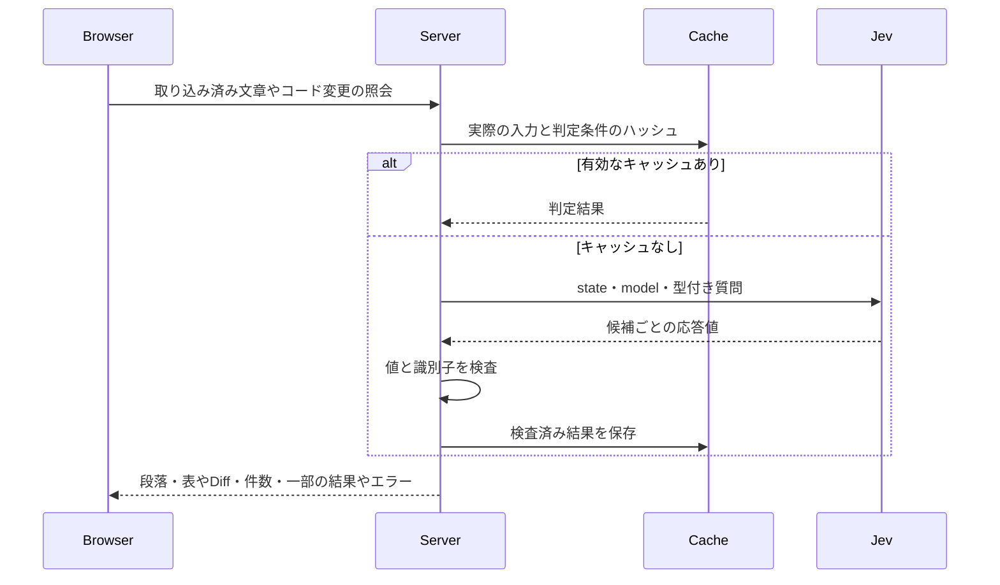

# 仕様を中心にしたレビューの設計

[English](design.md)

## この文書について

[sdev](../../product.ja.md)の[レビュー要件](requirements.ja.md)を、版を識別したGit比較、ローカル画面、任意のサーバー側Jev判定で実現します。

### 読む人

取り込み、照会、画面を保守する人とAgent。

### 前提

取り込みにはGitを使います。
外部照会には`--serve --jev`と、サーバーの環境変数`JEV_API_KEY`が必要です。
準備済み入力は、GitやAPIキーを使わず静的に表示できます。

### 対象外

Agent実行、理由や具体例の生成、人の承認は照会処理の外で扱います。

## 実現方法

起動時に取り込み、解決した比較元の版を保持します。
作業ツリーの配信では定期的に取り直し、入力が変われば新しい比較を公開します。
準備済み入力・2コミット間の比較・単一HTMLは固定したまま扱います。
版を解決し、外部Diffとtextconvを無効にします。
明示したコミット同士を比較する場合を除き、ステージ済み・未ステージ・無視対象ではない未追跡の変更を含めます。
変更したRequirements・Design、言語別ファイル、同じディレクトリの対応文書と`--spec`の指定を候補にします。
配置は候補を探す材料とし、関連の根拠にはしません。

実装の全文はサーバーまたは任意の準備済みJSONに保持します。
HTMLには仕様の表示データと任意のAgent材料だけを埋め込みます。
人が読んでいる箇所からJevで関連候補を選び、別の検査でコード変更を仕様候補と照合します。
対応先なしや不確かなコード箇所だけを、Diffを調べる確認候補として返します。

取り込み上限は片側1 MiB、全体16 MiB、500ファイルです。
バイナリ・非UTF-8・リンク・サブモジュール・上限超過・取得不能には理由を残します。
不正なリポジトリ相対パスとリンクの祖先を拒否します。

## 構成と処理の流れ

ブラウザーは文章の識別子やコード変更の検査を、同じ配信元のJSON POSTで要求します。
サーバーは照会で指定した版の比較から本文と候補を取り出し、同じ入力のキャッシュを再利用するかJevへ照会します。
応答を検査してから、実際の段落・表やDiff候補、調査範囲を返します。



## データモデル

`sdev review --prepare`が出力し、`--input`が読み込むJSONの形式を、先頭の`version: 1`で識別します。これはsdev本体のバージョンとは別です。
`version`が`1`以外の入力は、未対応の形式として読み込みを拒否します。
この比較の記録には`id`、`title`、`captured_at`、`base`、`target`、`files`、`items`、`warnings`を含めます。
ファイルは相対パス、役割、変更の有無、nullも取る前後の本文、取得時の通知を持ちます。
ブラウザー用データから実装ファイルの全文と参照を除き、サーバーは元の比較を保持します。

選んだ文や表の行は、ファイル・side・元の行範囲・引用で識別します。コード箇所はファイルと前後の差分範囲で識別します。
照会では選んだ文や表の行を保ち、反対側の役割の段落・末端のリスト項目・表を関連先の候補にします。
判定はそれらと候補ID・応答値・検査済み数・省略数・取得不能・一部だけの結果やエラーを関連付けます。
小さな対応関係なので、別のER図は設けません。

任意の項目は`id`、`title`、`attention`、`question`、`refs`、`links`、`decisions`、`examples`、`assessment`の互換性を維持します。
参照する行・side・ID・接続先・区別の値を検査し、参照0件も扱えます。
Agentの補助材料は外部照会の前提にしません。

コメントは本文と文章参照または項目を持ち、書き出しに比較対象を含めます。
下書きは元の対象ごとに保持します。
キャッシュは入力のハッシュ・モデル・判定条件の版・作成時刻・有効性・検査済み結果を持ち、API認証情報を含めません。

## インターフェース

### コマンド

主な使い方は次のとおりです。

```sh
sdev review --serve --jev
sdev review --serve --jev --base main --spec docs/feature/requirements.md
sdev review --serve --jev --jev-model jev-1.13.0 --cache-dir "$HOME/.cache/sdev/review"
```

`--jev`には`--serve`を必要とし、`JEV_API_KEY`はサーバーだけで読みます。
`--jev-model MODEL`の既定は固定版の`jev-1.13.0`です。
`--cache-dir PATH`の既定は`$XDG_CACHE_HOME/sdev/review`とし、XDGの設定がなければ`$HOME/.cache/sdev/review`を使います。
モデルの別名を指定した場合、キャッシュは最大1時間まで有効です。

`--head`、繰り返せる`--spec`、`--prepare`、`--input`、`--output`、`--port`、`--lang`を維持します。
比較元の既定はHEAD、ポートの既定は空きを選ぶ0です。
ループバックのURLを表示してflushし、Ctrl-Cで終了します。
`--serve`は`--prepare`や`--output`、`--input`は取り込みの引数と併用できません。
準備の既定出力はJSONの標準出力、HTMLの既定出力は`sdev-review.html`です。
`--output -`で標準出力を使い、既存ファイルは保持します。

レビューのGET/HEAD、本文更新・コメント受け渡し・解決確認のJSON POSTを提供し、Jevモードでは関連照会とコード検査を追加します。
各APIの配信元・形式・容量の制限は[セキュリティの考慮事項](#セキュリティの考慮事項)で定義します。
取得・入力・出力・サーバーの失敗は終了コード1、引数や設定の不正は2、成功は0です。

### Agentと画面

#### 並べた文書のスクロール

比較表示ではRequirementsとDesignを同時に開き、各文書の本文を独立した`.pane-scroll`で読みます。
各表示枠の高さは画面高の70%とし、本文だけを`overflow: auto`でスクロールさせ、ファイル選択欄は枠の上部に残します。
`overscroll-behavior: contain`で本文の端から外側へのスクロールの引き継ぎを抑えます。幅1000px以下では上下に並べ、各枠のスクロールは保ちます。
通常の1文書表示では本文内のスクロール枠を作らず、ページ全体を読み進めます。

スクロール位置は文書の役割・ファイル・変更前後・本文か差分かをキーに保存し、画面を組み直したときに各本文へ戻します。
片方のスクロール位置をもう片方へコピーしません。ホイールやポインター操作、本文のフォーカスで読んでいる文書を切り替え、目次とJ/Kの対象もそこへ合わせます。
比較表示の目次は本文枠の上端を基準に現在の節を判定し、自動更新後の引用への位置補正も、その本文枠だけへ適用します。

#### 文書の目次

左側には、現在読んでいるRequirementsまたはDesignの目次を表示します。
選択した変更前・変更後のMarkdownから、行情報を持つ見出しだけを取り出し、本文の順序と見出しの階層で並べます。
同名の見出しは元の行番号で区別します。
ファイルの選択は文書上部にまとめ、任意のAgent材料は折りたたんだ別のグループに残し、コード検査の入口も維持します。

目次を選ぶと差分やコード検査から本文へ切り替え、元の見出しへフォーカスし、固定ツールバーの下へスクロールします。
この操作では関連照会を始めません。
見出しの絞り込みはブラウザー内で行い、文書・変更前後・取り込み内容が変われば目次を作り直します。
2文書を並べた場合は、本文のフォーカスに合わせて目次の対象を切り替えます。
スクロール時はアニメーションフレームごとに1回だけ位置を調べ、ツールバーの基準位置を通過した最後の見出しへ`aria-current="location"`を付けます。
目次全体には名前を付けたナビゲーション領域を使います。

#### 文の選択

文の選択範囲は、表示済みの段落または末端のリスト項目の中で区切り、Markdownのブロックをまたぎません。
各ブロックの表示テキストに`new Intl.Segmenter(language, { granularity: "sentence" })`を使い、レビューの言語に応じて文を分割します。
句点や元ファイルの改行だけでは区切らず、ブラウザーの言語ごとの規則を使います。
たとえば同じ行の「詳細を開きます。読み進めます。」は、別々に選べる2文になります。
見出しとコードブロックは全体を扱い、`Intl.Segmenter`を利用できない環境では元のブロックを使います。

分割した位置をDOMのテキストノードへ対応させ、`Range`で各文を包むことで、強調・リンク・インラインコードを保ちます。
各文には元ブロックの行範囲と、空白を正規化した選択テキストを引用として持たせます。
照会・コメント・書き出しでは、この引用で同じ行の別の文を区別し、Markdownに存在しない行番号を作りません。
詳細は元の段落の下に置き、文章の途中を分断しません。

#### 表の行の選択

表では、セル内の文字やインラインコードをクリックしても、そのセルを含む行全体を選びます。
Markdownの表を描画した各`tr`に、元ファイルの行範囲を表す`data-line`・`data-line-end`と、フォーカス用の`tabindex="0"`を付けます。
クリックした要素から位置情報を持つ親要素をたどり、その行へフォーカスして、選択行に合わせた関連箇所を照会します。
列見出し行も1行として選択でき、セルや行内の文には分割しません。Markdownの見出しセルや列の配置は保ちます。

J/Kでは、現在読んでいる文書の文・見出し・コードブロック・表の行を、本文の順に並べた移動先として使います。
表の中ではJで次の行、Kで前の行へフォーカスを移し、画面中央へスクロールして関連表示も更新します。
たとえば「前の段落→列見出し行→データ1行目→データ2行目→次の段落」とJで進み、Kでは逆順に戻ります。
表の最初や最後の行では文書の前後の移動先へ進み、文書全体の先頭・末尾では折り返さず同じ箇所に留まります。
入力欄・選択欄・編集可能な文章では、この本文移動のキー操作を適用しません。

選択行の引用は各セルの表示テキストの空白をそろえて` | `でつなぎ、ファイル・変更前後・元の行範囲とともに照会とコメントの対象にします。
たとえば「操作」「要求」の表でコピーの行を選ぶと、引用は「コピー | メモ本文をクリップボードへコピーできる。」になります。
EnterまたはJ/K以外の文字で、その行へのコメント入力を始めます。
詳細と各行のコメント欄は表の直後へ置き、セルの中へ編集欄を挿入しません。行を移動しても、下書きと保存済みのコメントは元の行の対象を保ちます。

#### Mermaid図

Markdownの描画時に、言語指定の先頭が`mermaid`であるコードブロックだけを識別します。エスケープ済みのソースと元の行範囲を保持します。コメントの位置を付ける前に、そのブロックをフォーカス可能な図の枠へ置き換え、元の行範囲と、空白をそろえたソースの引用を付けます。元のコードは「図のソース」の折りたたみに残し、SVGや操作の文言は引用へ含めません。ソースを開閉する操作からコメント入力を始めません。

固定したMermaidパッケージとライセンスを単一の表示用ファイルへ同梱し、図がある場合だけ同梱モジュールを読み込みます。CDN・配置エンジン・フォントを外部取得しません。[Mermaidの描画API](https://mermaid.js.org/config/usage)を使い、`startOnLoad: false`・`securityLevel: "strict"`・`htmlLabels: false`・`suppressErrorRendering: true`に固定します。ソースは50,000文字、辺は500本までとし、これらの設定・テーマ・フローチャート設定を文書内の指定で変更できないようにします。既存のContent Security Policyを維持し、単一HTMLでは外部リソース取得と外部接続を許可しません。

文書を画面へ追加してから順に描画し、SVGごとに異なるIDを使います。描画開始時の図の枠が画面に残っている場合だけ結果を挿入し、文書移動や自動更新の後に古い結果を表示しません。図は本文の幅に収め、必要なら図の範囲で横スクロールします。失敗時はエラーをテキストとして表示し、変更していないソースを展開します。通常のコードブロックは描画しません。図は描画前後で同じJ/K・コメントの対象とし、SVG内の文字を文単位の選択対象にしません。挿入前にSVG内のリンク要素を外し、コールバックを登録せず、既存の本文と同じくリンクを無効にします。

#### 関連箇所の選択

通常の文章は両方向とも文単位に保ち、表では行単位で選びます。関連先は段落・末端のリスト項目・表にします。
サーバーは`pulldown-cmark`の元ファイル範囲から段落・リスト項目・コードブロック・表を取り出し、子の段落を含む親リスト項目は候補に重ねません。
同じ文章が別の位置にある場合は、それぞれの場所を残します。
候補は選択文と同じ変更前後、反対の役割、表示言語の文書から選び、ファイル・行順で最大160件を、候補を含む最上位（`##`）の節ごとにまとめて照合します。
段落は最大2400バイトとし、切り詰めた本文や省略した候補があれば一部だけの照会として返します。
表は上限内の最後の完全な行まで取り込み、途中で切れた行を完成した行として表示しません。

照会の質問は読む方向で変えます。
Requirementsからは「選んだ条件・操作・結果をどう実現するか」を問い、候補のDesignに具体的な仕組み・選択・運用上の制約があるかを調べます。
Designからは「選んだ方法はどの操作・結果・制約のためか」を問い、候補のRequirementsがその方法の支える振る舞いを含むかを調べます。
たとえば`Intl.Segmenter`は「文ごとに選べる」、`navigator.clipboard.writeText()`は「メモをコピーできる」という要求へ対応し得ます。
RequirementsにAPI名やアルゴリズム名があることは条件にしません。
どちらの方向でも一部分への対応を認め、選択文が関連先の段落全体を実現することは求めません。
同じ単語や機能の登場、方法を伴わない要求の言い換えだけでは対応とせず、明記されていない要求を技術的な細部から作りません。
同じ振る舞いについて矛盾する設計も対応先にはなり得るため、要求を満たすかは読む人が判断します。

選択文は役割・見出し・元の段落とともに送ります。箇条書きでは、選択箇所を含む最も内側のリスト全体と、その直前に空白だけを挟んで続く段落を文脈にします。これによりシナリオ名と同じシナリオのGiven／When／Thenを含め、次のシナリオへは広げません。
たとえば「When: 関連先を表示する」には、「段落中の注目する文が分かる」というシナリオ名と、そのGiven／Thenを付けます。
文脈は最大2400バイトとし、長い場合は選択箇所の最大800バイト前から取り込み、一部だけであることを示します。通常の段落内では前後の文をそのまま文脈にします。
この文脈は選択した操作の対象・条件・目的や指示語を補うために使い、判定の中心は選択文に保ちます。
選択文の代わりに周囲の別の文を照合せず、クリック・ホバー・Escなど別の操作を混同しません。
関連先の段落には対応する内容自体が必要です。
ブラウザーの引用は、取り込み済みMarkdownの表示テキストに存在するかを検証し、サーバー側で再分割しません。
返す参照は段落の元の行範囲とし、選択文の引用やコメントの対象は変えません。
判定条件の版を更新して、従来の文単位・共通質問のキャッシュを再利用しないようにします。

長い方向別の質問を候補ごとではなく節のまとまりごとに1回だけ送るため、候補を2段階で絞り込みます。
まず、節のまとまりごとに1つのChoice質問をします。
`###`以下の小見出しは`##`の節のまとまりに含め、各候補には最も近い見出しを付けます。
同じファイルの連続するまとまりを1つの要求にまとめ、`state`には選択文と文脈、まとまりごとに短いIDを付けた候補の一覧（`sections`）を入れます。
各質問の選択肢は、そのまとまりのIDと`none`にします。
IDは候補本文のSHA-256の先頭16進6桁とし、同じまとまりに同じ本文がある場合は出現番号を付けます。
IDは1回の要求の中だけの選択肢名で、サーバーは送った候補へ対応させて戻すため、ほかの箇所を編集してもIDの意味は変わりません。
候補を直列化した大きさが24,000バイトを超える節は連続する複数のまとまりに分け、要求も候補がその大きさを超える前に分けます。
これにより、日本語でも質問ごとの文脈の上限に収めます。
段落のように文脈が本文と同じ候補は文脈を省き、箇条書きの項目はリストやシナリオの文脈を残します。
表示する候補は確認で決めるため、この絞り込みには取りこぼしにくい短い質問を使います。
各まとまりからはChoiceの確率が0.05以上の候補を最大5件残し、全体では確率の高い順で最大8件を選びます。
Choiceの確率はまとまりの中での相対値なので、この絞り込みだけに使います。

次に、絞り込んだ候補を同じ方向のNoul質問で1候補ずつ確かめます。
各確認には選択文とその文脈、1件の候補の本文と見出しだけを渡し、ほかの候補は含めません。
確認の値が0.8以上の候補だけを表示します。
判定条件の版を更新し、従来の候補ごとの照合のキャッシュを再利用しないようにします。
再確認で落とした候補の代わりに下位の候補を補充せず、失敗時は照会全体をエラーにします。
これは複数候補による混同を減らすための実験的な方法で、単独の候補が正しいことを保証しません。
この境界値は表示のノイズを減らすための選択で、正しい対応を落とす可能性があり、精度の測定結果ではありません。
該当がなければ、調べた候補から明確な対応が見つからなかったと表示し、設計そのものが存在しないとは断定しません。

表の読み取りには`pulldown-cmark`のTableHead・TableRow・TableCellを使い、エスケープされた縦棒とインラインの書式をMarkdownの規則で解釈します。
列見出しとセルの表示テキストを配列にし、各行の元の行範囲を保持します。
表全体を関連候補とし、各行は選択用の参照だけにして候補を重ねません。
表の関連判定へは改行を保ったMarkdownを渡し、値と列をつぶしません。
選択行の引用はセルの表示テキストを空白正規化して` | `で連結し、列見出しとセルを組にした文脈も照会へ送ります。
この引用と行番号でコメントの対象を保持します。

関連先の表は`table`・`thead`・列見出しの`th`・`tbody`・各行の`td`をテキストから組み立てます。
横幅が足りなければ表の範囲で横スクロールし、未取得の行は補いません。

段落を返す際は、その中の注目する文を別のChoice質問で選びます。
`unicode-segmentation`で返す段落の表示テキストを文に区切り、各段落の先頭64文までと「該当なし」を選択肢にします。
1文だけの段落は既存の関連判定がその文の判定でもあるため、追加照会せず全体を強調します。
複数文の段落は選択文と返す段落だけをまとめて1回照会し、Requirementsなら実現方法、Designなら支える振る舞いを最も直接説明する1文を選びます。
表の場合は、列見出しと組にした先頭64データ行と「該当なし」を選択肢にし、同じ追加照会で対応する1行を選びます。
1データ行だけの表には追加照会せず、その行を強調します。
文と同じ表示境界を使い、明確に選べた行の添字だけを返して元の行全体を強調します。
この照会には候補文書の全体やコメントを含めません。
選ばれた文の値が0.8以上の場合だけ、元テキスト中のUTF-16の開始・終了位置と実際の文を返します。
この値は段落内の選択肢に対する相対的な値で、関連の確度や全対応文の網羅を示しません。
該当なしや不確かな選択なら段落全体を保ち、強調しません。
質問・段落・モデルが同じ場合は既存のディスクとメモリーのキャッシュを使い、追加照会の入力token数とキャッシュ利用の有無も応答のメタデータに残します。

ブラウザーは開始・終了位置と引用が本文に一致する場合だけ、テキストノードと`mark`で強調を作ります。
生成されたHTMLをモデルから受け取らず、原文の前後を切り詰めません。
参照先の見出しを太字、元ファイルを小さな文字、その下を段落として並べ、重複する「関連するDesign／Requirements」や「関連する仕様」の見出しを省きます。
強調の照会だけが失敗したときは、関連判定を取り消さず、段落と再試行を表示します。
再試行ではブラウザーの関連結果を外しますが、成功した関連判定のサーバーキャッシュは再利用できます。

初期画面から仕様の全文を表示します。
Requirementsの文章へのクリックではDesign、DesignではRequirementsの候補を照会します。
ホバーやTabのフォーカス移動だけでは、詳細を開閉・切り替えしません。
実行中の関連照会では、文章ごとの関連ボタンや下線を付けません。
返す段落や表にはファイル・side・行範囲を示します。
J/Kは前後の文へ移動して関連表示を更新し、クリックでは本文へフォーカスして詳細を固定します。
Escや外側のクリックで詳細を閉じます。

#### 本文へのコメント

EnterまたはJ/K以外の文字で直下コメントを始め、最初の文字も保持します。
操作ボタンや入力欄では本文のキー操作を無効にします。
コメントは元の段落や差分行の下へ置き、前後のsideと複数行の開始・終了位置を保持します。
下書きは移動しても元の対象に残します。
独立したコメント欄は置かず、本文や差分の直下で会話を続けられる配置にします。
コピー・ファイル保存・サーバー経由の受け渡しは、次の共通形式を使います。
未送出のコメントや下書きがあれば離脱前に警告します。

#### メモのコピーとAgentへの受け渡し

主操作を「メモをコピー」にし、保存済みのコメントから元の選択文・比較対象を含むMarkdownを組み立てます。
利用者の操作から`navigator.clipboard.writeText()`を呼び、成功後にコピー済みと表示します。
拒否やAPIの取得不能では未送出の状態を保ち、再試行かファイル保存を案内します。
[ブラウザーのClipboard API](https://developer.mozilla.org/en-US/docs/Web/API/Clipboard/writeText)を使うため、利用できる配信元と権限の条件はブラウザーに従います。
下書きは「コメントを追加」で確定するまで編集欄に残し、受け渡すメモに含めません。

コピー・ファイル保存・サーバー経由の受け渡しには、同じレビュー情報を含めます。
形式は次のとおりです。

| 項目 | 内容 |
| --- | --- |
| `version` | 形式の版。値は`1` |
| `snapshot` | 比較の`id`、解決した`base`、`target`、Unix秒の取得時刻、必要なら入力の`revision` |
| `notes[].id` | コメントごとのUUID。コピーや受け渡し後も同じ値を保持する |
| `notes[].resolution` | 解決時だけ持つ、Agentが確認した比較の`snapshot`と修正内容の`summary`。なければ未解決 |
| `notes[].text` | 保存したコメント本文 |
| `notes[].reference` | 元のファイル、1始まりの行、`old`か`new`のside、選択文があれば引用。参照先のない項目ではnull |
| `notes[].item` | 任意の準備済み項目ID。本文だけへのコメントではnull |
| `notes[].snapshot` | 自動更新時にコメントが指していた元の比較。なければメモ全体の比較を使う |

Markdownの先頭にはレビューの題名と比較情報を置きます。
番号ごとにファイル・変更前後・選択文の引用・コメントを並べ、元の比較が異なる場合はその比較元・比較先・取得時刻も残します。
Agentは現在の行番号だけに頼らず、利用者が読んでいた文章を特定できます。

保存用の操作として「メモを書き出す」と「JSONを書き出す」を残します。
共通の情報をMarkdownかJSONの`Blob`にし、オブジェクトURLからブラウザーのダウンロードを開始します。
ファイル名は`sdev-<比較ID>-notes.md`または`.json`にし、開始後にオブジェクトURLを解放します。
画面ではダウンロードを開始するだけで、利用者が保存したか取り消したかまでは確認しません。
コピーやファイル保存でJevへコメントを送らず、リポジトリも変更しません。
受け渡した後もページ内のコメントを残します。

サーバーモードには、`sdev review`を起動したAgentへの「Agentに渡す」を用意します。
同じ配信元の`/api/feedback`へ、再試行で変えない送信IDと`report`をJSON POSTします。
形式・対象パス・比較元と比較先を検証し、本文は1 MiB、待ち行列は8件までに制限します。
サーバーの主処理は`{type:"review.feedback", id, report}`というJSONを実行出力へ1行で書き、flushしてから画面へ受領を返します。
起動中は直近128件の送信IDと内容のハッシュを保持し、同じ内容の再送は二重に出力せず、同じIDで異なる内容を送った場合は拒否します。

実行出力の先頭は起動URLとし、停止方法の案内に続けてコメントのJSON行を出します。
起動元のAgentは、実行中のコマンドの出力からコメントを読み取ります。
この受け渡しで別のAgentを起動したり、待機中の会話を再開したりはしません。
出力の失敗・受領待ちのタイムアウト・要求の失敗ではコメントを残し、再試行かコピーを案内します。
受領は実行出力へ渡した意味とし、Agentが読んだことや対応したことの確認にはしません。
照会の失敗や比較の更新でも、未送出のコメントを破棄しません。

#### Agentによる解決の確認

サーバーは実行出力へ受け渡したコメントのIDと、本文・元の対象・比較情報のハッシュを保持します。同じIDで指摘の内容を差し替えることは拒否し、起動中の記録は最大2000件に制限します。
Agentが修正と検証を終えたら、`/api/refresh`から現在の`revision`を確認し、`POST /api/feedback/resolve`へ`{id, revision, summary}`を送ります。
`id`はコメントID、`summary`は確認した修正内容です。サーバーは未受領のID、空の説明、4096バイトを超える説明、現在と異なる版を拒否し、取得に失敗している間も解決を受け付けません。
確認時の比較情報はサーバー自身が付け、本文の引用や元の比較は書き換えません。
ブラウザーは1秒間隔の`/api/refresh`で解決記録を受け取り、対応するコメントを「解決済み」の折りたたみにします。修正内容と確認した版を展開でき、コピー・JSON・Markdownにも保持します。
固定比較のサーバーも解決記録を返しますが、本文を取り直しません。未解決のまま対象の文章が変わった場合は「変更あり・未確認」と示します。
サーバーの記録は終了時に失われ、コメントの保存は従来どおりコピーまたは書き出しで行います。

#### コードの確認

サイドバーと上部に「仕様にない実装」の入口を設け、開始前は未検査と表示します。
別の操作でコード差分を調べ、対応先なしや不確かな候補だけを実Diff付きの確認一覧に表示します。
Implementationの常設列は追加しません。
候補数・検査済み数・省略数・未取得と、一部だけの処理かを示します。
照会の失敗は関連なしと区別し、手動の再試行を用意します。
モデルの値は判断の参考であり、検証済みの確度や、通常の実装詳細が仕様違反である証拠とは表示しません。

コードの検査を始める前に、取り込んだ変更ファイル・変更箇所数・実際の照合に含める仕様ファイルを表示します。
HTMLには調査範囲の付随情報を含め、実装本文は含めません。
実行中は照合しているファイル・進捗・候補数と追加候補なしの件数を示します。
各候補には「仕様に残す変更か」「記載があるか」の2つの判定と固定の確認文、展開できる実Diffを表示します。
停止は処理中のまとまりが終わるまで待ち、途中の状態から再開できます。

Agentは[レビューガイド](../../../../guidelines/review.ja.md)に従い、通常の仕様と実装を編集し、必要なら`--spec`を追加します。
準備済み項目は追加の問いや観測に使えますが、必須にはしません。
画面からリポジトリを変更しません。
コメントの受け渡し先は起動元のプロセスだけとし、Jevへの照会APIには含めません。

## 外部サービスとの接続

送信先は`https://api.typesafe.ai`だけに固定し、[公式API仕様](https://api.typesafe.ai/openapi.json)に従います。
`/v1/systemone`へ`state`・選択した`model`・型付きの`questions`をPOSTし、候補の絞り込みにChoiceの確率、確認にNoul値を使います。
Bearer認証はサーバーで行い、要求からAPIの送信先を差し替えられないようにします。

関連候補は節のまとまりごとに1つのChoice質問で絞り込んで1件ずつ確認し、コードは差分のまとまり（hunk）を4件ずつ処理します。
同じ段階の要求は互いに独立しているため、キャッシュのない要求を最大8件ずつ同時に送ります。
これにより照会の待ち時間は、要求の数ではなく絞り込み・確認・強調の約3往復分になります。
HTTP 429または529は、1秒後と2秒後に最大2回まで再送します。
同じ段階のほかの要求が失敗しても、有効な回答はキャッシュに残します。
入力長・候補数・検査する変更箇所の総数に上限を設けます。
上限に達した場合は一部だけの結果として、省略数や取得不能を返します。
応答の質問IDと候補IDを検査し、値は有限の0〜1に限定します。
不正な応答とAPIの失敗はエラーのままとし、分類の閾値は検証済み精度の主張にせず実装で管理します。

`@pierre/diffs`、プレーンテキストの色付け、画面のアセット、ライセンス全文を同梱します。
固定した生成元からアセットを検査し、Rustの利用者にNode.jsを要求しません。

## 作業ツリーの自動反映

バックグラウンドで2秒の間隔を空けて取り直し、ブラウザーは応答後1秒で更新を確認します。
既存の上限とリンクの検査を含むGit取り込みを再利用し、起動時の比較元と`--spec`の選択を保ちます。
この定期取得で追加・削除も調べ、OS別のファイル監視や別の実行環境への依存を増やしません。
対象はレビューしている入力であり、画面自体のJavaScriptとCSSは同梱したままです。

生成したIDと取得時刻を除く入力から、SHA-256で更新の識別値を作ります。
変化がなければ画面を組み直さず、判定も失効させません。
変更時は仕様の表示データとHTMLを作ってから、サーバーの比較とまとめて入れ替えます。
取り込みに失敗した場合は最後に成功した比較を保ち、次の成功までエラーを示します。

同じ配信元のJSON POST `/api/refresh`で、ブラウザーの識別値と現在の値を比較します。
異なる場合だけ表示データを返し、取り込みのエラーも通知します。
実装の全文は返しません。
更新通知はJevのロックを取らないため、判定中も変更を受け取れます。
判定要求は画面の版を持ち、古い版ならHTTP 409で拒否し、応答にも使用した版を付けます。
次の判定前にエンジンの入力を更新し、入力のハッシュで識別するキャッシュは保持します。
取得に失敗している間は判定を拒否します。

ページを移動せず表示データと本文を置き換え、関連表示の応答待ちとコード検査の状態を破棄します。
遅れて届く古い応答を無視し、実行中か完了済みのコード検査だけをやり直します。
残っている文の引用と画面内の位置で読書位置を復元し、文が消えた場合は同じ文だとみなさず、おおよその位置を保ちます。
テキスト欄のフォーカス中や日本語の変換中は、画面の置き換えを待ちます。

コメントと下書きは元の比較対象と引用を保持します。本文の変更・削除だけではコメントを解決済みにしません。
同じファイル・sideに引用が一度だけ現れる場合は、新しい表示行へ追従させ、書き出す元の位置は変えません。
変更・消失・重複で対象を特定できないコメントは、更新前の文章への指摘として別の節に残します。
書き出しにもコメントごとの比較対象を含めます。
古い行番号へ戻る移動履歴は消し、接続が切れた場合は状態を示して自動再接続します。

## データの取り扱い

実際の入力本文・差分・候補集合・モデル・判定条件の版をSHA-256でハッシュ化します。
ハッシュと付随情報が一致するときだけ、メモリーかディスクの結果を再利用します。
期限切れ・破損・形式不正・不一致はキャッシュなしとして扱います。
モデルの別名は最大1時間、固定版も入力の一致を必要とします。
作業ツリーの変更は自動で新しい比較に取り込み、入力が変わればキャッシュキーも変わります。

キャッシュディレクトリは0700、ファイルは0600で作成します。
シンボリックリンクをたどるパスなど、安全でない保存先を拒否し、認証情報は保存しません。
比較の書き出しとキャッシュは、利用者がリポジトリに関するデータとして管理します。

## 認証・権限

Jevの明示的な有効化だけが、取り込み済みの仕様やコードの外部送信を許可します。
APIキーは`JEV_API_KEY`から読み、HTML・ブラウザーの要求・ログ・キャッシュへ渡しません。
ブラウザーは同じ配信元に取り込み済み対象を指定し、サービスの認証情報や任意のソースURLを送りません。

## セキュリティの考慮事項

別のWebページからローカルサーバーを呼び出して、文書の外部照会・Agentへのコメント送出・解決状態の変更を起こされないようにします。
`127.0.0.1`で待ち受け、Hostを実際の待ち受け先のIPとポートへ完全一致させます。POSTのOriginは`http://127.0.0.1:<port>`への完全一致を必須とし、欠落・`null`・他の配信元を拒否します。
この配信元の検証は[OWASPのOrigin検証](https://cheatsheetseries.owasp.org/cheatsheets/Cross-Site_Request_Forgery_Prevention_Cheat_Sheet.html#using-standard-headers-to-verify-origin)を参考にしています。同じ端末で任意のプログラムを実行できる相手の認証にはならないため、利用者自身が使うローカルサーバーとして扱います。
許可したパス・メソッド・`application/json`の本文だけを受け入れ、未知のフィールドや不正な識別子を拒否します。要求ヘッダーは8192バイト、通常のJSON本文は8192バイト、コメント送出は1 MiBまでとし、転送エンコードは受け付けません。
読み書きのタイムアウトは2秒、同時接続は8件とし、応答には`Cache-Control: no-store`と`X-Content-Type-Options: nosniff`を付けます。
照会先は指定した版の比較だけを読み、リポジトリのファイルは書き換えません。
コード候補は確認するDiffだけを返し、実装ファイルの全文はHTMLへ埋め込みません。

リポジトリ相対パスを検査し、シェルへの文字列埋め込みを使わずGitの版を解決します。
リンクも含めて既存の出力を保持します。
MarkdownのHTMLや埋め込みJSONをエスケープし、リンクや外部画像を無効にし、説明とコメントはテキストとして挿入します。
静的HTMLは通信を禁止し、外部照会を有効にしたHTMLもブラウザーからは同じ配信元だけへ接続します。
外部APIはサーバーから呼びます。

## 配布・運用

単一HTMLはサーバーなしで持ち運べます。
外部照会にはローカルのsdevサーバー、認証情報、APIへの接続が必要です。
作業ツリーを配信するサーバーは、起動中に入力を更新します。
準備済みJSON・2コミット間の比較・単一HTMLは固定したまま扱います。
公開作業や移行は不要です。

## 検討した代案

### サーバーだけの表示やCDN参照

固定した比較やオフラインでのレビューに使えるよう、同梱アセットと単一HTMLを残します。
サーバーとAPIが必要なのは、実行中の外部照会だけです。

### 仕様とコードレビューを一画面に集める

通常はRequirementsとDesignを読みます。
コードは、別の一覧から人が調べる候補を選んだときだけ実際の差分を示します。

### 候補ごとの照合やファイル単位の絞り込み

Jevは入力トークンで課金されます。
`state`は要求ごとに1回だけ読み込まれますが、質問の指示文は質問ごとに数えられます。
そのため、候補ごとに方向別のNoul質問を16件ずつ送る方法では、長い指示文を候補の数だけ繰り返します。
ファイルの全候補を1つのChoiceにまとめれば指示文は1回で済みますが、大きい日本語のファイルでは質問ごとの文脈の上限を超えます。
節ごとに要求を分ければ上限は避けられますが、同時に送った要求はJevの待ち行列で待つため、細かい要求が増えると照会が遅くなりました。
節ごとの質問を大きさの上限内で1つの要求にまとめると、質問は節に限ったまま要求の数を減らせます。
編集すると、その節を含む要求を絞り込み直し、大きさが変わると同じファイルの後続の要求も変わることがあります。
1候補ずつの確認はIDやほかの候補を含まないため、関係のない編集の後もキャッシュを使えます。

### 絞り込みで最初の1文だけを送る

段落の最初の1文とテンプレートの圧縮した構成だけを送ると、絞り込みの入力はさらに減りました。
一方で、2文目以降に書かれた対応先を取りこぼし、このリポジトリの仕様にもそうした段落がありました。
そのため絞り込みでも候補の本文は全文を送り、重複する文脈だけを省きます。

### コードと仕様の自動対応付け

Agentによるリンクや理由の事前記述を必須にせず、Jevで対応候補を見つけます。
関連箇所の不確かな候補は省き、照会範囲の制限は表示します。
コード検査の不確かな結果は確認候補として残し、モデルの判定だけで仕様違反を確定しません。

## 未決事項

順位付けの有用性と、仕様の対応先がないと誤って示す候補を、人のレビューで評価します。
その結果から実装の閾値を調整します。
高度な色付けとコメントの再読み込みは、必須の操作には含めません。
