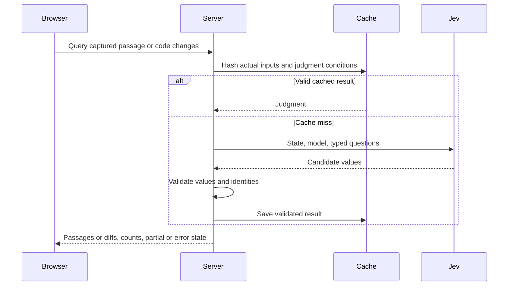

# Specification-centered review design

[日本語](design.ja.md)

## About this document

Implement the [review Requirements](requirements.md) for [sdev](../../product.md) with versioned Git captures, a local viewer, and optional server-side Jev judgments.

### Audience

People and agents maintaining capture, queries, and the viewer.

### Prerequisites

Git is required for capture. Live queries require `--serve --jev` and `JEV_API_KEY` in the server environment. Static input rendering needs neither Git nor an API key.

### Outside this document

Agent execution, generated rationale or examples, and human approval remain outside the query mechanism.

## Implementation approach

Capture at startup and pin the resolved comparison base. In working-tree server mode, recapture periodically and publish a new immutable snapshot when inputs change. Prepared input, explicit two-commit comparisons, and standalone output remain fixed. Resolve revisions, disable external diff and text conversion, and include staged, unstaged, and non-ignored untracked changes unless comparing explicit commits. Collect changed Requirements and Design, their language variants and same-directory counterparts, plus `--spec` documents. Directory membership supplies candidates, not relationships.

Keep full implementation contents on the server or in optional prepared JSON. Embed only specification presentation data and optional agent material in HTML. Select related passages through Jev queries as a person reads. A separate check judges changed code against specification candidates and returns only the uncertain or unmatched regions for diff inspection.

Capture limits remain 1 MiB per side, 16 MiB total, and 500 files. Preserve reasons for binary, non-UTF-8, symbolic-link, submodule, oversized, or unreadable content. Reject unsafe repository paths and symbolic-link ancestors.

## Architecture and sequence diagrams

The browser identifies a passage or requests a code-change check through same-origin JSON POST. The server obtains the text and candidates from its snapshot, reuses a matching cache entry or asks Jev, validates the response, and returns actual passages or diff candidates with scope information.



## Data model and ER diagrams

The JSON written by `sdev review --prepare` and read by `--input` identifies its format with the top-level `version: 1`. This is independent of the sdev application version. Reject inputs whose `version` is not `1` as unsupported. The snapshot contains `id`, `title`, `captured_at`, `base`, `target`, `files`, `items`, and `warnings`. Files retain their relative path, role, changed flag, nullable old/new text, and notice. The browser projection removes full implementation files and implementation references; the server keeps the original comparison.

A selected sentence or table row is identified by its file, side, source-line range, and quotation. The server checks the quote against the captured Markdown text before querying Jev. Model requests retain the selected sentence or table row and use candidate paragraphs, leaf list items, or tables from the opposite role. Code regions identify their file and old/new diff ranges. A judgment associates those identities with candidate IDs and values, inspected and omitted counts, unavailable content, and partial or error state. This is a small set of associations, so a separate ER diagram adds no information.

Optional items keep `id`, `title`, `attention`, `question`, `refs`, `links`, `decisions`, `examples`, and `assessment` compatible. Validate reference lines and sides, IDs, link endpoints, and existing label values. Empty references are allowed. Optional agent assertions are supplementary and are not required to make a live query.

Comments contain text and a passage reference or item target, with comparison identity on export. Drafts are keyed by their original target. Cached entries identify their input hash, model, judgment-condition revision, creation time, validity, and validated result; they never contain API credentials.

## APIs and interfaces

### Command

The main workflow is:

```sh
sdev review --serve --jev
sdev review --serve --jev --base main --spec docs/feature/requirements.md
sdev review --serve --jev --jev-model jev-1.13.0 --cache-dir "$HOME/.cache/sdev/review"
```

`--jev` requires `--serve`. Read `JEV_API_KEY` only on the server. `--jev-model MODEL` defaults to the fixed model `jev-1.13.0`. `--cache-dir PATH` defaults to `$XDG_CACHE_HOME/sdev/review`, or `$HOME/.cache/sdev/review` when XDG configuration is absent. Model aliases have a maximum cache lifetime of one hour.

Retain `--head`, repeatable `--spec`, `--prepare`, `--input`, `--output`, `--port`, and `--lang`. Base defaults to HEAD; default port 0 selects a free port. Print and flush the loopback URL and stop on Ctrl-C. `--serve` excludes `--prepare` and `--output`; `--input` excludes capture options. Preparation defaults to JSON on stdout; rendering defaults to `sdev-review.html`. `--output -` uses stdout, and existing files are preserved.

Serve GET/HEAD for the generated review and bounded JSON POST operations for refresh, feedback delivery, and resolution. Jev mode adds related-passage queries and code checks. Define origin, shape, and capacity restrictions in [Security considerations](#security-considerations). Capture, input, output, and server failures use exit code 1; invalid arguments or configuration use 2; successful commands use 0.

### Agent and viewer

#### Independent scrolling while comparing documents

Comparison mode opens Requirements and Design together with a separate `.pane-scroll` body for each. Each pane is 70% of the viewport height; `overflow: auto` scrolls its body while retaining the file selector above it. Use `overscroll-behavior: contain` to suppress scroll chaining at body boundaries. At viewport widths of 1,000px or less, stack panes vertically while keeping each scroll container independent. Ordinary single-document reading continues to scroll the page.

Store each position by role, file, old/new side, and document/diff mode, and restore it when rebuilding the view. Never copy one document's offset into the other. Wheel, pointer, and focus interactions choose the document being read and direct the contents and J/K navigation there. In comparison mode, determine the current heading from the pane body's top edge and apply live-update quote-position corrections within that body alone.

#### Document contents

Use the left sidebar for the currently active Requirements or Design document's contents. Extract only rendered Markdown headings with source-line metadata from the selected before/after side, retain their source order, and indent by heading rank. Use the source line to distinguish duplicate heading names. File selection stays in each document header; optional agent material remains in a separate collapsed group and the code-check entry remains available.

A contents action switches from diff or code-check mode to document text, focuses the source heading, and scrolls it below the sticky toolbar without opening a related query. Filter heading text locally. Rebuild the contents when the document, side, or captured inputs change; in the two-document view, text focus selects which document the contents follows. On scrolling, use a single animation-frame callback to mark the last heading above the toolbar offset with `aria-current="location"`. Render the contents as a labeled navigation region.

#### Sentence selection

Define a reading unit within each rendered paragraph or leaf list item, so selection never crosses a Markdown block. Use `new Intl.Segmenter(language, { granularity: "sentence" })` on that block's visible text, with the review language as the locale. Sentence boundaries follow the browser's language rules rather than splitting only at periods or source newlines. For example, `Open details. Keep reading.` on one source line becomes two selectable sentences. Keep headings and code blocks whole; if `Intl.Segmenter` is unavailable, use the original blocks.

Map the segment offsets back to DOM text nodes and wrap each sentence through a DOM `Range`, retaining emphasis, links, and inline code. Store the source block's line range and the selected text with whitespace normalized as its quote. That quote distinguishes sentences on the same source line in related queries, comments, and exports; it does not invent a separate Markdown line number. Place details below the containing paragraph so opening them does not split a sentence's surrounding text.

#### Selecting table rows

Clicking text or inline code inside a table cell selects the entire containing row. Give each rendered `tr` its original source-line range through `data-line` and `data-line-end`, plus `tabindex="0"`. From the clicked element, find its ancestor with source metadata, focus that row, and query counterparts for the selected row. Header rows are also selectable; do not select individual cells or split row text into sentences. Preserve Markdown header cells and column alignment.

J/K uses the current document's sentences, headings, code blocks, and table rows in reading order. Inside a table, J focuses the next row and K the previous row, scrolls it to the center, and updates related passages. For example, J follows “preceding paragraph → header row → first data row → second data row → following paragraph,” with K reversing the sequence. Cross the table boundary to the surrounding document targets; clamp at the document's beginning and end instead of wrapping. Ignore these reading shortcuts in inputs, textareas, select controls, and editable text.

Normalize whitespace in each cell's visible text and join cells with ` | ` for the row quotation, retaining its file, old/new side, and source-line range as the query and comment target. For example, the copy row in an Operation/Requirement table quotes “Copy | Copy notes to the clipboard.” Enter or a printable character other than J/K starts a comment on that row. Place details and per-row comment anchors immediately after the table, never inserting editors inside cells. Moving between rows preserves drafts and saved comments on their original targets.

#### Related passage selection

Keep prose selection at sentence level in both directions and select tables by row. Use paragraphs, leaf list items, or tables as counterparts. Extract paragraphs, list items, code blocks, and tables with `pulldown-cmark` source ranges. Exclude parent list items containing child blocks to avoid overlapping candidates, but retain repeated text at distinct locations. Select the opposite role on the same before/after side and preferred language. Inspect at most 160 candidates in file/line order, in batches of 16. Limit each passage to 2,400 bytes and report clipped text or omitted candidates as partial scope. Truncate tables at the last complete source row within the limit, never presenting an interrupted row as complete.

Use a different question for each reading direction. Requirements → Design asks how the selected condition, action, or result is realized, looking for a concrete mechanism, deliberate choice, or operational constraint. Design → Requirements asks which action, result, or constraint the selected method serves. For example, `Intl.Segmenter` may serve selecting individual sentences, and `navigator.clipboard.writeText()` may serve copying notes. Do not require the requirement to name the API or algorithm. Allow a method to implement only part of a requirement in both directions. Shared vocabulary, the same feature, or restating a requirement without a method is insufficient; do not invent requirements for technical details. Contradictory choices about the same behavior can still correspond; compliance remains the reviewer's judgment.

Send the selected sentence with its role, heading, and containing paragraph. For list selections, use the smallest containing list plus an immediately preceding paragraph separated only by whitespace. This includes a scenario label and its Given/When/Then steps without crossing into the next scenario. For example, “When: show the counterpart” retains the scenario about emphasizing a sentence within a paragraph. Bound context to 2,400 bytes; for long lists, begin up to 800 bytes before the selected block and report partial scope. Prose paragraphs already supply their surrounding sentences. Context may clarify its purpose or resolve references, but cannot replace it with another statement or conflate distinct triggers such as click, hover, and Escape. A direct counterpart must occur in the candidate passage itself. Validate the browser quote against captured visible Markdown text without splitting it again on the server. Return the candidate paragraph's source-line range, leaving sentence quotations and comment targets intact. Bump the judgment revision so old sentence-level, shared-question cache entries are not reused.

Take at most eight candidates scoring at least 0.8 in the directional query. When several candidates pass, confirm each separately with the same directional question, retaining the selected sentence and its context and one candidate's text and heading, without neighboring candidates. Use the initial judgment when exactly one candidate passes; otherwise show only candidates whose individual confirmation scores at least 0.8. Do not backfill removed candidates from lower ranks; failed confirmation makes the query fail. This experimental ambiguity check reduces mixing between candidates without guaranteeing that a single candidate is correct. This cutoff favors fewer distractions and can omit valid relationships; it is not measured accuracy. When no result passes, report that no clear correspondence was found in the inspected candidates, without claiming that no design exists.

Read tables through `pulldown-cmark` TableHead, TableRow, and TableCell events so escaped pipes and inline formatting follow Markdown rules. Keep header/cell display text in arrays and source-line ranges for each row. Only the complete table is a relation candidate; individual rows are source selections, avoiding overlapping candidates. Preserve Markdown newlines in table judgments. A selected row's quotation joins normalized cell display text with ` | `, while its query context pairs each value with its column header. Comments retain that quotation and source line.

Build related tables from text using `table`, `thead`, column-header `th`, `tbody`, and row `td` elements. Allow horizontal scrolling within the table and do not fabricate omitted rows.

Select a sentence to emphasize with a separate Choice question for each returned paragraph. Split its visible text with `unicode-segmentation` and offer at most its first 64 sentences plus `none`. A one-sentence paragraph needs no extra query: its existing relation judgment covers the whole sentence. For multi-sentence paragraphs, batch the selected text and returned paragraphs into one additional call. Ask for the sentence most directly explaining the realization for a Requirements selection or the served behavior for a Design selection; exclude the full candidate corpus and comments. For a table, offer its first 64 data rows described with their column headers plus `none`, selecting one row in the same additional call. A table containing one data row needs no extra call and emphasizes that row. Apply the same display cutoff, returning only the chosen row index to emphasize its original cells. Return the chosen sentence's actual text and UTF-16 start/end offsets only when its option probability is at least 0.8. This probability is relative to the paragraph's options, not a measured relation confidence or exhaustive evidence. Preserve the paragraph without emphasis for `none` or uncertain choices. Reuse the existing request-hashed memory/disk cache and include highlight input-token usage and cache status in response metadata.

Render emphasis using text nodes and `mark` only after verifying offsets and the quotation against the returned text. Do not accept model-generated HTML or truncate surrounding context. Lay out a bold destination heading, a small source location, and the paragraph below, omitting repeated Related Design/Requirements and Related specifications headings. A failed emphasis query retains the related paragraph and offers retry. Retrying clears the browser's related result but can reuse successful server-side relation judgments.

Show the full specification first. Clicking a Requirements block requests related Design; clicking Design requests Requirements.

Pointer movement and passive focus do not open, replace, or dismiss details. Live reading adds no per-passage related-action buttons or underlines. Display returned source passages with their file, side, and line range. J/K moves between sentences and updates related results; clicking focuses the passage and pins details. Escape and outside clicks close details.

#### Comments on the text

Enter or a printable character other than J/K starts an inline comment and preserves the initial character. Ignore passage shortcuts in controls and editors. Keep comments below their original block or diff line, preserve old/new sides, and map multiline blocks by source start/end lines. Drafts survive navigation.

Use inline threads without a separate comment pane. Copy, file export, and server handoff share the report format below. Warn before leaving with undelivered comments or unfinished drafts.

#### Copying and returning review notes

Make "Copy notes" the main handoff action. Build a Markdown report from saved comments, including the original selected text and comparison, then call `navigator.clipboard.writeText()` directly from the user action. Show success only after the promise resolves; on rejection or an unavailable API, retain the unsent state and offer retry or file export. This uses the [browser Clipboard API](https://developer.mozilla.org/en-US/docs/Web/API/Clipboard/writeText), subject to the browser's secure-context and permission rules. Drafts stay in their editors until the reviewer adds them as comments.

Use the same report for copying, file export, and server delivery so each route carries the same review context:

| Field | Meaning |
| --- | --- |
| `version` | Report format version, currently `1` |
| `snapshot` | Comparison `id`, resolved `base`, `target`, capture time in Unix seconds, and an optional input `revision` |
| `notes[].id` | Stable UUID identifying this comment across handoff and export |
| `notes[].resolution` | Present only when resolved: the agent-verified `snapshot` and fix `summary`; absence means open |
| `notes[].text` | The reviewer's saved comment |
| `notes[].reference` | Original file, one-based source line, `old` or `new` side, and optional selected quote; null for an item without a source passage |
| `notes[].item` | Optional prepared item ID; null for a plain text comment |
| `notes[].snapshot` | The comment's original comparison when live updating; otherwise inherit the report comparison |

Markdown begins with the review title and comparison metadata. Each numbered entry identifies the file and side, quotes the selected sentence when present, and includes the comment text. Include the per-comment base, target, and capture time when its original comparison differs from the current one. An agent can identify what the reviewer read without relying on current line numbers alone.

Keep "Export notes" and "Export JSON" as secondary saving actions. Serialize the report as Markdown or JSON into a `Blob`, create an object URL, and start a browser download named `sdev-<snapshot-id>-notes.md` or `.json`. Release the object URL afterward. The viewer starts a download without confirming whether the user saved or canceled it; neither file export nor copying sends notes to Jev or modifies the repository. Comments stay in the page after handoff.

In server mode, add "Send to agent" for the agent that launched `sdev review`. POST `{id, report}` to the same-origin `/api/feedback` endpoint with a stable submission ID. Validate the report shape, target paths, and comparison base/target, bound the body to 1 MiB, and enqueue at most eight deliveries. The main server loop emits a single JSON line of the form `{type:"review.feedback", id, report}` to its execution output, flushes it, and then acknowledges delivery to the browser. Keep the last 128 submission IDs and content hashes during the server lifetime so retries of an identical submission do not emit it twice; reject reuse with different content.

The startup URL remains the first output line; feedback records follow it and the stop instruction. The launching agent reads those records through its running-command output. This delivery does not start another agent or interrupt an idle conversation. If the output cannot be written, no receipt arrives, or a request fails, retain the notes and offer retry or copying. The receipt confirms output delivery, not that the agent has read or acted on the feedback. Query failures and snapshot replacement do not discard pending comments.

#### Agent-confirmed resolution

After delivery to launch output, retain each comment ID and a hash of its text, original target, and comparison. Reject ID reuse with changed content and bound this in-memory registry to 2,000 comments. After fixing and verifying a comment, the launching agent reads the current `revision` from `/api/refresh` and POSTs `{id, revision, summary}` to `/api/feedback/resolve`. The ID identifies the comment, and the summary describes the verified fix. Reject undelivered IDs, empty or over-4,096-byte summaries, stale revisions, and resolutions during capture failure. The server supplies the verified comparison without rewriting the original target.

The browser receives resolutions through one-second `/api/refresh` polling. Show resolved comments collapsed, with the fix summary and verified comparison available on expansion, and retain them in clipboard and file reports. Fixed-comparison servers also return resolutions while leaving their document inputs unchanged. Changed targets without agent confirmation remain changed and unverified. Registry state lasts until server shutdown; retain copy/export as the saving workflow.

#### Code investigation

The sidebar and header provide an "Implementation without a specification" entry, labeled "Not checked" until a scan begins. A separate action checks code differences. Only unmatched or uncertain code candidates get a confirmation list with actual diffs; do not add a permanent Implementation pane. Show candidate, inspected, omitted, and unavailable counts and whether processing is partial. Keep query failure distinct from no candidate and offer manual retry. A model value is a judgment signal, not verified confidence or proof that ordinary implementation details violate a specification.

Before starting the code check, show the captured change files, region counts, and the exact specification files included in the bounded comparison. The HTML includes this scope metadata without implementation contents. During a scan, show the active files, progress, candidates, and changes without an additional candidate. Each candidate shows the two separate judgments about needing specification and existing coverage, a fixed question for the reviewer, and an expandable actual diff. Stopping waits for the active batch and retains a resumable incomplete state.

Agents follow the [review guide](../../../../guidelines/review.md), edit normal specifications and code, and add `--spec` when needed. Prepared items can add questions or observations without becoming a prerequisite. The viewer does not modify the repository. The feedback endpoint delivers comments only to the launching process; Jev query endpoints never receive them.

## External service integration

Use only `https://api.typesafe.ai`, following the [official API schema](https://api.typesafe.ai/openapi.json). POST `state`, the selected `model`, and typed `questions` to `/v1/systemone`; use Noul values for candidate judgments. Authentication is server-side Bearer authorization. No request can replace the API destination.

Send at most 16 candidate questions per batch and process code in groups of four diff hunks. Bound input lengths, candidate counts, and total inspected regions. Return partial status and omitted or unavailable counts when a bound is reached. Validate every returned question or candidate ID and require finite values in the range 0–1. Malformed responses and API failures remain errors; classification thresholds are implementation choices, not claims of measured accuracy.

Bundle `@pierre/diffs`, plain-text highlighting, viewer assets, and third-party notices. Generated assets are checked against pinned build inputs; Rust users need no Node.js runtime.

## Working-tree hot updates

Use a background capture loop with a two-second pause between attempts and a browser refresh poll one second after each response. Reuse the same bounded, symlink-safe Git capture path, retaining the original resolved base and `--spec` selection. This polling approach detects additions and deletions without a platform-specific file watcher or another runtime dependency. Review UI JavaScript and CSS remain bundled; these updates concern the reviewed inputs.

Compute a SHA-256 revision from captured inputs, excluding the generated ID and capture time. Unchanged captures do not rebuild the page or invalidate judgments. Build the new specification projection and HTML before atomically publishing them with the server snapshot. A failed capture retains the last successful snapshot and reports an error until a later capture succeeds.

Same-origin JSON POST `/api/refresh` accepts the browser revision and returns a replacement projection only when it differs, plus any capture error. It never returns full implementation files. Refreshing does not acquire the Jev engine lock, so long judgments cannot block update notifications. Each judgment carries the revision used by the page; stale requests get HTTP 409, and responses carry their revision. Replace engine inputs before the next current-revision judgment, retaining request-hashed caches. Reject judgments while capture is failing.

Replace viewer data and rendered content in place without navigating the page. Clear related-result promises and scan state on revision change, ignore delayed old responses, and rerun only an active or completed code scan. Restore a reading anchor by an unchanged sentence quote and viewport offset when possible; otherwise retain the approximate location without assuming the same sentence exists. Delay replacement while a textarea has focus or text composition is active.

Comments and drafts retain their original snapshot identity and quotation. Editing or deleting the target alone never resolves a comment. Locate an unchanged quote only when it occurs once in the current file and side; use its new display line without changing the exported original target. Put comments with changed, missing, or ambiguous targets in an earlier-text section. Exports include each comment's original comparison. Clear navigation history that could point to old line numbers. A disconnected refresh poll reports its status and retries automatically.

## Data handling

Hash the actual input text, differences, candidate set, model, and judgment-condition revision with SHA-256. Reuse memory or disk results only when the hash and metadata match. Expired, corrupt, malformed, or mismatched entries are cache misses. A model alias expires after at most one hour; a fixed model still requires identical inputs. Automatic working-tree captures create new snapshots for changed inputs; those inputs create new cache keys.

Create cache directories with mode 0700 and files with 0600. Reject unsafe cache paths, including symbolic-link traversal. Do not save credentials. Users manage exported comparisons and cached results as repository-related data.

## Authentication and authorization notes

Only explicit Jev enablement permits external transmission of captured specification and code context. Comments use clipboard, file export, or explicitly requested local delivery to the launching agent. Read the API key from `JEV_API_KEY`; never expose it in HTML, browser payloads, logs, or cache. Browser queries identify captured inputs on the same origin rather than carrying service credentials or arbitrary source URLs.

## Security considerations

Prevent another webpage from using the local server to trigger external document queries, deliver agent feedback, or change resolution state. Bind to `127.0.0.1`; require an exact Host match to the bound IP and port and an exact POST Origin of `http://127.0.0.1:<port>`. Reject missing, `null`, and foreign origins. This follows [OWASP origin verification guidance](https://cheatsheetseries.owasp.org/cheatsheets/Cross-Site_Request_Forgery_Prevention_Cheat_Sheet.html#using-standard-headers-to-verify-origin). These browser checks do not authenticate programs already running on the same machine; this remains a personal local server.

Allow only listed paths/methods and `application/json`; validate request shapes and identities and reject unknown fields. Bound headers and ordinary JSON bodies to 8,192 bytes, feedback submissions to 1 MiB, and reject transfer encoding. Use two-second connection read/write timeouts, at most eight concurrent connections, and `Cache-Control: no-store` plus `X-Content-Type-Options: nosniff`. The query endpoint reads only its identified snapshot and cannot write repository files. Code candidates return only the requested investigation diffs; full implementation files are not embedded in HTML.

Validate repository-relative paths and resolve Git revisions without shell interpolation. Preserve existing output, including symlinks. Escape raw Markdown HTML and embedded JSON, make links and external images inert, and insert descriptions and comments as text. Static HTML blocks connections; live HTML permits only same-origin browser queries, with the external API called by the server.

## Deployment notes

Standalone HTML remains portable and does not need a server. Live queries require the local sdev server, service credentials, and API access. Working-tree servers update their inputs while running. Prepared JSON, explicit two-commit comparisons, and standalone HTML remain fixed. No publication or migration is required.

## Alternatives considered

### A server-only viewer or CDN imports

Retain bundled assets and standalone HTML for fixed or offline reviews. Only live judgments depend on the server and API.

### One view for specifications and code review

Keep ordinary reading focused on Requirements and Design. Show actual code only for candidates a person chooses to investigate from the separate list.

### Automatic code-to-specification matching

Use Jev to identify candidate correspondence instead of requiring agents to prewrite links and explanations. Omit uncertain related passages while reporting search limits. Preserve uncertain code-check results for investigation so model judgments do not become automatic specification violations.

## Open questions

Evaluate ranking usefulness and false missing-specification candidates in human reviews. Tune implementation thresholds from that evidence. Advanced highlighting and comment import remain outside the required workflow.
